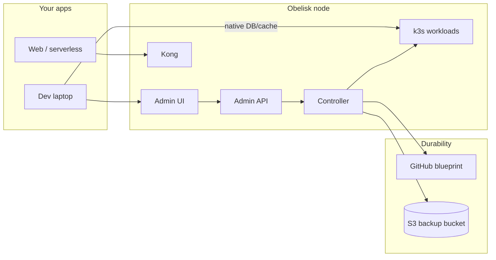

<p align="center">
  
</p>

<h1 align="center">Obelisk</h1>

<p align="center">
  <strong>A single-node middleware appliance for indie developers.</strong><br/>
  Shared Postgres, Redis, S3-compatible storage, and more—on <em>your</em> VPS or local machine—with backups, Kong, and a premium admin console.
</p>

<p align="center">
  <a href="https://github.com/hsoni92/obelisk/actions/workflows/ci.yml"></a>
  
  
  
</p>

<p align="center">
  <a href="#quick-start">Quick start</a> ·
  <a href="#installation">Installation</a> ·
  <a href="#admin-console">Admin console</a> ·
  <a href="#cli">CLI</a> ·
  <a href="#development">Development</a> ·
  <a href="#documentation">Docs</a>
</p>

---

## Why Obelisk

Every side project repeats the same stack: Postgres, Redis, object storage, backups, tunnels, and ad-hoc restore scripts. That wastes RAM on a small VPS and turns disaster recovery into a per-repo hobby.

**Obelisk concentrates that stack on one box.** Install brings up the **platform** in minutes (k3s, Kong, backup plumbing, admin UI). **Data services start only when you enable them**—no idle Postgres pods eating memory. Your apps stay on Vercel, Railway, or your laptop; they connect with **native** `postgresql://`, `redis://`, and S3 HTTP endpoints published by the console.

| | |
|---|---|
| **Who it’s for** | Solo developers and small teams running multiple projects on one Linux node |
| **What it is not** | An app host, CI runner, or multi-node HA cluster |
| **Min host** | 4 vCPU, 8 GB RAM (documented target); Ubuntu LTS on **linux/amd64** |

Full product spec: [docs/designs/obelisk.md](docs/designs/obelisk.md)

---

## What you get

<table>
<tr>
<td width="50%" valign="top">

### Platform (always on after install)

- **k3s** single-node Kubernetes
- **Kong** for HTTP (admin API, UI, S3 ingress)
- **obelisk-controller** — desired-state reconcile
- **Encrypted GitHub blueprint** for settings durability
- **S3-compatible backup** to your bucket (R2, AWS, etc.)

</td>
<td width="50%" valign="top">

### Data services (lazy — enable in UI)

| Service | Protocol |
|---------|----------|
| Postgres | `postgresql://` |
| Redis | `redis://` / `rediss://` |
| RustFS | S3 over HTTP (via Kong) |
| MySQL, MongoDB | Native drivers |
| Qdrant | Vector search |
| SearXNG | Metasearch |

</td>
</tr>
</table>

### Deployment profiles

| Profile | Tailscale | Typical use |
|---------|-----------|-------------|
| **`vps`** | Not installed (not required) | Public VPS + Kong **9080** (HTTP) and nginx native edge **9443** (TLS/SNI); never 80/443 |
| **`local`** | Optional at install | Home lab; opt in when you need remote reachability |

> **Tailscale Funnel** (RustFS S3 route only) applies when Tailscale is enabled on **local**. VPS public HTTP uses Kong on the host interface—not Funnel. Postgres and Redis are **not** exposed to the public internet by default.

---

## Architecture



---

## Quick start

On a clean **Ubuntu LTS** VPS with `sudo` and outbound HTTPS:

```bash
curl -fsSL https://raw.githubusercontent.com/hsoni92/obelisk/main/install/install.sh | sudo bash
```

Open the installer’s `http://<host>/` URL. Platform is ready when Kong serves the admin UI—**no data pods yet**.

```bash
sudo obelisk configure github    # OAuth wizard → encrypted blueprint
sudo obelisk status              # platform health
```

Enable Postgres, Redis, or RustFS from **Services** when you need them.

<details>
<summary><strong>Safer install (review before run)</strong></summary>

```bash
curl -fsSL -o install.sh https://raw.githubusercontent.com/hsoni92/obelisk/main/install/install.sh
less install.sh
sudo bash install.sh
```

</details>

---

## Installation

### Production VPS (recommended)

| Step | Action |
|------|--------|
| 1 | Run the [quick start](#quick-start) one-liner |
| 2 | Wait **~15–25 min** on first install (host image builds on 8 GB VMs) |
| 3 | Complete GitHub OAuth: `sudo obelisk configure github` |
| 4 | Configure **DR** → remote S3 bucket, then enable services |

**Pin a release** when you tag them:

```bash
curl -fsSL https://raw.githubusercontent.com/hsoni92/obelisk/main/install/install.sh \
  | sudo OBELISK_REF=v0.1.0 bash
```

| Variable | Default | Meaning |
|----------|---------|---------|
| `OBELISK_REF` | `main` | GitHub archive (branch, tag, commit) |
| `OBELISK_ROOT` | `/opt/obelisk` | Install tree on disk |
| `OBELISK_ARCHIVE_SHA256` | — | Optional archive checksum verify |
| `OBELISK_INSTALL_UPGRADE` | `false` | Replace tree in place when `true` |
| `OBELISK_SKIP_GITHUB_WIZARD` | `false` | Skip interactive OAuth after install |

Extended runbook: [docs/runbooks/install.md](docs/runbooks/install.md)

### From a git checkout (contributors or air-gapped prep)

```bash
git clone https://github.com/hsoni92/obelisk.git /opt/obelisk
cd /opt/obelisk

export OBELISK_ROOT=/opt/obelisk
export OBELISK_PROFILE=vps              # or local
export OBELISK_BUILD_IMAGES=true        # build/import images before Helm
sudo -E ./install/bootstrap.sh
```

**Local with optional Tailscale:**

```bash
export OBELISK_PROFILE=local
export OBELISK_TAILSCALE=true           # only for local profile
sudo -E ./install/bootstrap.sh
```

### Upgrade

```bash
sudo obelisk update
sudo obelisk update --ref v0.2.0
sudo obelisk update --skip-images       # controller/Helm only
```

### Start / stop / restart (VPS)

```bash
sudo obelisk stop
sudo obelisk start
sudo obelisk restart
```

Stops or starts **only the `obelisk` namespace**; k3s and every other namespace keep
running. Add `--system` to control the whole k3s service on a dedicated appliance.
See [install runbook](docs/runbooks/install.md).

### Uninstall

```bash
sudo obelisk uninstall --dry-run
sudo obelisk uninstall --yes
```

Shallow teardown (keep PVCs): `sudo obelisk uninstall --tier platform --yes`. Details: [docs/runbooks/uninstall.md](docs/runbooks/uninstall.md)

### VM integration test (Multipass)

Prod-like curl install against public GitHub:

```bash
make test-vm
```

See [tests/integration/README.md](tests/integration/README.md).

---

## Admin console

After install, the **Services**, **DR**, **Exposure**, and **Platform** areas of the admin UI mirror CLI capabilities:

| Area | Purpose |
|------|---------|
| **Services** | Start/stop data planes; copy connection strings |
| **DR** | Remote backup target, test connection, manual backup |
| **Exposure** | Kong routes; optional Funnel when Tailscale is on |
| **Platform** | Desired state (`obelisk.yaml`) when exposed in your build |

Local development UI: [http://localhost:3080](http://localhost:3080) (API on **8080**).

---

## CLI

```text
obelisk — middleware appliance CLI

  preflight [--profile vps|local] [--tailscale]
  init-config --profile vps|local [--path /etc/obelisk/obelisk.yaml]
  status [--api URL] [--config path]
  service enable|disable <postgres|mysql|mongodb|redis|rustfs|qdrant|searxng>
  reconcile [--config path] [--helm-root path]
  blueprint status|unlock|lock|push
  restore --chain [--adopt-machine-id | --keep-machine-id]
  configure deployment --profile vps|local [--public-host HOST] [--reconcile]
  configure github
  update [--ref REF] [--skip-images]
  uninstall [--dry-run] [--yes] [--tier full|platform]
```

Config on a live host: `/etc/obelisk/obelisk.yaml`. Override with `OBELISK_CONFIG` and `OBELISK_ROOT`.

---

## Development

**Prerequisites:** Go **1.22+**, Node.js **20 LTS** for `web/admin`. Run `make check-go` if `go` is missing from `PATH`.

One terminal — k3d, real Helm reconcile, API **:8080**, UI **:3080**:

```bash
make install-air    # once: API hot reload via air
make dev
```

| Command | What it does |
|---------|----------------|
| `make dev-observe` | UI + API without cluster reconcile (services stay pending) |
| `make dev-api` / `make dev-ui` | Split terminals |
| `make dev-k3d-up` | k3d cluster only |
| `make build-cli test-go` | CLI build + Go tests |
| `make helm-lint` | Helm chart lint |
| `make ci` | Same gate as GitHub Actions |

Without `/etc/obelisk/obelisk.yaml` on your laptop, the dev scripts use repo-local `dev/obelisk.yaml`.

Contributing (hooks, CI, secrets policy): [CONTRIBUTING.md](CONTRIBUTING.md)

---

## Repository layout

| Path | Role |
|------|------|
| `cmd/obelisk` | Operator CLI |
| `cmd/obelisk-controller` | Admin API + reconciler |
| `deploy/helm/` | Platform + per-service charts |
| `web/admin` | Next.js admin console |
| `install/` | `install.sh`, `bootstrap.sh`, `update.sh` |
| `schemas/obelisk.yaml.schema.json` | Desired-state JSON Schema |
| `docs/designs/` | Approved specifications (EGM) |
| `docs/runbooks/` | Operator guides |

---

## Documentation

| Document | Description |
|----------|-------------|
| [Product design](docs/designs/obelisk.md) | Goals, CUJs, architecture |
| [Install runbook](docs/runbooks/install.md) | VPS, upgrade, dev profiles |
| [GitHub blueprint](docs/runbooks/github-blueprint.md) | OAuth + encrypted settings sync |
| [Uninstall runbook](docs/runbooks/uninstall.md) | Reclaim host / tiered teardown |
| [Mail gateway](docs/runbooks/mail-gateway.md) | Optional mail edge |
| [OpenRouter gateway](docs/runbooks/openrouter-gateway.md) | Optional LLM proxy edge |
| [AGENTS.md](AGENTS.md) | Agent / EGM workflow for contributors |

---

## Security & secrets

- Do **not** commit tokens, `.env`, or `github-oauth.client.json`.
- Production secrets live on the appliance or in your **private** GitHub blueprint repo.
- CI runs **gitleaks** when available (`make gitleaks` locally).

---

## Contributing

We welcome issues and pull requests. Before pushing:

```bash
make ci
```

Optional faster feedback: `make hooks-install` for pre-commit + gitleaks on staged files.

---

<p align="center">
  
  <br/>
  <sub>One obelisk. Many projects. Your metal.</sub>
</p>