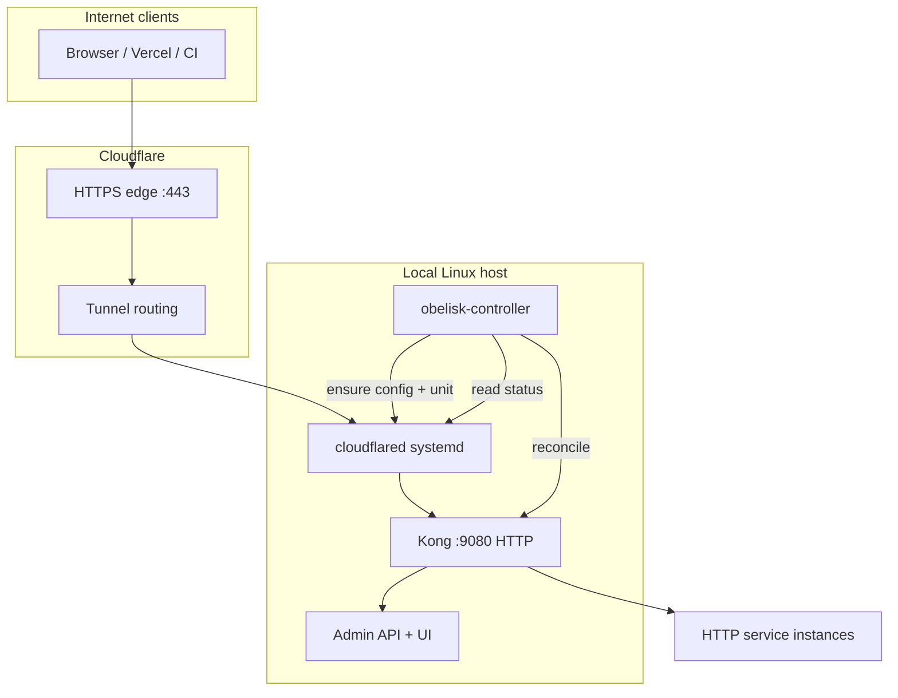

# Cloudflare Tunnel local ingress

* **Author:** hsoni92
* **Status:** Proposed
* **Date:** 2026-11-23

--------------------------------------------------------------------------------

## Overview

Obelisk on a **standalone local Linux box** (`deployment.profile: local`, `deployment.role: local`) gives operators LAN-oriented connection hints. **Per-instance HTTP hostnames** through Kong—what VPS appliances use for RustFS, Qdrant, and similar services—only activate when the profile is `vps` or the appliance acts as a **gateway** for tailnet peers. That leaves two expensive or heavy options for internet clients: rent a VPS as a public front, or run the gateway federation design with Tailscale backhaul.

This design adds an **optional Cloudflare Tunnel** for the standalone local case. The operator turns it on from a new admin console page, **Connectivity** (dedicated tab beside Tailscale—not on Exposure). Obelisk stores tunnel credentials in the same sidecar/blueprint pattern as other secrets, installs and supervises **`cloudflared` on the host** (similar in spirit to host Tailscale integration), and when the connector is healthy publishes **`https://` URLs** on the operator's Cloudflare zone for the admin UI, admin API, and Kong-fronted HTTP services used by projects. **Native TCP edge** (Postgres, Redis, MySQL, Mongo on port 9443) does not go on the public internet in v1.

The feature does **not** change gateway federation, Tailscale, or Tailscale Funnel. [`peer_gateway.md`](./peer_gateway.md) NG3 rejects Cloudflare Tunnel for **mesh backhaul**; this design is **single-node ingress only**.

**Intake:** [`cloudflare_tunnel_concepts_brief.md`](./cloudflare_tunnel_concepts_brief.md)

### Glossary

| Term | Definition |
| --- | --- |
| **HTTP connection edge** | Kong routes that match per-instance `Host` headers on the admin HTTP listen port. |
| **Native edge** | nginx stream TLS on 9443 for wire protocols (out of v1 tunnel scope). |
| **`HTTPEdgeEnabled`** | Predicate (name may change during implementation) that turns on HTTP edge reconcile and URL shape when VPS/gateway **or** local+tunnel. |
| **`base_domain`** | DNS suffix the operator controls in Cloudflare; drives `PublicEdgeHost` and client-facing HTTPS URLs. |

## The Problem

1. **No public hostname shape on local:** `ConnectionEdgeEnabled` is false on standalone local, so Kong does not emit per-instance routes and `/connections` stays LAN-shaped. Remote clients (browsers, Vercel, CI) cannot use the same URL patterns VPS operators get without extra infrastructure.

2. **VPS rent for ingress only:** Some operators run Obelisk at home and only need a stable public HTTP front—not a second full appliance in the cloud. Today that implies `profile: vps` or a gateway VPS, which adds cost and ops separate from the home box.

3. **Gateway mesh is the wrong tool:** Federation solves multi-machine fleets with Tailscale backhaul. A single home box with no Tailscale requirement for **clients** should not force gateway role, tailnet membership, or a VPS aggregators.

4. **Manual Cloudflare setup drifts:** Running `cloudflared` by hand without tying it to `obelisk.yaml`, reconcile, and restore leaves public ingress on after disaster recovery or out of sync with Kong routes.

**Proposed direction:** `exposure.cloudflare_tunnel` in desired state, **Connectivity** console UI + admin API, host `cloudflared` lifecycle, `HTTPEdgeEnabled` gating for Kong HTTP routes, HTTPS connection strings when tunnel is active, and restore forcing tunnel off until the operator re-enables it.

## Goals

* **G1 — Spec and validation:** `exposure.cloudflare_tunnel` in `obelisk.yaml`, JSON Schema, defaults off; allowed only on `profile: local` and `role: local`.
* **G2 — Connectivity UI and API:** New top-level **Connectivity** page with separate tabs for **Cloudflare Tunnel** and **Tailscale & gateway** (Tailscale panel moved from Platform); status polling; enable/disable; write-only tunnel token entry. Tabs are visually independent—no shared enable switch or single form.
* **G3 — Host lifecycle:** Obelisk can install, ensure, and report status for `cloudflared` (CLI parity: `obelisk cloudflare-tunnel install|ensure|status`).
* **G4 — HTTP edge when healthy:** When enabled and connector healthy, set public host (`base_domain` + controller `OBELISK_PUBLIC_HOST`), reconcile Kong HTTP routes, emit **`https://`** client URLs (no `:9080` in operator-facing strings).
* **G5 — Public surfaces in v1:** Admin UI (GitHub OAuth), admin API, `HTTPEdgeTypes` instances, and project-related Kong paths (OpenRouter/Mail members) reachable through the tunnel.
* **G6 — Operator DNS:** Document wildcard CNAME to the Cloudflare tunnel hostname; Obelisk does not manage DNS via API in v1.
* **G7 — Restore safety:** Blueprint/restore chain sets tunnel `enabled: false`, stops `cloudflared`, requires explicit re-enable.
* **G8 — Independence:** No dependency on `deployment.tailscale.enabled`; no reconcile or validation coupling between tunnel and Tailscale. Sharing the Connectivity **page** is allowed; sharing **controls** is not.

## Non-Goals

* **NG1 — Gateway backhaul:** No Cloudflare Tunnel for peer federation or amending NG3 in `peer_gateway.md`.
* **NG2 — Tailscale coupling:** Tunnel enablement must not require or auto-enable Tailscale or Funnel.
* **NG3 — Public native TCP:** No tunnel ingress to nginx stream / 9443 or public Postgres/Redis/MySQL/Mongo in v1.
* **NG4 — Cloudflare DNS/API automation:** No programmatic tunnel or record CRUD in v1.
* **NG5 — Cloudflare Access / WAF:** Edge identity policies deferred; v1 relies on existing Obelisk auth (GitHub session for admin, gateway tokens for exposure APIs).
* **NG6 — VPS profile:** `profile: vps` already has host-bound edge; tunnel is local-only.
* **NG7 — Funnel implementation:** This work does not complete Tailscale Funnel; tunnel is a separate ingress path.

## Open Questions

* **OQ1 — Admin public hostname:** Should the admin UI use `admin.{base_domain}`, the zone apex with a path prefix, or a dedicated subdomain the operator types in? (Affects Kong routes, `cloudflared` ingress rules, and cookie origin.) Options documented in Technical Plan; author choice required before implementation section is locked.
* **OQ2 — Tunnel + Funnel both enabled:** UI warning only, or validation error on save?
* **OQ3 — Predicate naming:** `HTTPEdgeEnabled` vs extending `ConnectionEdgeEnabled` with a native-edge sub-flag.

### Locked: console information architecture

* **IA1 — Connectivity page:** Add top-level nav **Connectivity** (`/connectivity`) for public reachability. **Exposure** (`/exposure`) remains OpenRouter and Mail gateways only. **Platform** (`/platform`) keeps Appearance and Blueprint; Tailscale tab moves to Connectivity.
* **IA2 — Tab copy:** Cloudflare tab leads with *standalone local, internet clients without Tailscale or ingress VPS*; Tailscale tab leads with *tailnet and optional gateway federation*. Each tab hidden or read-only with explanation when `deployment.profile` makes the path invalid (e.g. tunnel on `profile: vps`).
* **IA3 — Deep links:** `hashchange` routing like Platform today (`/connectivity#cloudflare`, `/connectivity#tailscale`). Optional redirect `/platform#tailscale` → `/connectivity#tailscale` for bookmarks.

## Technical Plan (Architecture)

### Summary

Obelisk treats Cloudflare Tunnel as **ingress adapter + desired-state flag**. Enabling the feature does not change `deployment.profile`. It (1) persists `exposure.cloudflare_tunnel`, (2) syncs `OBELISK_PUBLIC_HOST` to match `base_domain`, (3) flips **HTTP edge** reconcile paths through a new predicate, (4) renders and runs `cloudflared` on the host pointing at Kong on the admin HTTP port, and (5) changes connection/discovery URL builders to **`https://`** when tunnel mode is active and status reports **connected**.

Native edge reconciliation stays disabled for standalone local + tunnel (no `obelisk-native-edge` SNI map for public DB/cache in v1).

### Data flow



### Desired state (`obelisk.yaml`)

```yaml
exposure:
  cloudflare_tunnel:
    enabled: false
    base_domain: ""                    # required when enabled
    credentials_secret: cloudflare-tunnel
```

- **Token storage:** JSON sidecar beside config (e.g. `cloudflare-tunnel.credentials.json`, mode `0600`) and entry in blueprint `secrets.enc`; never in git-tracked yaml or public blueprint bundle fields.
- **Redacted export:** `RedactedSpec()` clears token material; bundle carries encrypted sidecar only.

### Edge predicates

| Predicate | Purpose | True when |
| --- | --- | --- |
| `VPSEdge(spec)` | Unchanged: direct host bind on VPS or gateway role | `profile == vps` or `IsGateway` |
| `HTTPEdgeEnabled(spec)` | Kong per-instance HTTP `Host` routes + HTTPS URL shape | `VPSEdge(spec)` **or** local tunnel enabled in spec with non-empty `base_domain` |
| `ConnectionEdgeEnabled(spec)` | Kong HTTP **and** native stream edge | `VPSEdge(spec)` or `IsGateway(spec)` — **unchanged** for tunnel local (native stays off) |

**Refactor rule:** Call sites that today use `ConnectionEdgeEnabled` only for **HTTP** behavior (e.g. `internal/exposure/kong.go` merge) switch to `HTTPEdgeEnabled`. Call sites for **native** TLS edge keep `ConnectionEdgeEnabled` or `VPSEdge` as today.

**URL builders** (`pkg/obelisk/endpoints.go`, `relational_url.go`, discovery helpers): when `HTTPEdgeEnabled` and tunnel status is **connected**, emit `https://{PublicEdgeHost(inst)}` without admin HTTP port; when tunnel enabled but not connected, keep LAN URLs and surface a note in `/connections`.

### `cloudflared` configuration (v1)

- **Install:** Pinned binary in `install/versions.lock`; `internal/cloudflare` mirrors `internal/tailscale` (`EnsureHost`, `GetStatus`, `Up`/`Down`).
- **Config file:** Written by reconcile to a fixed host path (e.g. `/etc/cloudflared/obelisk.yml` or under `/var/lib/obelisk/`); unit references that path.
- **Ingress rules (HTTP only):**
  - For each hostname Kong expects (`KongEdgeHosts` + admin host pattern from OQ1), map `hostname` → `http://127.0.0.1:{AdminHTTPPort}`.
  - **No** `tcp` ingress to 9443 in generated config (validated in unit tests).
- **DNS:** Operator creates wildcard `CNAME` to the tunnel; Obelisk validates reachability optionally via HTTP probe to a health path after connect.

### Reconcile and controller integration

1. **Load spec** → validate tunnel fields (`internal/config/load.go`).
2. **If tunnel enabled:** ensure `OBELISK_PUBLIC_HOST` on controller deployment matches apex used with `PublicEdgeBaseDomain()` / `base_domain` (reuse patterns from `cmd/obelisk/configure_deployment.go` `setControllerPublicHost`).
3. **`exposure.Reconcile`:** existing Kong + native edge paths; add `ApplyCloudflareTunnel(ctx, spec)` after Kong when tunnel flag set (parallel to `ApplyFunnel`).
4. **`ApplyCloudflareTunnel`:** read credentials from secret mount; render config; restart/ensure systemd unit; record last error for status API.
5. **Scheduler:** expose tunnel error separately from generic exposure Kong errors where possible (`tunnel:` prefix in overview messages).

### Admin API (sketch)

| Method | Path | Behavior |
| --- | --- | --- |
| `GET` | `/api/v1/cloudflare-tunnel/status` | Connector state, `desired_enabled`, `base_domain`, `public_host_env_match`, last reconcile error |
| `PUT` or `PATCH` | `/api/v1/cloudflare-tunnel` | Set `enabled`, `base_domain`, optional token (write-only body field) |
| `POST` | `/api/v1/cloudflare-tunnel/connect` | Optional: apply token + enable + reconcile (mirror tailscale connect) |

Handlers follow `internal/adminapi/tailscale.go`: load spec under mutex, validate, save, activity audit (no token in audit), trigger reconcile.

### Admin UI (Connectivity page)

**Route:** `web/admin/app/(console)/connectivity/page.tsx` renders `ConnectivitySettings` (tab shell modeled on `platform-settings.tsx`).

| Tab | Component | Notes |
| --- | --- | --- |
| **Cloudflare Tunnel** | `web/admin/components/connectivity/cloudflare-tunnel-panel.tsx` | Enable, `base_domain`, write-only token, status badge, DNS/CNAME hints (not R2 docs). Poll `GET /api/v1/cloudflare-tunnel/status` ~8s. |
| **Tailscale & gateway** | Move `TailscaleFederationPanel` from Platform (path: `components/connectivity/` or re-export from `platform/` to avoid churn) | Unchanged behavior; federation peers stay on this tab. |

**Nav (`web/admin/lib/nav.ts`, `app-shell.tsx`):** Add `connectivity` to `NavId`, `NAV_ROUTES`, `PAGE_TITLES` (e.g. title *Connectivity*, subtitle *Public reachability—Cloudflare Tunnel for standalone local, Tailscale for mesh and gateway*). Remove Tailscale from Platform tab list and Platform page subtitle Tailscale mention.

**Exposure page:** No tunnel card; subtitle updated to HTTP gateways only.

**RTK:** Endpoints in `web/admin/lib/store/obelisk-api.ts`; types in `web/admin/lib/types.ts`. Invalidate `Tailscale`, `Deployment`, `Status`, `Overview`, `Connections`, and tunnel-specific tags on either tab’s mutations—tabs do not share form state.

Toggle off (tunnel tab) → API disables spec + stops connector.

### Restore and blueprint

- Extend restore orchestrator phase (generalize `ForceFunnelOff` or add `ForceTunnelOff`): set `exposure.cloudflare_tunnel.enabled = false`, stop `cloudflared`, persist spec before `complete`.
- Blueprint `CollectSecrets` / `WriteSidecars` includes tunnel credentials version bump when `Secrets.Version` increments.
- Import path: tunnel token restored encrypted but **enabled** remains false until operator toggles on.

### Security

- Generated tunnel config must pass a validator (HTTP services only, origin localhost Kong port).
- Kong rate limits on existing routes unchanged.
- Public admin UI: existing GitHub OAuth; document increased exposure; Cloudflare Access out of scope.

### OQ1 — Admin hostname options (author must choose)

| Option | Mechanism | Trade-offs | Fails when |
| --- | --- | --- | --- |
| **A: `admin.{base_domain}`** | Dedicated subdomain in `cloudflared` + Kong route | Clear separation from instance hostnames; extra DNS label | Operator will not create `admin` label (wildcard `*` may not cover apex) |
| **B: Apex `base_domain`** | Single host; Kong default routes | Simpler DNS | Collides with marketing site on same apex |
| **C: Operator-supplied `admin_host`** | Extra field in spec | Flexible | More UI fields; validation burden |

### Non-functional requirements

| Area | Requirement |
| --- | --- |
| **Security** | Tokens in sidecar + encrypted blueprint; force off on restore; no TCP tunnel mappings in v1 |
| **Reliability** | Status distinguishes Kong healthy vs tunnel down; reconcile retries on unit restart |
| **Compatibility** | Old specs without `cloudflare_tunnel` block behave as today |
| **Rollout** | Feature off by default; enable only via Connectivity UI or yaml after validation |

### Related docs

* [`cloudflare_tunnel_concepts_brief.md`](./cloudflare_tunnel_concepts_brief.md)
* [`peer_gateway.md`](./peer_gateway.md) — NG3 backhaul non-goal
* [`obelisk.md`](./obelisk.md) — exposure and Funnel policy

## Alternatives Considered

### Rent a VPS for ingress only

* **Pros:** Reuses existing `profile: vps` edge code without new predicates; stable public IP.
* **Cons:** Recurring cost and a second machine to maintain when the workload already runs at home.
* **Reason for Rejection:** Rejected by author: goal is public HTTP from a home box without paying for ingress-only VPS.

### Move appliance to `profile: vps`

* **Pros:** Full HTTP + native edge available today.
* **Cons:** Implies cloud/VPS install assumptions; overkill if only ingress was missing.
* **Reason for Rejection:** Rejected by author: keep local profile and add tunnel instead.

### Gateway + Tailscale mesh

* **Pros:** Designed in `peer_gateway.md`; full per-instance hostnames including native edge via gateway.
* **Cons:** Requires gateway role, Tailscale backhaul, and often a VPS; clients are not the focus of tailnet design.
* **Reason for Rejection:** Rejected for this use case: operator wants standalone local without Tailscale for clients.

### Expand Tailscale Funnel to full HTTP edge

* **Pros:** Reuses Tailscale install path already in Obelisk.
* **Cons:** Couples public ingress to Tailscale; Funnel is narrow and largely unimplemented; conflicts with author constraint of no Tailscale intersection for this feature.
* **Reason for Rejection:** Rejected by author.

### Operator-run `cloudflared` outside Obelisk

* **Pros:** Smallest Obelisk diff.
* **Cons:** Config drift; restore does not stop ingress; URLs out of sync with Kong.
* **Reason for Rejection:** Rejected by author: wants UI-integrated toggle and lifecycle.

### Host nginx + Let's Encrypt on home IP

* **Pros:** No Cloudflare account required.
* **Cons:** Operator manages certs, NAT, and firewall; brittle on residential networks.
* **Reason for Rejection:** Rejected by author: prefer Cloudflare-terminated HTTPS and tunnel through CGNAT.

### Cloudflare Tunnel on gateway for peer backhaul

* **Pros:** Could replace some Tailscale paths in theory.
* **Cons:** Contradicts NG3 in `peer_gateway.md`; different failure mode from tailnet.
* **Reason for Rejection:** Rejected in peer_gateway for mesh backhaul; out of scope for standalone local ingress.

### New `deployment.profile` or role value

* **Pros:** Explicit mode in yaml.
* **Cons:** Expands validation matrix (`profile` × `role` × tailscale × tunnel).
* **Reason for Rejection:** Rejected: `exposure.cloudflare_tunnel` toggle is enough.

### Full Obelisk-managed Cloudflare DNS API

* **Pros:** Automated per-instance records.
* **Cons:** Extra API tokens, quotas, and failure modes; v1 operator can use wildcard CNAME.
* **Reason for Rejection:** Rejected for v1: wildcard CNAME documented in UI is sufficient.

### HTTP-only tunnel (chosen scope)

* **Pros:** Matches home security posture; simpler `cloudflared` config; reuses Kong HTTP edge only.
* **Cons:** No public `postgres-{id}.domain:9443` from the internet.
* **Reason for Selection:** Accepted for v1 per concepts brief; native public deferred.

## Critical User Journeys (CUJs)

### CUJ 1: Enable tunnel from Connectivity UI

* **Given:** Appliance on `profile: local`, `role: local`; operator has Cloudflare zone, tunnel created, wildcard CNAME in place.
* **When:** Operator enters `base_domain`, pastes tunnel token, toggles enable, saves.
* **Then:** Spec persists with `enabled: true`; controller `OBELISK_PUBLIC_HOST` matches `base_domain`; `cloudflared` runs; status API shows **connected**; Services panel lists `https://` URLs; off-LAN browser can load admin UI and an HTTP instance URL.

### CUJ 2: Remote project consumer (no Tailscale)

* **Given:** Tunnel connected; Qdrant instance enabled with HTTP edge type.
* **When:** Vercel deployment uses connection string / discovery URL from Obelisk.
* **Then:** HTTPS request to `https://qdrant-{id}.{base_domain}` succeeds through Cloudflare without tailnet.

### CUJ 3: Disable tunnel

* **Given:** Tunnel was connected.
* **When:** Operator toggles off on Connectivity → Cloudflare Tunnel tab.
* **Then:** Spec `enabled: false`; `cloudflared` stopped; `/connections` reverts to LAN-oriented notes; Kong HTTP edge routes no longer keyed for public hostnames via tunnel predicate.

### CUJ 4: Disaster restore

* **Given:** Blueprint had tunnel enabled before backup.
* **When:** Operator completes chained restore.
* **Then:** Restore phase forces `exposure.cloudflare_tunnel.enabled: false`, stops `cloudflared`; operator must re-enable explicitly; encrypted credentials may be present on disk but ingress stays off.

### CUJ 5: Invalid token

* **Given:** Operator pastes expired or wrong tunnel token.
* **When:** Reconcile runs.
* **Then:** Status shows error; tunnel not marked connected; public HTTPS URLs not advertised in UI; overview shows degraded tunnel state.

## Detailed Implementation Plan

Implementation assumes **OQ1** is resolved by the author before coding admin-specific routes; below references `AdminHost(spec)` helper fed by that decision.

### Target files to create or modify

#### Spec, schema, and defaults

| File | Action | Changes |
| --- | --- | --- |
| `pkg/obelisk/spec.go` | Modify | Add `CloudflareTunnel` under `Exposure`; extend `DefaultSpec()`. |
| `pkg/obelisk/edge.go` | Modify | Add `HTTPEdgeEnabled(spec)`, `TunnelEdgeActive(spec)` helpers; optional `AdminPublicHost(spec)`. |
| `pkg/obelisk/deployment.go` | Modify | Document that `ConnectionEdgeEnabled` remains VPS/gateway-only; reference `HTTPEdgeEnabled` in comments. |
| `pkg/obelisk/endpoints.go` | Modify | Branch URL builders on `HTTPEdgeEnabled` + tunnel connected → `https://` without port. |
| `pkg/obelisk/relational_url.go` | Modify | Align DB UI strings: LAN when no tunnel; do not imply public `:9443` on local+tunnel. |
| `pkg/obelisk/discovery_response_test.go` | Modify | Golden cases for tunnel HTTPS discovery URLs. |
| `schemas/obelisk.yaml.schema.json` | Modify | `exposure.cloudflare_tunnel` object. |
| `install/obelisk.yaml.example` | Modify | Commented example block. |

#### Validation and config

| File | Action | Changes |
| --- | --- | --- |
| `internal/config/load.go` | Modify | Validate local+local only; require `base_domain` when enabled; forbid on vps/gateway. |
| `internal/config/validate_test.go` | Modify | Table tests for tunnel rules. |

#### Exposure reconcile and Kong

| File | Action | Changes |
| --- | --- | --- |
| `internal/exposure/kong.go` | Modify | Use `HTTPEdgeEnabled` instead of `ConnectionEdgeEnabled` for instance HTTP route merge. |
| `internal/exposure/kong_test.go` | Modify | Golden: `profile: local` + tunnel enabled → Host routes present. |
| `internal/exposure/reconcile.go` | Modify | Call `ApplyCloudflareTunnel`; ensure `NeedsEdgeTLSSecret` unchanged for local+tunnel. |
| `internal/exposure/native_edge.go` | Modify | Verify native map still requires `ConnectionEdgeEnabled` (no accidental local+tunnel native). |
| `internal/exposure/native_edge_test.go` | Modify | Assert no native deployment for local+tunnel spec. |
| `internal/exposure/cloudflare_tunnel.go` | **Create** | `ApplyCloudflareTunnel`, config validation (HTTP-only ingress). |
| `internal/exposure/funnel.go` | — | No coupling; optional comment that tunnel is separate. |

#### Cloudflare host integration (new package)

| File | Action | Changes |
| --- | --- | --- |
| `internal/cloudflare/status.go` | **Create** | Parse `cloudflared` version / tunnel info for status API. |
| `internal/cloudflare/config.go` | **Create** | Render ingress YAML from spec + `KongEdgeHosts` + admin host. |
| `internal/cloudflare/ensure.go` | **Create** | Install binary (from versions.lock), write config, systemd unit ensure/stop. |
| `internal/cloudflare/credentials.go` | **Create** | Load/save sidecar JSON beside config path. |
| `internal/cloudflare/exec_test.go` | **Create** | Config validator tests (no tcp, localhost origin). |

#### Controller and scheduler

| File | Action | Changes |
| --- | --- | --- |
| `internal/controller/reconcile.go` | Modify | When tunnel enabled, call `setControllerPublicHost` equivalent before exposure reconcile. |
| `internal/controller/scheduler.go` | Modify | Track `tunnelErr` separately or tag exposure messages. |
| `internal/controller/helmvalues.go` | Modify | RustFS `serverDomains` when `HTTPEdgeEnabled`. |
| `internal/controller/drift.go` | Modify | Include tunnel fields in instance/platform drift hash if needed. |
| `internal/controller/databases.go` | Modify | Keep `VPSEdge` gate for edge TLS provisioning (no edge TLS certs for local+tunnel v1). |
| `internal/peer/connections.go` | Modify | Use `HTTPEdgeEnabled` where HTTP edge notes apply (not federation tunnel). |

#### Admin API

| File | Action | Changes |
| --- | --- | --- |
| `internal/adminapi/server.go` | Modify | Register cloudflare-tunnel routes. |
| `internal/adminapi/cloudflare_tunnel.go` | **Create** | Status, patch, connect handlers; audit without token. |
| `internal/adminapi/overview.go` | Modify | Surface tunnel degraded state. |

#### Restore and blueprint

| File | Action | Changes |
| --- | --- | --- |
| `internal/restore/orchestrator.go` | Modify | Add `ForceTunnelOff` phase or generalize exposure-off step after funnel. |
| `internal/restore/orchestrator_test.go` | Modify | Expect tunnel-off phase in chain. |
| `internal/adminapi/restore.go` | Modify | Wire `ForceTunnelOff`: spec off + `cloudflare.Stop()`. |
| `internal/blueprint/sidecars.go` | Modify | Collect/write tunnel credentials; bump `Secrets` struct version. |
| `internal/blueprint/sync_test.go` | Modify | Round-trip tunnel enabled flag; credentials encrypted. |
| `internal/blueprint/secrets.go` (if present) | Modify | New `CloudflareTunnel []byte` field on `Secrets`. |

#### CLI and install

| File | Action | Changes |
| --- | --- | --- |
| `cmd/obelisk/main.go` | Modify | Dispatch `cloudflare-tunnel` subcommand. |
| `cmd/obelisk/cloudflare_tunnel_cmd.go` | **Create** | `install`, `ensure`, `status` (--json). |
| `cmd/obelisk/configure_deployment.go` | Modify | Optional: refuse `public-host` conflicts when tunnel owns host. |
| `install/versions.lock` | Modify | Pin `cloudflared` version per arch. |
| `install/bootstrap.sh` | Modify | Optional ensure on first enable only (document). |
| `deploy/helm/platform/templates/controller.yaml` | Modify | Volume/mount for tunnel creds secret if using in-cluster path; host socket pattern if mirroring tailscale. |
| `Dockerfile.controller` | Modify | Install `cloudflared` binary or document host-only execution. |
| `README.md` | Modify | Connectivity / local profile row for Cloudflare Tunnel. |

#### Web admin

| File | Action | Changes |
| --- | --- | --- |
| `web/admin/app/(console)/connectivity/page.tsx` | **Create** | Page shell + `ConnectivitySettings`. |
| `web/admin/components/connectivity/connectivity-settings.tsx` | **Create** | Tabs: Cloudflare Tunnel, Tailscale & gateway; hash routing. |
| `web/admin/components/connectivity/cloudflare-tunnel-panel.tsx` | **Create** | Toggle, base domain, token field, status, DNS hint. |
| `web/admin/components/platform/platform-settings.tsx` | Modify | Remove Tailscale tab; Appearance + Blueprint only. |
| `web/admin/components/platform/tailscale-federation-panel.tsx` | Modify | Optional relocate to `connectivity/` or import from Platform. |
| `web/admin/components/layout/app-shell.tsx` | Modify | Add Connectivity nav item (icon e.g. `Globe` or `Radio`). |
| `web/admin/lib/nav.ts` | Modify | `connectivity` id; update Exposure and Platform subtitles. |
| `web/admin/lib/store/obelisk-api.ts` | Modify | Tunnel queries/mutations + tag invalidation. |
| `web/admin/lib/types.ts` | Modify | Response types for tunnel status. |
| `web/admin/app/(console)/platform/page.tsx` | Modify | If needed, drop Tailscale-only layout assumptions. |

#### Documentation

| File | Action | Changes |
| --- | --- | --- |
| `docs/designs/SITEMAP.md` | Modify | Register final design doc on finalize (Step 6). |
| `docs/runbooks/` (new or existing) | **Create** | `cloudflare-tunnel.md` operator steps (Zero Trust, wildcard CNAME). |

### Staging order (implementation)

1. **T0:** Spec, schema, `HTTPEdgeEnabled`, validation, URL builders + unit tests.
2. **T1:** Kong + helmvalues + endpoints wired to predicate; no cloudflared yet (feature flag off).
3. **T2:** `internal/cloudflare` + `ApplyCloudflareTunnel` + controller public host sync.
4. **T3:** Admin API + Connectivity console page + overview status.
5. **T4:** CLI + versions.lock + bootstrap notes.
6. **T5:** Restore force-off + blueprint sidecar + orchestrator tests.

### Verification plan

| Check | Command / criterion |
| --- | --- |
| **Build** | `go build ./...` |
| **Unit tests** | `go test ./pkg/obelisk/... ./internal/config/... ./internal/exposure/... ./internal/cloudflare/... ./internal/restore/...` |
| **Golden Kong** | Local spec + tunnel enabled produces expected Host routes in `kong_test.go`. |
| **Native edge negative** | Local + tunnel does not render native-edge ConfigMap in `native_edge_test.go`. |
| **Config validator** | Tunnel on gateway/vps fails `validate_test.go`. |
| **Config render** | Generated `cloudflared` config has zero `tcp` services. |
| **Manual CUJ** | Enable tunnel on test appliance; verify HTTPS admin + one `HTTPEdgeTypes` instance from external network. |
| **Restore** | Chained restore leaves `enabled: false` and unit stopped. |
| **Lint** | Existing repo CI golangci/eslint as on main. |

--------------------------------------------------------------------------------

*Drafted with EGM*