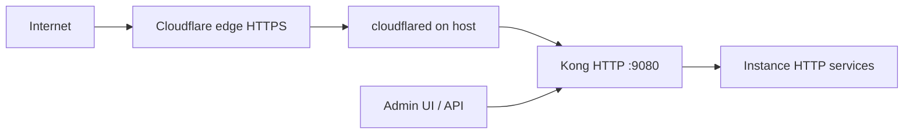

# Cloudflare Tunnel local ingress

* **Author:** hsoni92
* **Date:** 2026-11-23
* **Status:** Ideation (brainstorm)

## Overview

Obelisk operators who run a **standalone local Linux appliance** (`deployment.profile: local`, `deployment.role: local`) today get LAN-style connection strings and path URLs. **Per-instance HTTP hostnames** (the shape VPS uses for Kong routes) only turn on when `profile: vps` or the box is a **gateway** federating peers over Tailscale. Renting a VPS purely as a public front door is one way to get internet URLs; joining a **gateway mesh** is another. Neither path fits someone who wants one home box, no Tailscale dependency for clients, and no extra VPS for ingress.

This feature adds an optional **Cloudflare Tunnel** on that standalone local path: toggled from the admin **Exposure** UI, credentials stored like other appliance secrets, and `cloudflared` lifecycle managed by Obelisk (same class of integration as host Tailscale). When enabled and healthy, Obelisk sets a durable **public base hostname** on the operator’s Cloudflare zone, enables **HTTP connection edge** (Kong on the admin HTTP port), and publishes **`https://` URLs** (no `:9080` in client-facing strings) for the admin UI and Kong-fronted HTTP services—including project instances. **Native TCP edge** (`:9443`, Postgres/Redis/MySQL/Mongo wire protocols) stays off the public internet in v1.

This lane is **orthogonal** to Tailscale, Tailscale Funnel, and **gateway federation**. [`peer_gateway.md`](./peer_gateway.md) rejected Cloudflare Tunnel for **mesh backhaul** (NG3); this feature is **single-node public ingress only**, not peer backhaul.

## Analysis

### Today’s local exposure model

- `ConnectionEdgeEnabled` is true only for `VPSEdge(spec) || IsGateway(spec)` — i.e. `profile: vps` or `role: gateway` (`pkg/obelisk/deployment.go`).
- On plain local, Kong does not merge per-instance `Host` routes; `/connections` and discovery emit LAN-oriented URLs.
- `exposure.funnel` exists for a narrow RustFS path but `ApplyFunnel` is still largely unimplemented; Funnel requires Tailscale on local and is not the model for full HTTP edge.
- Public URLs on VPS use `http://{host}:{AdminHTTPPort}` internally; clients expect `https://` on 443 when traffic terminates at Cloudflare.

### Proposed tunnel path



1. Operator creates a tunnel in Cloudflare Zero Trust and maps DNS (wildcard recommended; see below).
2. Operator saves the tunnel token via Exposure UI (sidecar secret, not in git-tracked yaml).
3. Obelisk sets `exposure.cloudflare_tunnel.enabled: true`, persists `base_domain` / public host, updates controller `OBELISK_PUBLIC_HOST`, reconciles Kong HTTP routes, starts or ensures `cloudflared`.
4. Services and Projects show externally valid `https://{type}-{id}.{base_domain}/...` strings.

Ingress origins target **host-local Kong on the admin HTTP port**, not host 80/443 (Obelisk never binds those ports).

### Contradiction: VPS-shaped URLs without VPS profile

| Tension | Resolution |
| --- | --- |
| Edge behavior is tied to `profile: vps` | Introduce a single predicate **`HTTPEdgeEnabled(spec)`** (name negotiable in draft): true when `VPSEdge(spec)` **or** (`local` + `exposure.cloudflare_tunnel.enabled` + tunnel healthy + public host set). |
| `VPSEdge` name implies profile | Keep `VPSEdge` for “direct bind on VPS/gateway”; tunnel path reuses Kong merge logic via the new predicate without changing `profile`. |
| Reachability before advertising URLs | Reconciler and status API treat tunnel as **not ready** until connector is up; do not emit public edge URLs until then. |

Native edge (`ReconcileNativeEdge`, `:9443`) remains gated separately—**off** for standalone local + tunnel in v1.

### Config, credentials, lifecycle

**Desired-state shape (v1 sketch):**

```yaml
exposure:
  cloudflare_tunnel:
    enabled: false
    base_domain: example.com   # suffix for PublicEdgeHost; drives OBELISK_PUBLIC_HOST
    credentials_secret: cloudflare-tunnel   # K8s secret name; token in sidecar
```

- Validation: allowed only on `profile: local` and `role: local`; forbidden on gateway and vps-only flows.
- No requirement on `deployment.tailscale.enabled`.
- Blueprint: tunnel `enabled` in bundle; token in encrypted sidecar (`secrets.enc` pattern); **restore forces `enabled: false`**, stops `cloudflared`, extends restore chain beyond Funnel-only `ForceFunnelOff`.
- CLI parity: `obelisk cloudflare-tunnel install|ensure|status` (mirror Tailscale commands).
- Admin API: `GET .../cloudflare-tunnel/status`, `POST`/`PATCH` to enable and store credentials (write-only token in UI).

### Operator workflow and DNS

**Preconditions:** Cloudflare account, zone for `base_domain`, tunnel created in Zero Trust, tunnel token copied.

**v1 DNS model (minimal scope):** Operator configures a **wildcard** `CNAME` (e.g. `*.obelisk.example.com` or `*.example.com`) to the tunnel hostname Cloudflare provides. Obelisk generates **per-instance hostnames** (`redis-{id}.example.com`, `s3-{id}.example.com`, …) matching today’s `PublicEdgeHost` rules. Obelisk does **not** call the Cloudflare DNS API in v1.

**URL profile:** Externally published strings use **`https://`** and standard port 443; connection builders gain a **tunnel edge** variant distinct from LAN and VPS `http://host:9080`.

### v1 public surface (explicit catalog)

| Surface | Host pattern | In v1 tunnel? |
| --- | --- | --- |
| Admin UI (GitHub OAuth) | `https://admin.{base_domain}` or shared apex + path (draft picks one) | **Yes** — operator asked for login from internet |
| Admin API | Same origin as UI | **Yes** (same constraints as today’s auth) |
| HTTP instance types (`HTTPEdgeTypes`: rustfs, qdrant, searxng, redpanda, bunqueue) | `https://{type}-{id}.{base_domain}` | **Yes** |
| Project discovery / gateway members (OpenRouter, Mail) | Kong paths on public hostnames | **Yes** (same Kong routes as VPS HTTP edge) |
| Native wire (Postgres, Redis, MySQL, Mongo on `:9443`) | — | **No** (v1 non-goal) |
| Tailscale / Funnel paths | — | Unchanged; not required |

Public admin increases attack surface vs base `obelisk.md` Funnel non-goals. v1 relies on existing GitHub session gating; **Cloudflare Access** is deferred.

### Security and blast radius

- Tunnel token is an **ingress key**; compromise exposes whatever Kong routes publish—store in sidecar + blueprint encryption, never log.
- Reconciled `cloudflared` config must be **HTTP-only ingress** to Kong; no TCP mappings to `:9443` in v1; tests assert native edge deployment does not activate on local + tunnel.
- Kong rate limits on sensitive routes (e.g. RustFS) apply regardless of ingress type.
- Optional UI warning when both tunnel and Funnel are enabled (independent features; no shared reconcile).

### Observability and failure modes

- Separate status: connector state, last error, published `base_domain`, mismatch between spec host and `OBELISK_PUBLIC_HOST`.
- Overview / Exposure panel: degraded when tunnel enabled but connector down (distinct from Kong reconcile errors).
- Audit events on enable/disable (no token in audit payload).

### Three lanes (no overlap)

| Lane | Who | Reachability |
| --- | --- | --- |
| **Local + Cloudflare Tunnel** | Standalone home / lab box | Internet → CF → home Kong |
| **VPS or gateway edge** | Public front or federator | Direct host bind + optional peer backhaul |
| **Tailscale (optional on local/gateway)** | Operator / mesh | Tailnet; Funnel remains narrow and separate |

### Risk summary

| Risk | Mitigation |
| --- | --- |
| Kong routes missing on local | `HTTPEdgeEnabled` predicate used in kong merge, endpoints, helm edge flags |
| Wrong URLs (`:9080`, `http://`) | Tunnel-specific URL builder; UI shows HTTPS |
| Public DB exposure | No native edge + no TCP tunnel config in v1 |
| Restore leaves tunnel running | Spec off + stop process in restore phase |
| Home uplink / CF limits | Document bandwidth expectations; large S3 bulk may be slow |
| `peer_gateway` NG3 confusion | Carve-out in non-goals; link peer gateway doc |

### Goldfish reviewer status

| Lens | Status |
| --- | --- |
| egm-design | completed |
| egm-codebase-details | completed |
| egm-zoom-out | completed |
| egm-comprehension | completed |
| egm-implementation-readiness | completed |
| egm-structural | completed |
| egm-inventive-catalyst | completed |

### Glossary

| Term | Meaning |
| --- | --- |
| **Profile** | `local` or `vps` install / hardware context |
| **Role** | `local` or `gateway` federation plane |
| **HTTP connection edge** | Per-instance Kong `Host` routes on admin HTTP port |
| **Native edge** | nginx stream TLS on `:9443` for wire protocols |
| **Cloudflare Tunnel** | `cloudflared` connector to Cloudflare; this feature |
| **Tailscale Funnel** | Separate optional public path; requires Tailscale on local |

## Goals vs. Non-Goals

**In-scope goals**

- **G1:** `exposure.cloudflare_tunnel` in spec, schema, defaults off.
- **G2:** Exposure UI panel + admin API + status polling (independent of Platform Tailscale UI).
- **G3:** Host `cloudflared` install/ensure/status managed by Obelisk.
- **G4:** When enabled and healthy: set public host, enable HTTP Kong routes, emit HTTPS connection strings for admin UI and HTTP services.
- **G5:** Operator wildcard DNS workflow documented in UI hints.
- **G6:** Blueprint restore forces tunnel off until operator re-enables; stop connector.
- **G7:** Standalone `profile: local`, `role: local` only.

**Out-of-scope non-goals**

- **NG1:** Gateway federation, peer backhaul, or amending NG3 to use CF for mesh (`peer_gateway.md`).
- **NG2:** Coupling to `deployment.tailscale.enabled` or shared Tailscale UI controls.
- **NG3:** Public native TCP (`:9443`) via tunnel in v1.
- **NG4:** Cloudflare API–driven DNS or tunnel CRUD from Obelisk in v1.
- **NG5:** Cloudflare Access / WAF / ZTNA integration in v1.
- **NG6:** Using tunnel on `profile: vps` (already has host edge).
- **NG7:** Replacing Tailscale Funnel implementation; tunnel does not fix Funnel stub.

## Alternatives Weighed

| Alternative | Decision |
| --- | --- |
| **Rent a VPS for ingress only** | Rejected by author: recurring cost; goal is home box with public URLs. |
| **Move appliance to `profile: vps`** | Rejected by author: overkill when only ingress is missing. |
| **Gateway + Tailscale mesh (existing design)** | Rejected for this use case: requires VPS gateway and tailnet; user wants no Tailscale for clients. |
| **Expand Tailscale Funnel to full HTTP edge** | Rejected by author: no intersection with Tailscale; Funnel stays narrow. |
| **Operator-run `cloudflared` outside Obelisk** | Rejected by author: wants UI-integrated toggle and lifecycle. |
| **Host nginx + Let’s Encrypt on home IP** | Rejected by author: operator-managed certs and NAT pain; CF Tunnel handles edge TLS. |
| **Cloudflare Tunnel on gateway for peer backhaul** | Rejected in peer_gateway NG3; distinct from standalone local ingress here. |
| **New `deployment.profile` or role value** | Rejected: exposure toggle avoids validation matrix explosion. |
| **`cloudflared → Kong` HTTP only (not native edge)** | **Accepted for v1** by author: native public deferred. |
| **Full Obelisk-managed CF DNS API** | Rejected for v1: wildcard CNAME operator setup is enough. |

## Key Decisions & Staging for Next Steps

### Locked decisions

| ID | Decision |
| --- | --- |
| T1 | Feature gated to `profile: local` + `role: local`; no gateway/VPS. |
| T2 | Spec block `exposure.cloudflare_tunnel`; credentials via sidecar + secret ref. |
| T3 | **`HTTPEdgeEnabled`** (or equivalent) extends Kong HTTP routes when tunnel on—not `profile: vps`. |
| T4 | Client-facing URLs use **HTTPS on 443** when tunnel active. |
| T5 | v1 includes **admin UI + HTTP services** on tunnel; native TCP public **out**. |
| T6 | DNS: operator wildcard CNAME; no CF DNS API in v1. |
| T7 | Restore: force tunnel **off** and stop `cloudflared` (extend Funnel-off phase). |
| T8 | Orthogonal to Tailscale/Funnel; no validator coupling to Tailscale. |
| T9 | Carve-out from peer_gateway NG3: backhaul rejection does not apply to this ingress feature. |

### Left for `/egm-draft`

- Exact admin hostname pattern (`admin.{base}` vs apex).
- Predicate naming and refactor list (`VPSEdge` call sites).
- Mutual-exclusivity rules if tunnel + Funnel both enabled (warn vs forbid).
- Sidecar filename, blueprint secrets version bump.
- Helm/controller env update atomicity with reconcile.
- Acceptance tests (kong golden, restore phase, no native edge).

### Proposed staging

| Stage | Delivers |
| --- | --- |
| T0 | Spec + schema + validation + `HTTPEdgeEnabled` + URL builder |
| T1 | Kong/endpoints/helm wiring when tunnel on |
| T2 | `internal/cloudflare` + reconcile `ApplyCloudflareTunnel` |
| T3 | Admin API + Exposure UI + status |
| T4 | CLI install/ensure/status; bootstrap hook |
| T5 | Restore force-off + blueprint sidecar + E2E |

### Critical user journeys

1. **Enable:** Local operator enters `base_domain`, pastes tunnel token, toggles on → status **connected** → Services show `https://...` URLs reachable from off-LAN browser.
2. **Project URL:** Deployed app on Vercel calls `https://qdrant-{id}.example.com` without Tailscale.
3. **Disable:** Toggle off → connector stopped; URLs revert to LAN notes in UI.
4. **Restore:** After DR, tunnel remains off until operator re-pastes token and enables.
5. **No VPS:** Same operator never provisions an ingress-only VPS for hostname-shaped HTTP access.