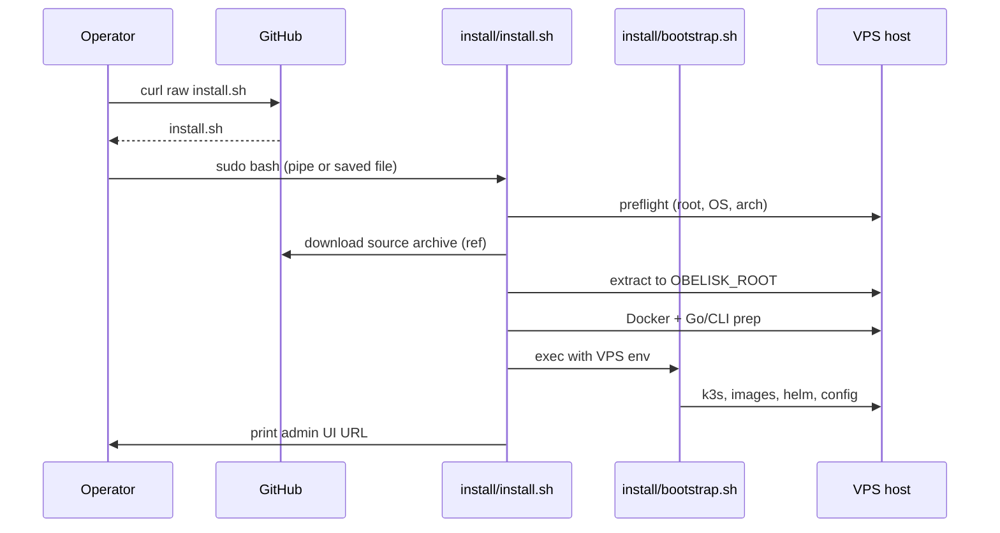

# Curl VPS installer

* **Author:** hsoni92
* **Status:** Proposed
* **Date:** 2026-11-16

---

## Overview

Obelisk’s production VPS install path today asks the operator to place a git checkout on the server (for example under `/opt/obelisk`) and run `install/bootstrap.sh` by hand. That matches development and integration tests but adds friction for CUJ 1 and design goal G5, which call for a single `curl | bash` entry on a clean Ubuntu VPS.

This design adds a thin **`install/install.sh`** entry script that operators fetch with curl. The script downloads a GitHub source archive (no `git clone` on the host), unpacks to `/opt/obelisk`, ensures prerequisites for on-host image build, and executes the existing **`install/bootstrap.sh`** with `OBELISK_PROFILE=vps`. Local development, k3d, and Multipass-based workflows stay unchanged.

## The Problem

Operators provisioning a fresh VPS must understand Obelisk’s repo layout, clone or copy sources, set environment variables, and run bootstrap manually. Documentation diverges: the runbook still leads with “clone or copy,” while `docs/designs/obelisk.md` describes a curl installer that does not exist in the tree. Integration tests validate bootstrap but deliver the tree via rsync from a dev mount, not via the operator-facing download path.

The gap is not the bootstrap engine (k3s, Helm, config, images)—it is **how the tree and prerequisites arrive on the box** before bootstrap runs. Until that path exists, CUJ 1 and DR “install on fresh VPS” stories lack a single command that matches what we tell operators to run.

## Goals

* Provide one documented **curl + sudo bash** command as the **canonical VPS production** install path.
* Fetch **current GitHub source** as an archive (default branch at install time) without `git clone`, with optional **`OBELISK_REF`** to pin tag, branch, or commit.
* Reuse **`install/bootstrap.sh`** without inlining k3s or Helm logic in the remote entry script.
* On first boot, default **`OBELISK_BUILD_IMAGES=true`** until prebuilt registry images are a follow-on.
* Meet the same **platform-ready** bar as integration smoke: Kong reachable from the VPS host, admin UI over HTTP, config under `/etc/obelisk`, no data pods until enabled in the UI.
* Set **VPS Kong defaults** (LoadBalancer via k3s servicelb) so a bare install is not left at ClusterIP-only Kong.
* Install or build **`obelisk` CLI** on the host before bootstrap expects it.
* Ensure **Docker** is available when on-host image build runs.
* Update **runbook and README** so VPS operators are not sent to clone-first instructions.
* Add an integration test that exercises **archive download** rather than only rsync from a mount.

## Non-Goals

* Curl installer for **local profile**, Tailscale, or k3d dev clusters.
* **Tailscale on VPS** (unchanged: `bootstrap.sh` rejects Tailscale on `vps`).
* **Registry-first image delivery** or GHCR publish as a v1 requirement.
* **Signed release bundles**, cosign, or stable/canary channels in v1 (documented follow-on).
* **`obelisk uninstall`** or full resumable install state machine beyond bootstrap idempotency today.
* Removing **git clone + bootstrap** for contributors (fallback remains valid).
* Promising **≤5 minute wall-clock** install while v1 still **builds container images on the VPS** (honest timing documented separately from CUJ 1 aspirational text in the parent design).

### Operator expectations (comprehension)

One curl command **starts** a VPS platform install; it is not a instant binary drop. The host ends up with a full tree under `/opt/obelisk`, pulls sources from GitHub, may install Docker and Go, builds the CLI and container images on first boot, and can take on the order of **15–25 minutes** on the documented hardware floor (not the ≤5 minute CUJ 1 headline while on-host image build remains default).

**“No clone”** means no `git checkout` on the operator’s part; the installer still places a **source archive** on disk.

**“Latest”** without `OBELISK_REF` means default-branch HEAD at run time (`main` today). Production runbooks should recommend pinning (`OBELISK_REF=<tag|sha>`) when tags exist.

**Install complete** means platform-ready only: Kong + admin UI over HTTP, no data pods. **Product usable** for backups and services still requires GitHub sign-in, blueprint unlock, and DR setup ([github-blueprint.md](../runbooks/github-blueprint.md)). Runbook copy must include a short “what to do next” after the printed admin URL.

| Term | Meaning |
| --- | --- |
| `install/install.sh` | **Entry wrapper** — the only script the operator curls |
| `install/bootstrap.sh` | **Host bootstrap engine** — k3s, images, Helm, config; not run directly in VPS docs |
| VPS / prod | `OBELISK_PROFILE=vps`; Tailscale off |
| Idempotent (bootstrap) | Safe to repeat k3s/Helm; config at `/etc/obelisk` not overwritten |
| Destructive (wrapper) | Re-extract can replace `/opt/obelisk` unless upgrade policy says otherwise |

### Goldfish synthesis note

Reviewers ([Design](809074ca-c95b-4e00-b3a5-af7a1a798c53), [Implementation readiness](cc9d96c6-2537-44ea-9da9-373f91b9bd1b)) argued for **prebuilt images in v1** and mandatory checksums. This design **defers registry-first images** (scope in Alternatives) but **requires** runbook download-inspect-run, optional `OBELISK_ARCHIVE_SHA256`, and the curl-shaped VM test before calling the feature done.

---

## Technical Plan

### Operator flow



### New and modified components

| Piece | Action | Role |
| --- | --- | --- |
| `install/install.sh` | **Create** | Curl target: resolve ref, fetch archive, extract, prerequisites, invoke bootstrap, print URL |
| `install/fetch-source.sh` | **Optional create** | Isolate GitHub archive URL + layout handling for testing |
| `install/bootstrap.sh` | **Modify (small)** | VPS defaults for Kong LoadBalancer when `PROFILE=vps`; Docker required when `OBELISK_BUILD_IMAGES=true`; optional log file hook |
| `tests/integration/vm/curl-install.sh` | **Create** | Like `install-in-vm.sh` but download archive instead of rsync |
| `tests/integration/vm/install-in-vm.sh` | **Refactor** | Share helpers; optional `OBELISK_INSTALL_MODE=curl\|rsync` |
| `docs/runbooks/install.md`, `README.md` | **Modify** | VPS one-liner first; clone path as contributor fallback |

### `install/install.sh` behavior (v1)

1. **Preflight** — root; supported OS (Ubuntu LTS baseline); `linux/amd64`; warn if RAM/disk below design floor (4 vCPU, 8 GB, ~40G disk).
2. **Resolve ref** — `OBELISK_REF` default = repository default branch (`main`). Map to GitHub archive URL `https://github.com/hsoni92/obelisk/archive/<ref>.tar.gz` (exact URL rules documented in runbook).
3. **Fetch and extract** — download to tempdir; optional verify when `OBELISK_ARCHIVE_SHA256` set; extract with strip-components so `deploy/`, `install/bootstrap.sh`, etc. land directly under `OBELISK_ROOT` (default `/opt/obelisk`). On upgrade re-run, define whether to merge or replace tree (v1: replace only when `OBELISK_INSTALL_UPGRADE=true` or document fresh-install-only for first ship).
4. **Prerequisites** — if `OBELISK_BUILD_IMAGES=true`: ensure Docker daemon running (install `docker.io` on Ubuntu if missing, matching integration cloud-init). Build `obelisk` CLI with Go (install Go via snap if missing, same as VM script) **or** use prebuilt binary from release asset when present.
5. **Environment** — export `OBELISK_PROFILE=vps`, `OBELISK_ROOT`, `OBELISK_BUILD_IMAGES=true` (first install), `OBELISK_HELM_EXTRA_ARGS='--set kong.service.type=LoadBalancer'` unless already set.
6. **Delegate** — `exec` or call `"$OBELISK_ROOT/install/bootstrap.sh"`.
7. **Post-install** — write `/opt/obelisk/.install-meta.json` (ref, timestamp); append stages to `/var/log/obelisk-install.log`; detect host IP and print `http://<ip>/` (parity with harness `url` command).
8. **Re-run** — do not regenerate `/etc/obelisk/obelisk.yaml` if present (bootstrap contract). Do not overwrite operator-edited files without explicit upgrade flag.

### Canonical one-liner

```bash
curl -fsSL https://raw.githubusercontent.com/hsoni92/obelisk/main/install/install.sh | sudo bash
```

Pin example:

```bash
sudo OBELISK_REF=v0.2.0 bash -s < <(curl -fsSL https://raw.githubusercontent.com/hsoni92/obelisk/main/install/install.sh)
```

(Exact pin invocation may be simplified to env-only on the same pipe; final UX in implementation.)

### Environment variables

| Variable | Default (VPS curl) | Purpose |
| --- | --- | --- |
| `OBELISK_REPO` | `hsoni92/obelisk` | GitHub slug for archive |
| `OBELISK_REF` | default branch | Pin tag, branch, or SHA |
| `OBELISK_ROOT` | `/opt/obelisk` | Extract and bootstrap root |
| `OBELISK_PROFILE` | `vps` | Set by wrapper; not overridable to `local` in published snippet |
| `OBELISK_BUILD_IMAGES` | `true` | On-host image build on first boot |
| `OBELISK_HELM_EXTRA_ARGS` | Kong LoadBalancer | Reachable admin UI on k3s servicelb |
| `OBELISK_ARCHIVE_SHA256` | unset | Optional archive integrity check |

### Bootstrap changes (minimal)

* When `PROFILE=vps` and `OBELISK_HELM_EXTRA_ARGS` unset, default `--set kong.service.type=LoadBalancer` inside bootstrap (so manual bootstrap after clone gets the same VPS behavior).
* Before `build_images`, fail fast with a clear message if Docker is not available and `OBELISK_BUILD_IMAGES=true`.
* Defer **k3s pin from `versions.lock`** to follow-on; note in rollout section.

### Testing

* **Multipass / VM:** new script downloads archive from GitHub (or `file://` staged tarball in CI), runs install path, then existing `smoke.sh`.
* **CI:** optional future job publishes archive + checksums; not required to merge v1 if curl test uses public GitHub archive.

### Documentation and parent design alignment

* Runbook VPS section becomes curl-first; DR restore runbook references the same command for greenfield hosts.
* Parent `obelisk.md` G5 bullet updated when this design ships: thin entry delegates to `bootstrap.sh`; timing footnote for image build.

---

## Alternatives Considered

### Git clone + manual `bootstrap.sh` only

Keep the runbook path: operator clones to `/opt/obelisk`, exports env vars, runs bootstrap.

**Rejected by author:** Adds steps on a fresh VPS; conflicts with CUJ 1 / G5 and the stated goal of a single curl command without a checkout step.

### Shallow `git clone` inside `install.sh`

Wrapper runs `git clone --depth 1` instead of downloading an archive.

**Rejected by author:** Still requires git on the host and reads as “clone the repo”; archive download matches “no git checkout” operator wording.

### Monolithic remote install script (all logic in curl’d file)

Single large script from raw GitHub containing k3s, Helm, and image build inline.

**Rejected by author:** Duplicates `install/bootstrap.sh`, diverges from integration tests, and increases maintenance drift.

### Always track default branch with no pin story

Every install pulls moving `main` with no `OBELISK_REF` or release channel.

**Rejected by author:** Unacceptable for production without documented pinning; brief commits to `OBELISK_REF` and future stable channel.

### Prebuilt images from a registry as v1 requirement

Publish GHCR images; VPS pulls instead of `OBELISK_BUILD_IMAGES=true`.

**Rejected by author:** Large CI/registry scope for first ship; defer until curl path exists; v1 keeps on-host build like today’s VM install.

### apt/snap package as primary install

Distribute obelisk as a distro package with maintainer scripts.

**Rejected by author:** Release matrix and distro support overhead; curl matches existing G5 pattern.

### Cloud-init / Terraform as the primary VPS install UX

Operators use IaC modules instead of a curl one-liner.

**Rejected by author:** Out of scope for indie VPS CUJ; curl remains the documented first step (IaC may wrap curl later).

### Unsigned `curl | bash` with no verify path

Never document checksums, saved-then-run, or offline bundle install.

**Partially accepted:** v1 keeps the one-liner for ergonomics; design requires optional `OBELISK_ARCHIVE_SHA256`, download-inspect-run in runbook, and follow-on signed bundles.

---

## Detailed Implementation

### Work breakdown

1. Implement `install/install.sh` with stages: preflight → fetch archive → extract → chmod install scripts → Docker ensure → Go ensure → `go build` CLI → set VPS env → call bootstrap → write meta/log → print URL.
2. Adjust `install/bootstrap.sh` for VPS Kong default and Docker preflight when building images.
3. Add curl-mode integration test and wire harness optional mode.
4. Update operator docs and parent design G5 wording.
5. Manual validation: Multipass `make test-vm` path plus new curl script on Ubuntu 24.04.

### Files to create

| File | What changes | Why |
| --- | --- | --- |
| `install/install.sh` | New bash entry script (~150–250 lines). Functions: `resolve_ref`, `download_archive`, `extract_tree`, `ensure_docker`, `ensure_go`, `build_cli`, `invoke_bootstrap`, `write_meta`, `print_url`. `set -euo pipefail`. | Curl target referenced in docs; orchestrates archive path before bootstrap. |
| `install/fetch-source.sh` | Optional small library sourced by `install.sh` for URL construction and extract layout tests. | Keeps archive logic testable without full bootstrap. |
| `tests/integration/vm/curl-install.sh` | New script: `curl` or `wget` archive from `OBELISK_ARCHIVE_URL` or GitHub; extract; chmod; build CLI; same env as `install-in-vm.sh`; run bootstrap. | Proves prod delivery path without rsync mount. |

### Files to modify

| File | What changes | Why |
| --- | --- | --- |
| `install/bootstrap.sh` | If `PROFILE=vps` and `OBELISK_HELM_EXTRA_ARGS` empty, append Kong LoadBalancer `--set`. In `build_images` path, `command -v docker` + daemon check with actionable error. Optional: accept `OBELISK_INSTALL_LOG` append hook from wrapper. | Fixes VPS reachability gap; fails fast on missing Docker. |
| `tests/integration/vm/install-in-vm.sh` | Extract shared env defaults (LoadBalancer, `OBELISK_BUILD_IMAGES`) into functions or sourced fragment; branch on `OBELISK_INSTALL_MODE=rsync\|curl`. | Reduces duplication between rsync and curl tests. |
| `tests/integration/multipass/harness.sh` | Document or add subcommand/env to run `curl-install.sh` inside VM when mount not used (stretch: second install mode). | CI parity with operator path. |
| `tests/integration/README.md` | Document curl install mode, env vars, expected duration. | Operators and maintainers know how to run smoke. |
| `docs/runbooks/install.md` | Replace VPS step 1 with curl one-liner; prerequisites (Ubuntu LTS, sudo, RAM); pin with `OBELISK_REF`; inspect-before-pipe note; timing honesty; keep dev sections unchanged. | Single source of truth for VPS prod. |
| `README.md` | Bootstrap section: curl first for VPS; clone fallback for dev. | First doc operators read. |
| `docs/runbooks/github-blueprint.md` | One sentence: greenfield VPS install uses same curl command before GitHub onboarding. | DR narrative alignment. |
| `docs/designs/obelisk.md` | G5 / CUJ 1: note thin `install.sh` → `bootstrap.sh`; footnote on image build time vs five-minute target. | Parent design matches implementation. |
| `Makefile` | Optional target `test-vm-curl` delegating to harness with curl mode if added. | Developer ergonomy for regression. |

### Files explicitly not changed in v1

| File | Why deferred |
| --- | --- |
| `deploy/helm/platform/values.yaml` | Kong type set via helm args for VPS; chart default stays ClusterIP for k3d/local. |
| `.github/workflows/*` | No CI directory today; release job is optional follow-on. |
| `install/versions.lock` | k3s pin wiring deferred; documented follow-on. |
| `cmd/obelisk/*` | No CLI behavior change; only build on host during install. |

### `install/install.sh` interface (pseudocode)

```
main():
  require_root()
  preflight_os_arch()
  REF = env OBELISK_REF or query default branch via git hub API or hardcode main
  URL = github_archive_url(OBELISK_REPO, REF)
  TMP = mktemp -d
  curl -fL URL -o TMP/archive.tar.gz
  verify_optional_sha256()
  extract_strip_components(TMP/archive.tar.gz, OBELISK_ROOT)
  chmod +x OBELISK_ROOT/install/*.sh
  ensure_docker()
  ensure_go()
  (cd OBELISK_ROOT && go build -o obelisk ./cmd/obelisk)
  export OBELISK_PROFILE=vps OBELISK_BUILD_IMAGES=true OBELISK_ROOT
  export OBELISK_HELM_EXTRA_ARGS unless set
  install/bootstrap.sh
  write_json OBELISK_ROOT/.install-meta.json
  print_admin_url()
```

### Error handling requirements

* Every `die` message must state stage name and remediation (install Docker, re-run with pin, check outbound HTTPS).
* Trap `ERR` to log last failed line number to `/var/log/obelisk-install.log` when writable.
* Non-zero exit before mutating `/etc/obelisk` when failure happens during fetch/extract.

### Acceptance criteria

* On Ubuntu 24.04 VM with only curl/ca-certificates/sudo initially provisioned, documented one-liner reaches admin UI HTTP 200 on host IP port 80.
* `tests/integration/vm/smoke.sh` passes after `curl-install.sh`.
* Re-run on same host does not destroy existing `obelisk.yaml`.
* `OBELISK_REF` pointing at a tag installs that tag’s tree (manual check once tags exist).

### Rollout order

1. `bootstrap.sh` VPS defaults (low risk, helps manual installs too).
2. `install/install.sh` + unit-style shell test if added under `tests/`.
3. `curl-install.sh` + doc updates.
4. Parent design doc tweak in same PR or immediate follow-up.

---

## Follow-on (post-v1)

From [Inventive Catalyst](54375f6e-c874-4d84-822a-d9fe9ea7d5df) review — not v1 scope:

* **Thin immortal URL** (e.g. vanity domain or release-hosted stub) that fetches a **signed channel manifest**, then a **versioned bundle** (tarball + `versions.lock` + optional prebuilt CLI/images).
* **Dual channel:** `stable` (last tagged release, VPS default) vs `canary` (CI-promoted from `main`), selected via `OBELISK_CHANNEL` without a second curl URL.
* **Verify-before-mutate:** cosign/SBOM on the bundle before k3s/Helm; offline install via explicit bundle URL + digest.
* **Prebuilt images in GHCR** to meet a honest short install SLA without on-host `npm ci` / Docker builds on 8 GB VPS ([Zoom-out](35e6c010-01c9-45d9-a2c1-3ece01cbb68c): image delivery, not clone vs curl, dominates install time).