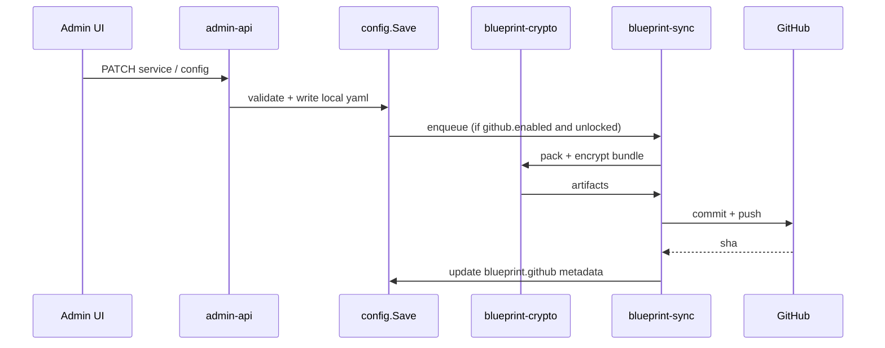

# Encrypted GitHub blueprint mirror

* **Author:** hsoni92
* **Status:** Proposed
* **Date:** 2026-11-14

--------------------------------------------------------------------------------

## Overview

Obelisk stores desired state in `obelisk.yaml` on the appliance. After a hardware loss or full reinstall, operators must rebuild that state and re-enter secrets even when S3/R2 still holds database and object backups. This design adds an **encrypted mirror** of control-plane state in a **private GitHub repository**: the appliance **pushes** after each successful save, and a fresh install can **pull, decrypt, and apply** settings, then **chain into the existing S3 data restore** using backup policy and credentials recovered from the mirror.

GitHub holds **settings and encrypted secrets**, not data dumps. S3/R2 under `machine.id` remains the store for `data/{type}/{instance}/`. The pattern is **Encrypted Blueprint Mirror** (unidirectional), not bidirectional GitOps.

## The Problem

1. **Control plane is fragile off-box today:** DR plans upload `config/` tarballs to S3, but restore UX still centers on manual credential entry and scattered DR steps. Operators who live in GitHub want a familiar off-site copy of **what the appliance should look like**, including backup endpoint and schedule fields.
2. **Secrets block naive git backup:** Putting `obelisk.yaml` in git would leak or tempt plaintext storage of backup keys, gateway tokens, and instance passwords.
3. **Two-bucket mental load:** Operators must distinguish local yaml, optional S3 `config/`, S3 `data/`, and (now) git without a single story for **which source wins on rebirth**.
4. **Headless VPS:** Sync and restore must work without a browser on the server for day-to-day pushes; pairing happens once from a trusted device.

**Proposed direction:** Encrypt secret material with a **user-held passphrase** before any git write; keep cleartext desired structure where safe; use a **machine credential** (deploy key or GitHub App) for push; expose **sync and chained restore status** in the admin UI; treat local disk as source of truth during normal operation.

## Goals

* **G1 — Encrypted mirror:** Opt-in continuous sync of control-plane state to a private GitHub repo after successful saves (debounced, retried).
* **G2 — User-held key:** Passphrase-derived key encrypts secret bundles; passphrase is not persisted on the appliance (session unlock in memory for auto-push).
* **G3 — Backup policy in mirror:** `backup.remote` and related policy fields are part of the mirrored state so DR targets need not be retyped after rebirth.
* **G4 — Chained rebirth:** Explicit orchestrator path: pull mirror → unlock → apply control → restore S3 data → reconcile; UI separates **settings restored** from **data restored**.
* **G5 — Risk controls:** Pre-push plaintext checks, generation/clobber guards, push-failure queue, key-loss messaging, headless pairing CUJ.
* **G6 — Coexistence:** Appliances without GitHub enabled continue to use local yaml + S3 DR only.

## Non-Goals

* **NG1:** Bidirectional GitOps (silent pull from GitHub while running, merge from git).
* **NG2:** Application containers, Helm marketplace, or deploy-from-git for user apps.
* **NG3:** Database or object blobs in GitHub.
* **NG4:** Server-side recovery of a lost passphrase.
* **NG5:** Multi-writer or multi-node sync.
* **NG6:** Mandatory GitHub for all installs (feature defaults off).

## Resolved decisions (formerly open questions)

* **D1 — GitHub auth (OQ1):** **GitHub OAuth** for operator login and repo access. The admin UI uses **Sign in with GitHub** (OAuth Authorization Code flow in the browser). On headless VPS, first-time linking uses the **OAuth Device Authorization Grant** (code on screen, approval on a phone or laptop). After authorization, the appliance stores **refresh + access tokens** only in Kubernetes Secret `obelisk-blueprint-github` (never in `obelisk.yaml` or git). A background refresher renews access tokens for auto-push. Token loss requires re-authorization, not passphrase re-entry.
* **D2 — Bundle format (OQ2):** **Split v1 bundle** for reliability: `manifest.json` (schema version, generation, `machine.id`, `key_id`, crypto metadata) + `obelisk.public.yaml` (redacted spec) + `secrets.enc` (single AEAD blob). **Argon2id** KDF for the user passphrase; **XChaCha20-Poly1305** for `secrets.enc`; envelope fields in manifest for future key rotation (`key_id` / re-wrap without history rewrite). Pre-push validator scans cleartext paths before commit.
* **D3 — S3 `config/` (OQ3):** When `blueprint.github.enabled` is true, **do not upload** S3 `config/` tarballs. **No S3 fallback** for control plane. Off-appliance desired state lives only in GitHub (+ local disk on the appliance). S3 bucket `machine.id` holds **`data/` only** for mirrored appliances.
* **D4 — Ship scope (OQ4):** **Full restore chain is required** before the feature is generally available (`blueprint.github.enabled` in docs/UI). Encrypted auto-push may land earlier behind an internal flag, but **GA** requires `POST /api/v1/restore/chain` (or `obelisk restore --chain`) completing **pull blueprint → unlock → apply control → restore data → reconcile** with progress persisted and UI parity.

## Technical Plan (Architecture)

### Design principles

1. **Local disk wins during operation:** `obelisk.yaml` and credential sidecars on the appliance remain the live source of truth. GitHub is a **write-only encrypted mirror** for off-site durability.
2. **No silent pull:** GitHub → appliance applies only during explicit **bootstrap**, **import**, or **chained restore** flows.
3. **Encrypt before git:** Secret material never enters the repository in plaintext. A validator runs immediately before commit.
4. **Split stores:** GitHub = control-plane mirror; S3 `machine.id` bucket = **`data/` backups only** when GitHub mirror is enabled (no `config/` uploads).
5. **Session crypto for auto-push:** Passphrase unlocks an in-memory key with TTL; when locked, saves persist locally but pushes are skipped and surfaced in UI.

### Authority table

| Store | Contents | Written when | Applies on rebirth |
| --- | --- | --- | --- |
| Local | Full spec + sidecars + K8s secrets | Every save | N/A (replaced during restore) |
| GitHub | `obelisk.public.yaml` + encrypted bundle + `manifest.json` | After save, post-encrypt, debounced push | **Settings** (via pull + decrypt) |
| S3 `data/` | pg_dump, RDB, RustFS artifacts | Backup jobs | **Data** (via existing/future restore worker) |

When `blueprint.github.enabled` is true, **GitHub is the only off-appliance control-plane store**. The backup reconciler **skips** `config/` uploads (D3).

### Logical components (new / extended)

| Component | Responsibility |
| --- | --- |
| **blueprint-crypto** (`internal/blueprint/crypto`) | KDF (Argon2id), envelope encrypt/decrypt, bundle pack/unpack, `key_id`, pre-push secret scan |
| **blueprint-git** (`internal/blueprint/git`) | Clone/fetch/push to configured repo/branch; commit message with `generation` and `machine.id` |
| **blueprint-sync** (`internal/blueprint/sync`) | Post-`config.Save` hook: debounce, encrypt, push queue, retry backoff, clobber check vs remote `generation` |
| **blueprint-auth** (`internal/blueprint/auth`) | GitHub OAuth (browser + device flow); token refresh; store tokens in K8s Secret `obelisk-blueprint-github`; `POST /blueprint/github/authorize` + callback/device poll |
| **restore-orchestrator** (extend `internal/backup` or new `internal/restore`) | Phased chain: `pull_blueprint` → `unlock` → `apply_control` → `restore_data` → `reconcile_services` |
| **admin API** | `GET/PATCH /api/v1/blueprint/github`, `POST .../unlock`, `POST .../pair`, `POST .../pull`, restore chain endpoints |
| **admin UI** | **Platform → Blueprint sync** panel; DR banner cross-link; sync badge (local / pushed / failed) |
| **obelisk CLI** | `blueprint status`, `blueprint unlock`, `restore --chain` parity |

### Bundle layout (v1 — locked per D2)

Repository path (default repo root):

```
manifest.json          # apiVersion, generation, machine.id, algorithm, key_id, committed_at
obelisk.public.yaml    # Spec with secrets redacted / references only
secrets.enc            # AEAD ciphertext of JSON map: sidecar contents + instance creds
```

`manifest.json` includes `blueprint_schema_version` for forward-compatible unpack.

### Spec extension

```yaml
blueprint:
  github:
    enabled: false
    repository: "owner/obelisk-appliance"  # non-secret
    branch: main
    generation: 0
    last_sync_at: null
    last_commit_sha: null
    sync_status: idle | pending | synced | failed
    unlock_expires_at: null                # hint for UI only
    oauth_login: null                      # GitHub username, non-secret, set after OAuth
    oauth_connected: false
```

OAuth tokens **never** appear in `obelisk.yaml` or git; only in Secret `obelisk-blueprint-github` (D1).

### Data flow — normal operation



### Data flow — chained rebirth


`machine.id` from decrypted spec must be applied **before** `EnsureMachineIdentity` can mint a new ID.

### API sketch

| Method | Path | Purpose |
| --- | --- | --- |
| GET | `/api/v1/blueprint/status` | sync_status, generation, last_sha, unlock state |
| PATCH | `/api/v1/blueprint/github` | enable, repo, branch (requires unlocked session to push) |
| POST | `/api/v1/blueprint/unlock` | passphrase → session key in controller memory (TTL) |
| POST | `/api/v1/blueprint/lock` | drop session key |
| POST | `/api/v1/blueprint/push` | manual push (operator override) |
| POST | `/api/v1/blueprint/github/authorize` | start OAuth (redirect URL or device code) |
| POST | `/api/v1/blueprint/github/callback` | exchange code; store tokens in Secret |
| POST | `/api/v1/restore/chain` | run orchestrator phases with progress JSON (**required for GA**, D4) |

### Security notes

* Pre-push scan rejects patterns that match known secret fields or PEM blocks in paths slated for cleartext files.
* Push queue caps depth; failures exponential backoff; no blocking of local `config.Save`.
* Remote-ahead guard: if `remote.generation > local.generation`, refuse push and show **import required** (prevents overwriting newer off-box state).
* Recovery Kit (optional export): repo, branch, `machine.id`, S3 endpoint, key fingerprint—printed once at enable time.

### Observability

Extend status/overview with: `blueprint.sync_status`, `last_push_error` (sanitized), `restore.phase` during chain. Structured logs: `machine_id`, `generation`, `repo`, `phase`; never log passphrase or object keys with secrets.

### Dependency note (D4)

**GA blocks on full chain:** S3 backup upload, data restore workers, and restore orchestrator must be **non-stub** before `blueprint.github.enabled` is documented as supported. OAuth push (D1) and encrypted bundle (D2) ship in the same release train as `restore/chain`, not as a standalone “sync only” product surface.

### GitHub OAuth (D1)

| Surface | Flow | Notes |
| --- | --- | --- |
| Admin UI on laptop/browser | Authorization Code + PKCE | Session cookie for admin UI; links GitHub identity to appliance |
| Headless VPS first link | Device Authorization Grant | Display user code; operator approves at `github.com/login/device` |
| Background sync | Refresh token → access token | Refresher runs in controller; on `401`, mark `sync_status: failed` and prompt re-auth |

OAuth App registration is operator-supplied or documented Obelisk client IDs with redirect URL to admin UI. Scopes: minimum **`repo`** (private repository) or successor fine-grained permission set that allows read/write on the configured repository only.

## Alternatives Considered

### S3-only encrypted control plane (extend G4 `config/` tarball)

Encrypt the existing `config/latest.tar` upload with the same user passphrase (age or envelope) and skip GitHub entirely.

**Rejected by author:** Wants GitHub for familiarity, diff/history on settings, and storage tied to a GitHub account rather than only the backup bucket.

### Manual `obelisk blueprint push` / pull without auto-sync

Operator runs CLI when they remember; no post-save hook.

**Rejected by author:** Wants continuous sync so off-box state stays current without discipline.

### Cleartext `obelisk.yaml` in a private GitHub repo; secrets only on S3

Keep secrets out of git entirely; only non-secret yaml is pushed.

**Rejected by author:** Wants one encrypted bundle so backup keys and gateway credentials restore together with policy fields; private-repo cleartext still leaks topology and tempts secret fields in yaml over time.

### Defer GitHub until S3 backup and restore orchestrator ship

Build DR CUJ 5 first, add mirror later.

**Partially accepted:** Design requires restore orchestrator for full G4; mirror-only v1 must be labeled settings-only if data restore remains stub. Reviewers treat parallel greenfield without S3 upload as unsafe.

### GitHub as sole disaster store (drop S3 for control plane)

Use only git for settings and only S3 for data—no S3 `config/`.

**Accepted as target:** This is the intended demotion of S3 `config/` when mirror is enabled; exact migration is OQ3.

### Full GitOps (pull from git on interval, reconcile from remote)

Standard flux-style loop.

**Rejected:** Conflicts with single-writer appliance, v1 non-goals, and headless conflict handling cost. Mirror stays push-only from appliance.

### Operator-managed git in `/etc/obelisk`

Document `git init` and cron; no product code.

**Rejected by author:** Wants integrated encrypt, push queue, and restore chain—not a runbook-only approach.

## Implementation Plan

Phases are ordered so operators are not misled by sync without data DR.

| Phase | Outcome | Exit criteria |
| --- | --- | --- |
| **P0** | D1–D4 locked | OAuth auth, bundle v1, no S3 `config/`, GA gated on full chain |
| **P1** | Crypto bundle + tests | Round-trip tests; wrong passphrase fails; tamper fails |
| **P2** | Git transport + machine Secret | Push/pull against test repo; pairing stores credential |
| **P3** | Post-save sync worker | All `config.Save` paths enqueue; debounce + retry |
| **P4** | Admin API + UI + CLI status | Unlock/lock, enable repo, sync badges |
| **P4b** | S3 backup upload + data restore workers | Real `RunNow` uploads; `data/` restore implemented (**blocker for GA**) |
| **P5** | Chained restore + CUJs + OAuth GA | `restore/chain` E2E; disable `config/` when mirror on; Funnel forced off |

### File changes

#### Schema and types

| File | Change |
| --- | --- |
| `pkg/obelisk/spec.go` | Add `Blueprint`, `BlueprintGitHub` structs; default `enabled: false`; bump generation on successful push |
| `pkg/obelisk/spec.go` | Add `RedactedSpec()` helper for public yaml export |
| `schemas/obelisk.yaml.schema.json` | Document `blueprint.github` fields |
| `docs/designs/obelisk.md` | Update CUJ 5, demote S3 `config/` when mirror on; cross-link this design |

#### Config layer

| File | Change |
| --- | --- |
| `internal/config/load.go` | On bootstrap restore path: apply `machine.id` from spec before `EnsureMachineIdentity` when flag set |
| `internal/config/save.go` (new hook file or same package) | `SaveAndNotify(spec)` wrapper calling `sync.Enqueue` after successful save |
| `internal/config/load.go` | Optional: detect `blueprint.github.enabled` on first boot → skip auto-init empty spec |

#### Blueprint packages (new)

| File | Change |
| --- | --- |
| `internal/blueprint/crypto.go` | KDF, AEAD, pack/unpack, `key_id`, pre-scan |
| `internal/blueprint/bundle.go` | Manifest + redacted yaml + secrets map from sidecars |
| `internal/blueprint/git.go` | Remote operations; read remote generation from `manifest.json` on fetch |
| `internal/blueprint/sync.go` | Debounced queue, worker goroutine, backoff |
| `internal/blueprint/session.go` | In-memory unlock TTL; mutex |
| `internal/blueprint/auth.go` | OAuth code/device exchange, token refresh, Secret `obelisk-blueprint-github` |
| `internal/backup/reconciler.go` or controller | Skip `config/` prefix upload when `blueprint.github.enabled` |
| `internal/blueprint/crypto_test.go` | Vectors and tamper tests |
| `internal/blueprint/sync_test.go` | Mock git; enqueue coalescing |

#### Sidecar integration

| File | Change |
| --- | --- |
| `internal/backup/credentials.go` | Export for bundle packer |
| `internal/openrouter/credentials.go` | Export for bundle packer |
| `internal/mail/credentials.go` | Export for bundle packer |
| `pkg/obelisk/instances.go` | Plan migration: instance creds into bundle only on sync paths; document plaintext yaml debt |

#### Admin API

| File | Change |
| --- | --- |
| `internal/adminapi/blueprint.go` (new) | Handlers: status, patch github, unlock, lock, push, pair |
| `internal/adminapi/restore.go` (new) | `POST /restore/chain` state machine + persisted phase |
| `internal/adminapi/server.go` | Route registration |
| `internal/adminapi/server.go` | Replace direct `config.Save` with wrapper where spec mutates (instances, backup, mail, openrouter, config put) |

#### Restore / backup

| File | Change |
| --- | --- |
| `internal/backup/runner.go` | Implement real upload (prerequisite for meaningful chain) |
| `internal/restore/orchestrator.go` (new) | Phases per Technical Plan |
| `internal/restore/orchestrator_test.go` | Phase order; abort on wrong `machine.id` |

#### Controller / CLI

| File | Change |
| --- | --- |
| `cmd/obelisk/main.go` | Subcommands: `blueprint unlock|lock|status|push` |
| `cmd/obelisk/main.go` | `restore --chain` delegates to orchestrator |
| `internal/controller/controller.go` | Call after `apply_control` in restore |

#### Admin UI

| File | Change |
| --- | --- |
| `web/admin/app/platform/blueprint/page.tsx` (new) | Enable, repo, unlock, sync status |
| `web/admin/components/dr/backup-remote-panel.tsx` | Banner linking to blueprint sync |
| `web/admin/app/layout.tsx` or nav config | Platform submenu entry |
| `web/admin/lib/api.ts` | RTK endpoints for blueprint + restore chain |

#### Install / docs / ops

| File | Change |
| --- | --- |
| `docs/runbooks/github-blueprint.md` (new) | Pairing CUJ, key loss, headless VPS |
| `docs/runbooks/install.md` | Optional pointer to blueprint bootstrap |
| `install/obelisk.yaml.example` | Sample `blueprint.github` disabled block |
| `docs/designs/SITEMAP.md` | Register this design when finalized |

#### Helm / deploy (if Secret names ship in chart)

| File | Change |
| --- | --- |
| `deploy/helm/obelisk-platform/templates/` | Optional Secret placeholder for blueprint github credential |

### Rollout

* Default `blueprint.github.enabled: false` on upgrade.
* Enable wizard: create repo → pair → unlock → initial push → show Recovery Kit.
* Feature flag in UI hides panel until controller version supports API.

## Verification Plan

| Test | Asserts |
| --- | --- |
| `crypto_test` | Encrypt/decrypt; wrong passphrase; corrupted ciphertext |
| `sync_test` | N saves in 1s → 1 push; failure retries |
| `identity_test` | Restore blueprint preserves `machine.id` |
| `scan_test` | PEM in public yaml rejected |
| API integration | PATCH backup triggers single push |
| Manual CUJ | Pair → enable → unlock → edit service → sha updates |
| Chain CUJ (P5) | Fresh vm: pull → unlock → data prefix restore |

## Non-Functional Requirements

* **Security:** No plaintext secrets in git; machine token scoped to one repo; session key cleared on lock/TTL.
* **Availability:** Local saves succeed when GitHub is down; sync catches up on retry.
* **Operability:** `sync_status` and `restore.phase` visible in UI and `obelisk blueprint status`.
* **Performance:** Debounce default 5s; max 1 push per debounce window per appliance.