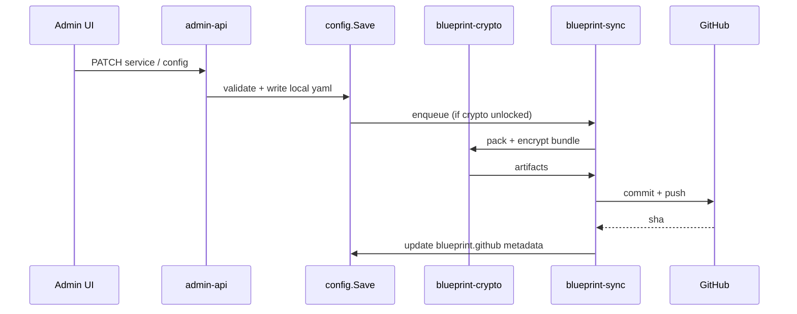
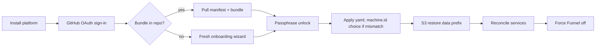

# Encrypted GitHub blueprint mirror

* **Author:** hsoni92
* **Status:** Proposed
* **Date:** 2026-11-15

--------------------------------------------------------------------------------

## Overview

Obelisk stores desired state in `obelisk.yaml` on the appliance. Operators **sign in with GitHub** in the admin UI. Every appliance has a **GitHub home for its encrypted blueprint** (private repo). If the repo already has a bundle, install/login **pulls, decrypts, and applies** it; if the repo is empty, the operator goes through **fresh onboarding** (initial spec, passphrase, first push).

The appliance **pushes** an encrypted mirror after each successful save. On disaster recovery, the same login flow leads into **chained restore**: blueprint from GitHub, then **S3/R2 `data/`** using `machine.id` and backup settings from the bundle.

**Glossary (short):** *Settings* = control-plane desired state (yaml + encrypted sidecars). *Sidecars* = `backup-remote`, mail, and openrouter credential JSON beside config. *`machine.id`* = stable appliance id and S3 bucket name (`obelisk.yaml`). *Funnel* = optional Tailscale Funnel for RustFS S3 only ([obelisk.md](./obelisk.md)); forced off after restore until re-enabled.

GitHub holds **settings and encrypted secrets**, not data dumps. S3/R2 under `machine.id` holds **`data/` only** (no `config/` tarball). Pattern: **encrypted blueprint mirror** (push-only from appliance), not bidirectional GitOps.

## The Problem

1. **Control plane is fragile off-box today:** DR plans upload `config/` tarballs to S3, but restore UX still centers on manual credential entry and scattered DR steps. Operators who live in GitHub want a familiar off-site copy of **what the appliance should look like**, including backup endpoint and schedule fields.
2. **Secrets block naive git backup:** Putting `obelisk.yaml` in git would leak or tempt plaintext storage of backup keys, gateway tokens, and instance passwords.
3. **Store split:** Operators need one story: **GitHub = off-appliance settings**, **S3 `data/` = backups**, **local disk = live** until push succeeds.
4. **Headless VPS:** GitHub **device OAuth** for first link; day-to-day encrypt/push needs a **passphrase unlock** on the controller (see D6).

**Proposed direction:** **GitHub OAuth** (full repo permissions required for create/read/write on the blueprint repo) for login and git transport; **passphrase** encrypts secrets before every commit; **passphrase remembered in browser storage** (client-side) and re-sent to unlock after reboot; local disk is authoritative until push succeeds.

## Goals

* **G1 — GitHub-first:** Sign in with GitHub is the entry path; blueprint repo always exists for the account (created on onboarding if missing).
* **G2 — Encrypted mirror:** Continuous sync to GitHub after successful saves (debounced, retried) when controller crypto is unlocked.
* **G3 — User-held key:** Passphrase-derived key encrypts secret bundles; **not stored on appliance disk**; **stored in browser local storage** by the admin UI (operator accepts device compromise risk).
* **G4 — Backup policy in mirror:** `backup.remote` and related fields travel in the bundle so DR targets need not be retyped after rebirth.
* **G5 — Chained rebirth:** pull blueprint → unlock → apply control → restore S3 data → reconcile; UI separates **settings restored** from **data restored**.
* **G6 — Risk controls:** Pre-push plaintext checks, generation guard, push-failure queue, key-loss messaging, device OAuth for headless link.

## Non-Goals

* **NG1:** Bidirectional GitOps (silent pull from GitHub while running, merge from git).
* **NG2:** Application containers, Helm marketplace, or deploy-from-git for user apps.
* **NG3:** Database or object blobs in GitHub.
* **NG4:** Server-side recovery of a lost passphrase.
* **NG5:** Multi-writer or multi-node sync.
* **NG6:** S3 `config/` control-plane tarballs (settings durability is GitHub-only in this model).

## Resolved decisions (formerly open questions)

* **D1 — GitHub auth (OQ1):** **GitHub OAuth** for operator login and repo access. The admin UI uses **Sign in with GitHub** (OAuth Authorization Code flow in the browser). On headless VPS, first-time linking uses the **OAuth Device Authorization Grant** (code on screen, approval on a phone or laptop). After authorization, the appliance stores **refresh + access tokens** only in Kubernetes Secret `obelisk-blueprint-github` (never in `obelisk.yaml` or git). A background refresher renews access tokens for auto-push. Token loss requires re-authorization, not passphrase re-entry.
* **D2 — Bundle format (OQ2):** **Split v1 bundle** for reliability: `manifest.json` (schema version, generation, `machine.id`, `key_id`, crypto metadata) + `obelisk.public.yaml` (redacted spec) + `secrets.enc` (single AEAD blob). **Argon2id** KDF for the user passphrase; **XChaCha20-Poly1305** for `secrets.enc`; envelope fields in manifest for future key rotation (`key_id` / re-wrap without history rewrite). Pre-push validator scans cleartext paths before commit.
* **D3 — S3 `config/`:** **Never upload** S3 `config/` tarballs. **No S3 fallback** for control plane. Off-appliance settings = GitHub only. S3 bucket `machine.id` = **`data/` only**.
* **D4 — Ship scope:** **GA** requires full `POST /api/v1/restore/chain` (or `obelisk restore --chain`): pull blueprint → unlock → apply control → restore data → reconcile.
* **D5 — No mirror toggle:** There is no “blueprint off” product mode. Flow is always: **GitHub login → repo has bundle or fresh onboarding**.
* **D6 — Passphrase session:** Passphrase unlocks crypto in **controller memory** with **no TTL** until `POST /blueprint/lock` or process restart. **After reboot**, operator unlocks again; UI may **read passphrase from browser storage** and call unlock automatically (still an explicit unlock step to the API). Passphrase is **never written to appliance disk**.
* **D7 — OAuth scopes:** Request **all GitHub permissions needed** to create/read/write the blueprint repo (v1: private-repo `repo` scope or fine-grained equivalent covering contents + metadata).
* **D8 — `machine.id` on rebirth:** Default: **reuse `machine.id` from decrypted blueprint** (same S3 bucket). If local `machine.id` already differs (new empty install), UI **warns “different machine”** and operator may **adopt blueprint id** or **start new id** (new bucket; no automatic data restore to old bucket).
* **D9 — `generation`:** Increment on each successful push. If remote `generation > local`, block push and require **import from GitHub** (overwrite local desired state from bundle, then reconcile).
* **D10 — `pull_control`:** Parent [obelisk.md](./obelisk.md) CUJ 5 uses **`pull_blueprint` from GitHub** then existing restore phases (not S3 `config/`).

## Critical User Journeys (CUJs)

### CUJ 1: Fresh onboarding (empty GitHub bundle)

* **Given:** Platform installed; operator opens admin UI; GitHub repo exists but has no Obelisk bundle yet.
* **When:** Operator signs in with GitHub, sets passphrase (saved in browser storage), completes minimal platform wizard, saves first config.
* **Then:** Encrypted bundle pushed; `generation` = 1; local and GitHub aligned.

### CUJ 2: Returning operator (bundle exists)

* **Given:** Repo contains latest `manifest.json` + bundle.
* **When:** Operator signs in with GitHub; UI loads passphrase from browser storage and calls unlock; bootstrap pulls bundle if local is empty or user confirms import.
* **Then:** Local `obelisk.yaml` and sidecars match bundle; services reconcile; sync resumes on save.

### CUJ 3: Headless VPS — first GitHub link

* **Given:** Fresh VPS; operator has phone/laptop.
* **When:** Admin UI shows device code; operator approves at GitHub; tokens stored in `obelisk-blueprint-github` Secret.
* **Then:** Pull/push works; unlock still requires passphrase via UI (browser storage on whichever device opens admin).

### CUJ 4: Chained disaster recovery

* **Given:** New VPS; S3 `data/` intact for blueprint `machine.id`.
* **When:** Operator runs restore wizard: GitHub login → unlock → `restore/chain`.
* **Then:** Settings restored, then data restored, then reconcile; Funnel off until re-enabled; UI shows both legs complete.

### CUJ 5: Different machine id detected

* **Given:** Local minted new `machine.id`; pulled blueprint carries another id.
* **When:** Import/bootstrap surfaces mismatch.
* **Then:** Operator chooses **adopt blueprint id** (continue DR to that bucket) or **keep new id** (settings only, no automatic data restore from old bucket).

### CUJ 6: Reboot

* **Given:** Controller restarted; OAuth tokens still valid in Secret.
* **When:** Operator opens admin UI; UI sends unlock (passphrase from browser storage or prompt).
* **Then:** Crypto unlocked; queued pushes run; until unlock, saves local-only with **push paused** badge.

## Risks & Mitigations

| Risk | Mitigation |
| --- | --- |
| Passphrase in browser storage | Explicit consent copy; optional “forget on this device”; never log passphrase server-side |
| Passphrase lost | No recovery; data blobs may survive on S3 but secrets in bundle are lost |
| Controller reboot | Push paused until unlock; OAuth may still work for pull |
| GitHub outage | Local saves continue; retry queue when API returns |
| Wrong machine id choice | Clear UI copy before adopt/new-id |
| OAuth token revoked | `sync_status: failed`; re-run GitHub login |
| Generation conflict | Refuse push; offer import from GitHub |

## Technical Plan (Architecture)

### Design principles

1. **Local disk wins during operation:** `obelisk.yaml` and credential sidecars on the appliance remain the live source of truth. GitHub is a **write-only encrypted mirror** for off-site durability.
2. **No silent pull:** GitHub → appliance applies only during explicit **bootstrap**, **import**, or **chained restore** flows.
3. **Encrypt before git:** Secret material never enters the repository in plaintext. A validator runs immediately before commit.
4. **Split stores:** GitHub = off-appliance settings; S3 `machine.id` = **`data/` only** (D3).
5. **Unlock for push:** Encrypt/push runs only while controller holds passphrase-derived key in memory (D6). Locked or post-reboot: local save ok, push paused.
6. **GitHub login gate:** Admin UI requires GitHub session before settings screens (except platform install bootstrap that routes to login).

### Authority table

| Store | Contents | Written when | Applies on rebirth |
| --- | --- | --- | --- |
| Local | Full spec + sidecars + K8s secrets | Every save | N/A (replaced during restore) |
| GitHub | `obelisk.public.yaml` + encrypted bundle + `manifest.json` | After save, post-encrypt, debounced push | **Settings** (via pull + decrypt) |
| S3 `data/` | pg_dump, RDB, RustFS artifacts | Backup jobs | **Data** (via existing/future restore worker) |

The backup reconciler **never uploads** S3 `config/` (D3). Parent `obelisk.md` CUJ 5 is updated via D10.

### Logical components (new / extended)

| Component | Responsibility |
| --- | --- |
| **blueprint-crypto** (`internal/blueprint/crypto`) | KDF (Argon2id), envelope encrypt/decrypt, bundle pack/unpack, `key_id`, pre-push secret scan |
| **blueprint-git** (`internal/blueprint/git`) | Clone/fetch/push to configured repo/branch; commit message with `generation` and `machine.id` |
| **blueprint-sync** (`internal/blueprint/sync`) | Post-`config.Save` hook: debounce, encrypt, push queue, retry backoff, clobber check vs remote `generation` |
| **blueprint-auth** (`internal/blueprint/auth`) | GitHub OAuth (browser + device flow); token refresh; store tokens in K8s Secret `obelisk-blueprint-github`; `POST /blueprint/github/authorize` + callback/device poll |
| **restore-orchestrator** (extend `internal/backup` or new `internal/restore`) | Phased chain: `pull_blueprint` → `unlock` → `apply_control` → `restore_data` → `reconcile_services` |
| **admin API** | GitHub OAuth, `POST /blueprint/unlock`, status, `restore/chain` |
| **admin UI** | GitHub sign-in gate; passphrase setup + browser storage; sync badge; DR chain wizard |
| **obelisk CLI** | `blueprint status`, `blueprint unlock`, `restore --chain` parity |

### Bundle layout (v1 — locked per D2)

Repository path (default repo root):

```
manifest.json          # apiVersion, generation, machine.id, algorithm, key_id, committed_at
obelisk.public.yaml    # Spec with secrets redacted / references only
secrets.enc            # AEAD ciphertext of JSON map: sidecar contents + instance creds
```

`manifest.json` includes `blueprint_schema_version` for forward-compatible unpack.

### Spec extension

```yaml
blueprint:
  github:
    repository: "owner/obelisk-appliance"  # non-secret; set after onboarding
    branch: main
    generation: 0
    last_sync_at: null
    last_commit_sha: null
    sync_status: idle | pending | synced | failed | locked | push_paused
    crypto_unlocked: false                 # UI hint only; real unlock state is server memory
    oauth_login: null                      # GitHub username, non-secret
```

OAuth tokens **never** appear in `obelisk.yaml` or git; only in Secret `obelisk-blueprint-github` (D1).

### Data flow — normal operation



### Data flow — chained rebirth



When adopting blueprint id, apply `machine.id` from bundle **before** `EnsureMachineIdentity` would mint a new one (D8).

### API sketch

| Method | Path | Purpose |
| --- | --- | --- |
| GET | `/api/v1/blueprint/status` | sync_status, generation, last_sha, unlock state |
| POST | `/api/v1/blueprint/onboard` | create/select repo; first push after fresh onboarding |
| POST | `/api/v1/blueprint/unlock` | passphrase → session key in controller memory (no TTL, D6) |
| POST | `/api/v1/blueprint/import` | pull remote when `generation` ahead of local (D9) |
| POST | `/api/v1/blueprint/lock` | drop session key |
| POST | `/api/v1/blueprint/push` | manual push (operator override) |
| POST | `/api/v1/blueprint/github/authorize` | start OAuth (redirect URL or device code) |
| POST | `/api/v1/blueprint/github/callback` | exchange code; store tokens in Secret |
| POST | `/api/v1/restore/chain` | run orchestrator phases with progress JSON (**required for GA**, D4) |

### Security notes

* Pre-push scan rejects patterns that match known secret fields or PEM blocks in paths slated for cleartext files.
* Push queue caps depth; failures exponential backoff; no blocking of local `config.Save`.
* Remote-ahead guard: if `remote.generation > local.generation`, refuse push and show **import required** (prevents overwriting newer off-box state).
* Recovery Kit (optional export): repo, branch, `machine.id`, S3 endpoint, key fingerprint—printed once at enable time.

### Observability

Extend status/overview with: `blueprint.sync_status`, `last_push_error` (sanitized), `restore.phase` during chain. Structured logs: `machine_id`, `generation`, `repo`, `phase`; never log passphrase or object keys with secrets.

### Dependency note (D4)

**GA blocks on full chain (D4):** S3 data upload/restore and `restore/chain` must be non-stub in the same release as GitHub-first onboarding.

### GitHub OAuth (D1)

| Surface | Flow | Notes |
| --- | --- | --- |
| Admin UI on laptop/browser | Authorization Code + PKCE | Session cookie for admin UI; links GitHub identity to appliance |
| Headless VPS first link | Device Authorization Grant | Display user code; operator approves at `github.com/login/device` |
| Background sync | Refresh token → access token | Refresher runs in controller; on `401`, mark `sync_status: failed` and prompt re-auth |

OAuth App: operator-supplied or Obelisk-shipped client with redirect to admin UI. **D7:** grant scopes needed for private repo lifecycle (read/write/create as required by onboarding). Git operations use OAuth access token over HTTPS.

## Alternatives Considered

### S3-only encrypted control plane (extend G4 `config/` tarball)

Encrypt the existing `config/latest.tar` upload with the same user passphrase (age or envelope) and skip GitHub entirely.

**Rejected by author:** Wants GitHub for familiarity, diff/history on settings, and storage tied to a GitHub account rather than only the backup bucket.

### Manual `obelisk blueprint push` / pull without auto-sync

Operator runs CLI when they remember; no post-save hook.

**Rejected by author:** Wants continuous sync so off-box state stays current without discipline.

### Cleartext `obelisk.yaml` in a private GitHub repo; secrets only on S3

Keep secrets out of git entirely; only non-secret yaml is pushed.

**Rejected by author:** Wants one encrypted bundle so backup keys and gateway credentials restore together with policy fields; private-repo cleartext still leaks topology and tempts secret fields in yaml over time.

### Defer GitHub until S3 backup and restore orchestrator ship

Build DR CUJ 5 first, add mirror later.

**Partially accepted:** GA still requires non-stub data restore (D4).

### GitHub as sole disaster store (drop S3 for control plane)

Use only git for settings and only S3 for data—no S3 `config/`.

**Accepted per D3/D5:** Always; not conditional on a toggle.

### Full GitOps (pull from git on interval, reconcile from remote)

Standard flux-style loop.

**Rejected:** Conflicts with single-writer appliance, v1 non-goals, and headless conflict handling cost. Mirror stays push-only from appliance.

### Operator-managed git in `/etc/obelisk`

Document `git init` and cron; no product code.

**Rejected by author:** Wants integrated encrypt, push queue, and restore chain—not a runbook-only approach.

## Implementation Plan

Phases are ordered so operators are not misled by sync without data DR.

| Phase | Outcome | Exit criteria |
| --- | --- | --- |
| **P0** | D1–D10 locked | OAuth, bundle, no S3 `config/`, GitHub-first, browser passphrase |
| **P1** | Crypto bundle + tests | Round-trip tests; wrong passphrase fails; tamper fails |
| **P2** | Git transport + machine Secret | Push/pull against test repo; pairing stores credential |
| **P3** | Post-save sync worker | All `config.Save` paths enqueue; debounce + retry |
| **P4** | Admin API + UI + CLI status | Unlock/lock, enable repo, sync badges |
| **P4b** | S3 backup upload + data restore workers | Real `RunNow` uploads; `data/` restore implemented (**blocker for GA**) |
| **P5** | Chained restore + CUJs GA | `restore/chain` E2E; no S3 `config/` upload; Funnel forced off |

### File changes

#### Schema and types

| File | Change |
| --- | --- |
| `pkg/obelisk/spec.go` | Add `Blueprint`, `BlueprintGitHub` structs; bump generation on successful push |
| `pkg/obelisk/spec.go` | Add `RedactedSpec()` helper for public yaml export |
| `schemas/obelisk.yaml.schema.json` | Document `blueprint.github` fields |
| `docs/designs/obelisk.md` | Update CUJ 5, demote S3 `config/` when mirror on; cross-link this design |

#### Config layer

| File | Change |
| --- | --- |
| `internal/config/load.go` | On bootstrap restore path: apply `machine.id` from spec before `EnsureMachineIdentity` when flag set |
| `internal/config/save.go` (new hook file or same package) | `SaveAndNotify(spec)` wrapper calling `sync.Enqueue` after successful save |
| `internal/config/load.go` | Bootstrap: apply blueprint `machine.id` when operator adopts id (D8) |

#### Blueprint packages (new)

| File | Change |
| --- | --- |
| `internal/blueprint/crypto.go` | KDF, AEAD, pack/unpack, `key_id`, pre-scan |
| `internal/blueprint/bundle.go` | Manifest + redacted yaml + secrets map from sidecars |
| `internal/blueprint/git.go` | Remote operations; read remote generation from `manifest.json` on fetch |
| `internal/blueprint/sync.go` | Debounced queue, worker goroutine, backoff |
| `internal/blueprint/session.go` | In-memory unlock until lock/restart (no TTL, D6); mutex |
| `internal/blueprint/auth.go` | OAuth code/device exchange, token refresh, Secret `obelisk-blueprint-github` |
| backup upload worker | Never write S3 `config/` prefix (D3) |
| `internal/blueprint/crypto_test.go` | Vectors and tamper tests |
| `internal/blueprint/sync_test.go` | Mock git; enqueue coalescing |

#### Sidecar integration

| File | Change |
| --- | --- |
| `internal/backup/credentials.go` | Export for bundle packer |
| `internal/openrouter/credentials.go` | Export for bundle packer |
| `internal/mail/credentials.go` | Export for bundle packer |
| `pkg/obelisk/instances.go` | Plan migration: instance creds into bundle only on sync paths; document plaintext yaml debt |

#### Admin API

| File | Change |
| --- | --- |
| `internal/adminapi/blueprint.go` (new) | Handlers: status, patch github, unlock, lock, push, pair |
| `internal/adminapi/restore.go` (new) | `POST /restore/chain` state machine + persisted phase |
| `internal/adminapi/server.go` | Route registration |
| `internal/config/load.go` (`Save`) | Central post-save sync hook; suppress during restore/import |

#### Restore / backup

| File | Change |
| --- | --- |
| `internal/backup/runner.go` | Implement real upload (prerequisite for meaningful chain) |
| `internal/restore/orchestrator.go` (new) | Phases per Technical Plan |
| `internal/restore/orchestrator_test.go` | Phase order; abort on wrong `machine.id` |

#### Controller / CLI

| File | Change |
| --- | --- |
| `cmd/obelisk/main.go` | Subcommands: `blueprint unlock|lock|status|push` |
| `cmd/obelisk/main.go` | `restore --chain` delegates to orchestrator |
| `internal/controller/controller.go` | Call after `apply_control` in restore |

#### Admin UI

| File | Change |
| --- | --- |
| `web/admin` auth + onboarding | GitHub OAuth gate, passphrase + `localStorage`, unlock-on-load, sync status |
| `web/admin/components/dr/backup-remote-panel.tsx` | Banner linking to blueprint sync |
| `web/admin/app/layout.tsx` or nav config | Platform submenu entry |
| `web/admin/lib/api.ts` | RTK endpoints for blueprint + restore chain |

#### Install / docs / ops

| File | Change |
| --- | --- |
| `docs/runbooks/github-blueprint.md` (new) | Pairing CUJ, key loss, headless VPS |
| `docs/runbooks/install.md` | Optional pointer to blueprint bootstrap |
| `install/obelisk.yaml.example` | Sample `blueprint.github` metadata block |
| `docs/designs/SITEMAP.md` | Register this design when finalized |

#### Helm / deploy (if Secret names ship in chart)

| File | Change |
| --- | --- |
| `deploy/helm/obelisk-platform/templates/` | Optional Secret placeholder for blueprint github credential |

### Rollout

* First open: GitHub sign-in → onboarding (repo + passphrase) → unlock → initial push.
* Upgrades: require GitHub login before admin settings; migrate metadata into `blueprint.github` spec section.

## Verification Plan

| Test | Asserts |
| --- | --- |
| `crypto_test` | Encrypt/decrypt; wrong passphrase; corrupted ciphertext |
| `sync_test` | N saves in 1s → 1 push; failure retries |
| `identity_test` | Restore blueprint preserves `machine.id` |
| `scan_test` | PEM in public yaml rejected |
| API integration | PATCH backup triggers single push |
| Manual CUJ | Pair → enable → unlock → edit service → sha updates |
| Chain CUJ (P5) | Fresh vm: pull → unlock → data prefix restore |

## Non-Functional Requirements

* **Security:** No plaintext secrets in git; passphrase only in browser storage + controller RAM; session cleared on lock or process exit (not TTL).
* **Availability:** Local saves succeed when GitHub is down; sync catches up on retry.
* **Operability:** `sync_status` and `restore.phase` visible in UI and `obelisk blueprint status`.
* **Performance:** Debounce default 5s; max 1 push per debounce window per appliance.