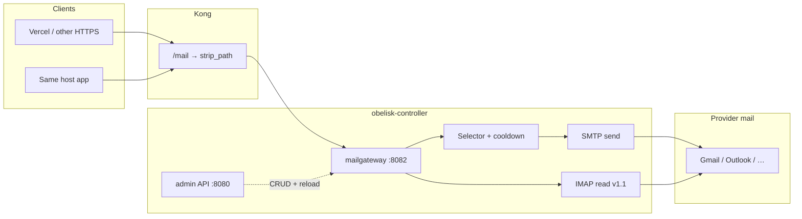

# Obelisk Mail Gateway

* **Author:** hsoni92
* **Status:** Proposed
* **Date:** 2026-11-14

--------------------------------------------------------------------------------

## Overview

Obelisk already exposes an **OpenRouter gateway**: the operator registers several upstream API keys, enables a single **gateway bearer token**, and client apps call one HTTP base URL (via Kong) while the controller picks keys in rotation. The **Mail gateway** applies the same pattern to **operator-owned mailboxes** (Gmail, Outlook, and other providers supported via Artemis-style host presets).

Client apps on Vercel, on the same VPS, or on a laptop send mail with a simple HTTP `POST`. **Read** (list and fetch messages over IMAP) is delivered in a follow-on stage on the same token and paths. Obelisk never exposes raw SMTP or IMAP on the public internet; only HTTP crosses Kong.

The feature is an **Exposure** concern on `obelisk-controller`, not a new Helm data service like Postgres.

### Glossary

| Term | Definition |
| --- | --- |
| **Exposure** | Admin UI section (with OpenRouter) for HTTP gateways exposed through Kong. |
| **Artemis** | Sibling project (`../artemis`); source for SMTP/IMAP host tables and send error mapping to port into Go. |
| **`{origin}`** | Public site URL clients use: VPS hostname + TLS as shown in admin, e.g. `https://my-vps.example.com`. |
| **Platform ready** | k3s platform chart healthy, Kong routing admin API, controller pod running (same bar as enabling OpenRouter). |

## The Problem

1. **Repeated mail setup:** Each side project configures SMTP/IMAP credentials, provider hostnames, and rotation logic on its own.
2. **Quota and reliability:** A single consumer mailbox hits daily send limits quickly; there is no central failover across spare accounts.
3. **Serverless mismatch:** Vercel and similar hosts cannot hold long-lived IMAP connections or store many provider secrets safely.
4. **No appliance-native mail surface:** OpenRouter solved multi-key HTTP proxying for LLMs; mail has no equivalent on Obelisk today.

**Proposed direction:** A versioned HTTP mail API behind Kong, mailbox pool in admin UI, secrets in a sidecar credentials file, and SMTP/IMAP only on the controller—mirroring `internal/openroutergateway` and Artemis send/read libraries.

## Goals

* **G1 — Gateway enablement:** Operator enables mail gateway, rotates bearer token, sees public base URL `{origin}/mail/api/v1`.
* **G2 — Mailbox pool (v1.0):** Add, enable, disable, and remove up to ~10 mailboxes; **SMTP AUTH validation only** on add; reject duplicates and unsupported domains.
* **G3 — HTTP send (v1.0):** `POST /mail/api/v1/send` with optional `account_id`, `text` and/or `html` only (no attachments in v1.0); response includes `account_id` and `from`.
* **G4 — Pool send routing:** Round-robin with failover when no `account_id`; optional pinned sender when `account_id` is set.
* **G5 — Remote consumers:** Any HTTPS client with the gateway token (including Vercel serverless).
* **G6 — Provider presets (v1.0):** Inline Go SMTP presets for **gmail.com, googlemail.com, outlook.com, hotmail.com, live.com, yahoo.com** (ported from Artemis); expand in v1.1 with IMAP table.
* **G7 — Admin test send:** Test from Exposure UI without reading server logs.
* **G8 — HTTP read (v1.1):** List and get messages per `account_id` via IMAP on the controller.
* **G9 — Rate limits:** Kong rate limiting and request size limits on `/mail` (stricter than OpenRouter).

## Non-Goals

* **NG1:** Raw SMTP/IMAP TCP proxy on public ports.
* **NG2:** Artemis per-user mailbox nodes or shared vault coupling.
* **NG3:** Merged inbox across all pool accounts.
* **NG4:** Long-term message storage on the appliance (Postgres/RustFS archive) in v1.
* **NG5:** IMAP IDLE, webhooks, or push notifications in v1.
* **NG6:** OAuth login for Gmail/Outlook in v1 (app passwords only).
* **NG7:** Bulk marketing, list management, or deliverability guarantees.
* **NG8:** Full webmail UI; DKIM/SPF management on the appliance.
* **NG9:** Per-app API keys in v1 (one gateway token).
* **NG10:** Tailscale Funnel exposure for mail routes in v1 default policy.

## Open Questions

* **OQ2 (v1.1):** Go IMAP library and connect-per-request vs one warm connection per account (default: connect-per-request, 15s dial timeout).
* **OQ4 (v1.1):** List pagination cursor format (`uid` + `limit`).

**Closed decisions (review 2026-11-14):**

* **OQ1 — Credentials on k3s:** Store `mail.credentials.json` and `openrouter.credentials.json` under **`/var/lib/obelisk/credentials/`** (writable hostPath volume). Read-only `obelisk.yaml` stays under `/etc/obelisk`. Controller resolves sidecar path via config loader; Helm adds mount + init ensure dir `0700`. Same fix applies to OpenRouter.
* **OQ3 — Failover duplicates:** Clients may send optional `Idempotency-Key` header (or JSON field). Gateway keeps in-memory TTL map (24h) of key → outcome. **Without a key:** failover to next mailbox only on connection/auth errors before SMTP `250`; **no** failover after ambiguous accept. With key: at most one successful send per key.
* **OQ5 — Observability v1.0:** Log fields: `mail_send`, `account_id`, `provider`, `outcome`, `duration_ms`, `recipient_domain`. Admin `runtime`: `enabled`, `configured`, `enabled_account_count`, `last_account_id` (match OpenRouter).

## Critical User Journeys (CUJs)

### CUJ 1: Enable gateway and send from an app

* **Given:** Platform ready; operator has a Gmail app password.
* **When:** Operator enables mail gateway, adds mailbox, copies token and `POST /mail/api/v1/send` example; app on Vercel sends transactional mail.
* **Then:** HTTP 2xx with `account_id` and `from`; message appears in recipient inbox (provider permitting).

### CUJ 2: Pool spreads send across mailboxes

* **Given:** Three enabled mailboxes in the pool.
* **When:** App sends ten messages without `account_id`.
* **Then:** Sends rotate across accounts per policy; a single account suspension does not block all sends if others are healthy.

### CUJ 3: Read message for OTP (v1.1)

* **Given:** Mail arrived at a known `account_id`.
* **When:** App calls list then get for that account with the gateway token.
* **Then:** Message body returned within **30s** request budget; secrets do not appear in error text.

### CUJ 4: Rotate compromised token

* **Given:** Gateway token was leaked.
* **When:** Operator regenerates token in admin UI and updates app env.
* **Then:** Old token returns 401; new token works for send and read.

## Technical Plan (Architecture)

### Design principles

1. **Three-layer split** (same as OpenRouter): metadata in `obelisk.yaml`, secrets in `mail.credentials.json`, data plane on a dedicated controller listen port.
2. **HTTP at the edge only:** Kong terminates TLS and applies rate limits; controller speaks SMTP/IMAP upstream.
3. **Stateless send proxy:** No local mail spool in v1.0; accepted means SMTP upstream took the message.
4. **Read is account-scoped:** Every read route includes `account_id`; no pool-wide inbox.
5. **Staged delivery:** v1.0 ships send + admin + Kong; v1.1 adds IMAP list/get on the same `/mail/api/v1` prefix.

### Logical components

| Component | Responsibility |
| --- | --- |
| **`pkg/obelisk/mail.go`** | `MailGateway`, `MailAccount`, normalize, validate, duplicate address detection |
| **`internal/mail/credentials.go`** | Load/save `mail.credentials.json` (gateway token + per-account secrets) |
| **`internal/mail/providers.go`** | Domain → SMTP/IMAP host/port/TLS (ported from Artemis TS tables) |
| **`internal/mail/validate.go`** | SMTP AUTH + IMAP login probes on admin add |
| **`internal/mailgateway/`** | HTTP handler, bearer auth, send path, selector (round-robin + failover), v1.1 read handlers |
| **`internal/adminapi/mail.go`** | CRUD, token rotate, test send, config response with runtime status |
| **`cmd/obelisk-controller`** | `-mail-gateway-listen` (default `:8082`), reload on spec/creds change |
| **Kong** | Route `/mail` → controller `:8082`, `strip_path: true`, rate-limit + body size plugins |
| **Admin UI** | `mail-panel.tsx` under Exposure (clone OpenRouter panel patterns) |

### Architecture diagram



### Data plane API (v1.0 send)

Base URL for clients: `{origin}/mail/api/v1`  
Auth: `Authorization: Bearer <gateway_token>`

| Method | Path | Purpose |
| --- | --- | --- |
| `POST` | `/send` | Send one message |

**Send request (JSON):**

- `to` (required): string or array of strings
- `subject` (required)
- `text` and/or `html`
- `account_id` (optional): pin sender; omit for pool rotation
- `failover` (optional, default false when pinned): allow pool fallback
- `idempotency_key` (optional): dedup across failover (see OQ3)

**Send response (JSON):**

- `account_id`, `from`, `accepted: true`
- On failure: HTTP 4xx/5xx with `{ "error", "retry_after"? }` — no secrets in body

### Data plane API (v1.1 read)

| Method | Path | Purpose |
| --- | --- | --- |
| `GET` | `/accounts/{account_id}/messages` | List envelopes (`uid`, `from`, `subject`, `date`, flags) |
| `GET` | `/accounts/{account_id}/messages/{uid}` | Full body; optional `include_attachments=true` with size cap |

Query params for list: `limit` (default 20, max 100), `unseen_only` (default false).

### Control plane API (admin)

Mirror OpenRouter routes under `/api/v1/mail/`:

- `GET/PATCH /config` — enable, regenerate token
- `POST/PATCH/DELETE /accounts`
- `POST /test` — SMTP test send (and IMAP probe when read ships)

### Spec and credentials

```yaml
mail_gateway:
  enabled: false
  accounts:
    - id: mail-1730000000
      label: "Main Gmail"
      enabled: true
      address: user@gmail.com
      provider: gmail   # preset key; optional smtp_host/imap_host override later
      notes: ""
```

`mail.credentials.json` (mode `0600`):

```json
{
  "gateway_token": "obk_…",
  "accounts": {
    "mail-1730000000": { "secret": "app-password" }
  }
}
```

Password is one field when SMTP and IMAP use the same app password (Artemis default).

### Send routing

- **Selector** maintains enabled accounts with credentials; **Next()** advances a persistent cursor file under `/var/lib/obelisk/mail_gateway.cursor`.
- **Failover:** on retryable SMTP errors (connection timeout, 4xx quota from provider, auth failure on one account), try next account in rotation order; document risk of duplicate send on ambiguous failures.
- **Cooldown:** mark account unhealthy until `retry_after` on rate-limit responses (in-memory + optional file stamp).

### Kong changes

Add service `mail-gateway` → `http://obelisk-controller:8082`, route path `/mail`, plugins:

- `rate-limiting`: **30 requests/minute** per client IP on `/mail` (OpenRouter has none; mail is write-heavy)
- `request-size-limiting`: **1 MB** JSON body (v1.0 text/html only)

### Helm / controller

- New container port `8082`, arg `-mail-gateway-listen=:8082`.
- **Credentials mount:** writable `hostPath` at `/var/lib/obelisk/credentials` (see OQ1); NetworkPolicy: only Kong pod may reach controller `:8082`.

### Observability (v1.0 minimum)

Structured log line per send: `account_id`, provider preset, outcome, duration_ms, recipient domain (not full address if treated as PII). Admin config response includes `runtime` block: `enabled`, `enabled_account_count`, `last_account_id` (like OpenRouter).

### Implementation sequencing

| Slice | Contents |
| --- | --- |
| M0 | Spec, schema, credentials, admin CRUD, no public send |
| M1 | Send handler + selector + bearer auth on `:8082` |
| M2 | Kong route + runbook `docs/runbooks/mail-gateway.md` |
| M3 | Admin Exposure panel + test send |
| M4 | IMAP read handlers (v1.1) |
| M5 | Optional `wait-for-mail` long-poll helper (v1.1+) |

### Testing

- **Unit:** provider map golden tests vs Artemis TS fixtures; selector rotation; credential redaction; spec validation.
- **Manual:** operator mailbox smoke test; Kong path curl with bearer.
- **CI:** no live provider in CI unless mailhog added later.

## Non-Functional Requirements

* **Security:** One gateway token grants send (v1.0) and read (v1.1) for all pool mailboxes—document as high-privilege; rotate via admin UI. Bearer compare uses constant-time compare. Production blocks direct `:8082` except from Kong (NetworkPolicy).
* **Latency (v1.0):** Send p95 target **30s** end-to-end; admin SMTP test **45s** max.
* **Scale:** Single controller replica for v1; pool ≤10 accounts; operator transactional volume only.
* **Availability:** Send failover across accounts on connection/auth failures only; see OQ3 for duplicate policy.
* **Kong limits:** 30 req/min/IP, 1 MB body (see Technical Plan).

## Risks and mitigations

| Risk | Mitigation |
| --- | --- |
| Leaked gateway token | Kong rate limit; runbook rotation; no browser-exposed token |
| Provider daily quota | Document per-provider caps in runbook; skip account when provider returns rate-limit class errors |
| k3s credentials not writable | OQ1 path under `/var/lib/obelisk/credentials` |
| Duplicate send on failover | OQ3 idempotency + no post-250 failover |
| App password deprecation (Google/Microsoft) | NG6; runbook warns; OAuth deferred v2 |
| Controller restart loses cooldown | v1.0 in-memory cooldown acceptable; file-backed health deferred |
| Spam/abuse from Vercel | Rate limit + recipient validation (RFC5322 parse, reject obvious malformed) |

--------------------------------------------------------------------------------

## Alternatives Considered

| Alternative | Why rejected |
| --- | --- |
| **Third-party API only (Resend, SendGrid, Mailgun)** | Rejected by author: wants to use existing consumer mailboxes on the appliance without a separate SaaS bill for every project. |
| **Separate mail microservice or Helm workload** | Rejected by author: duplicates deploy and auth; OpenRouter-style co-location on `obelisk-controller` matches the appliance model. |
| **Raw SMTP/IMAP TCP proxy through Kong** | Rejected by author: bypasses bearer auth and rate limits; harder to observe and abuse-harden. |
| **Shared inbox read API (pool-wide list)** | Rejected by author: callers need explicit `account_id` for OTP and multi-mailbox workflows. |
| **Single release with full send + read + wait-for-mail** | Rejected after review: IMAP client work in Go is large; send ships first, read follows on same token and paths. |
| **Node sidecar running Artemis `imapflow`/`nodemailer`** | Rejected by author: splits runtime languages on controller; port provider behavior to Go with parity tests. |
| **Persist all messages in RustFS or Postgres** | Rejected for v1: turns gateway into a mail store with retention and compliance obligations. |
| **Use OpenRouter’s account iteration as round-robin** | Rejected: current gateway snapshot order is failover-biased; mail needs a real rotation cursor and explicit `from` in responses. |
| **Multi gateway token per app in v1** | Deferred (not rejected): one token keeps parity with OpenRouter; per-app scopes are v2. |

## Detailed Implementation

### Unified work list

1. Add `mail_gateway` to spec, schema, defaults, and config validation.
2. Implement credentials sidecar load/save and gateway token generation.
3. Port v1.0 SMTP presets (six domains) to `internal/mail/providers.go` with golden tests vendored from Artemis tables.
4. Implement mailbox validation (**SMTP AUTH only** in v1.0).
5. Implement `internal/mailgateway` HTTP server: bearer auth, `POST /api/v1/send`, selector with cursor file under `/var/lib/obelisk/`.
6. Wire admin API CRUD, config patch, test send, gateway reload.
7. Add controller second gateway listener `:8082` and reload hooks on admin mutations and config PUT fix if needed.
8. Update Kong dbless + Helm controller Service ports and args.
9. Add admin Exposure panel + RTK API endpoints.
10. Write operator runbook and fix k3s writable credentials path (shared with OpenRouter).
11. v1.1: IMAP list/get handlers on same server.

### Files to create

| File | Rationale |
| --- | --- |
| `pkg/obelisk/mail.go` | `MailGateway`, `MailAccount`, `NormalizeMail`, `ValidateMail`, duplicate email finder |
| `pkg/obelisk/mail_test.go` | Normalization and validation unit tests |
| `internal/mail/credentials.go` | `mail.credentials.json` load/save, path beside config, atomic write mode 0600 |
| `internal/mail/providers.go` | Static domain maps from Artemis `smtp-hosts.ts` / `hosts.ts` |
| `internal/mail/providers_test.go` | Golden domain fixtures matching Artemis |
| `internal/mail/validate.go` | SMTP and IMAP connectivity probes for admin add/test |
| `internal/mail/smtp_send.go` | v1.0: text/html MIME via stdlib `net/smtp` + `mime` |
| `internal/mailgateway/server.go` | mux, auth, enabled flag, reload from spec+creds |
| `internal/mailgateway/send.go` | Parse send JSON, invoke selector + smtp_send |
| `internal/mailgateway/selector.go` | Round-robin + failover; cursor persisted under `/var/lib/obelisk/` |
| `internal/mailgateway/selector_test.go` | Rotation and empty-pool behavior |
| `internal/adminapi/mail.go` | Admin handlers mirroring `openrouter.go` |
| `web/admin/components/exposure/mail-panel.tsx` | Operator UI |
| `docs/runbooks/mail-gateway.md` | Enable, token, curl examples, limits, troubleshooting |

### Files to modify

| File | Rationale |
| --- | --- |
| `pkg/obelisk/spec.go` | Add `MailGateway` field to `Spec`; default in `DefaultSpec()` |
| `internal/config/load.go` | Call `NormalizeMail` and `ValidateMail` on load |
| `internal/adminapi/server.go` | Register mail routes; hold `*mailgateway.Server`; `reloadMailGateway()` |
| `cmd/obelisk-controller/main.go` | Start mail gateway listener; flag `-mail-gateway-listen` |
| `Makefile` | `MAIL_GATEWAY_LISTEN ?= :18082` for local dev |
| `deploy/kong/kong-dbless.yaml` | Service + route `/mail`, rate-limit and size plugins |
| `deploy/helm/platform/files/kong-dbless.yaml` | Same as dev Kong file |
| `deploy/helm/platform/templates/controller.yaml` | Port 8082, args, optional writable creds volume |
| `schemas/obelisk.yaml.schema.json` | `mail_gateway` object schema |
| `web/admin/lib/store/obelisk-api.ts` | RTK queries/mutations for `/api/v1/mail/*` |
| `web/admin/lib/types.ts` | `MailConfigResponse`, `MailAccountView` types |
| `web/admin/app/page.tsx` | Render `MailPanel` in Exposure section |
| `web/admin/lib/api.ts` | Re-export hooks if used by page |
| `docs/designs/SITEMAP.md` | Already lists `mail_gateway.md` |

### Files unchanged but referenced

| File | Role |
| --- | --- |
| `internal/openroutergateway/*` | Template for server auth, reload, status |
| `internal/openrouter/credentials.go` | Template for sidecar file pattern |
| `internal/adminapi/openrouter.go` | Template for admin CRUD and token regen |
| `web/admin/components/exposure/openrouter-panel.tsx` | Template for UI layout |
| Artemis `ui/lib/notifications/smtp-hosts.ts` | Source for provider port/TLS table |
| Artemis `ui/lib/mail/hosts.ts` | Source for IMAP table (v1.1) |

### Admin API contract (v1.0 — matches OpenRouter field names)

`GET /api/v1/mail/config` → `MailConfigResponse`:

- `enabled`, `gateway_token_configured`, `gateway_public_path` (`/mail/api/v1`), `gateway_direct_path`, `gateway_local_base_url` (for test UI, e.g. `http://127.0.0.1:18082`)
- `accounts`: `{ id, label, enabled, address, provider, has_secret, notes }`
- `runtime`: `{ enabled, configured, last_account_id, enabled_account_count }`

`PATCH /api/v1/mail/config` — `enabled?`, `regenerate_gateway_token?` (returns `{ gateway_token }` once)

`POST /api/v1/mail/accounts` — `{ label, address, secret }` → `{ account }` or `409 duplicate_address`

`PATCH/DELETE /api/v1/mail/accounts/{id}` — same shape as OpenRouter account patch (label, enabled, notes, secret rotation)

`POST /api/v1/mail/test` — `{ gateway_url?, to? }` default `to` = first account self-address; returns `{ ok, message, error?, from?, account_id? }`

Account ids: `mail-<unix_nano>` (parallel `or-<unix_nano>`).

### Error handling contract

- `401` invalid/missing bearer
- `503` gateway disabled or no enabled accounts
- `404` unknown `account_id` on read
- `413` body too large (>1 MB)
- `409` duplicate mailbox address on admin add (`duplicate_address`, `existing_account_id`)
- `422` unsupported provider domain or validation failed on add
- Error JSON: `{ "error": "human message" }` — strip app passwords from upstream SMTP/IMAP errors (Artemis `publicMailError` behavior)

### Security checklist for implementation

- Constant-time bearer compare
- Never log secrets or full message bodies at info level
- Kong rate limit on `/mail` only (direct `:8082` access blocked by network policy in prod doc)
- Document token blast radius in runbook