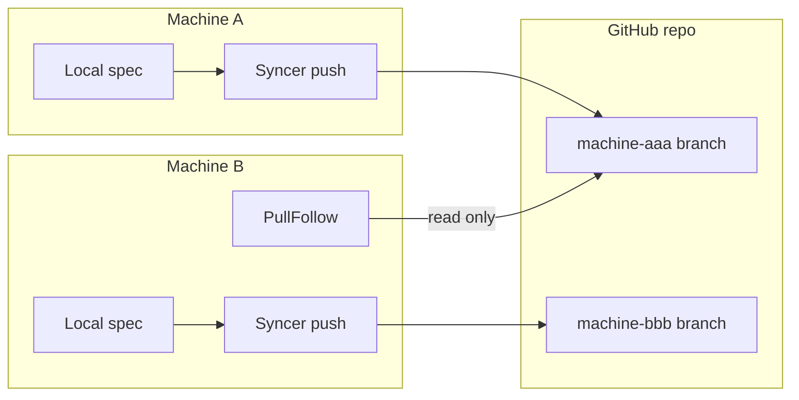

# Multi-machine blueprint (single repo, branch-per-machine)

* **Author:** hsoni92
* **Status:** Proposed
* **Date:** 2026-11-20

--------------------------------------------------------------------------------

## Overview

Obelisk mirrors encrypted desired state to a private GitHub repository per appliance. Operators often use **one GitHub login** for a home box and a VPS. Today every appliance defaults to the same repository and **`main` branch**, so a second machine can overwrite the first machine's bundle. This design keeps **one shared repository** (default `login/obelisk-appliance`) and gives each appliance its **own git branch** as its push upstream (`machine-` + full `machine.id`). Optional **`blueprint.follows[]`** entries let an appliance **pull** settings from another branch on demand without changing where it pushes.

This document **amends** [github_encrypted_blueprint.md](./github_encrypted_blueprint.md): single-writer semantics apply **per branch**, not per repository only. OAuth, bundle format, and push-only mirror rules stay the same unless stated here.

## The Problem

1. **Shared `main` causes data loss:** `Spec.Blueprint.GitHub` carries one repository and branch. Defaults resolve to `obelisk-appliance` on `main`. When a new appliance has generation 0, `localNeverSynced` skips the remote-ahead check in `internal/blueprint/sync.go`, so it can push over another machine's encrypted bundle on the same ref.

2. **Discovery steers the wrong machine:** Onboarding and `attachRemote` probe `main` when the branch is unset. A new host sees another machine's bundle and enters import/restore flows before it has its own branch.

3. **Operator constraint:** The author wants **one repository per login**, not one repository per machine.

4. **Follow without repointing upstream:** Operators want to copy or track another machine's profile while still pushing to their own branch and keeping their own `machine.id` and backup bucket.

## Goals

* **G1 — Branch isolation:** Each appliance's default upstream is `machine-` + full `machine.id` in the shared repo; pushes never target another machine's branch by default.

* **G2 — No clobber on misconfiguration:** If two appliances share a branch, refuse push (including force push) when remote `manifest.machine_id` differs from local and the operator has not chosen adopt/DR recovery (reuse import vocabulary).

* **G3 — Brownfield migration:** On controller upgrade, when local branch is `main`, remote `main` bundle matches local `machine.id`, auto-repoint to `machine-<machine.id>` with a one-time push; leave `main` unchanged.

* **G4 — Follow list (v1):** Manual pull-only `follows[]`; same fleet passphrase / matching `key_id`; optional `include_secrets`; PullFollow keeps local upstream and identity.

* **G5 — Correct status:** Remote probes and cache keyed by `(repository, branch)`; onboarding sets branch before probing another machine's `main` bundle.

* **G6 — Operator surfaces:** Machines & Following UI; API and CLI parity for follow add/pull/remove and extended status.

## Non-Goals

* **NG1:** Multiple GitHub repositories per login for isolation (author rejected).

* **NG2:** `AutoFollow` or background scheduled pull from followed branches (v2).

* **NG3:** Folder-per-machine tree on `main` (`machines/<id>/…`) without per-machine branches.

* **NG4:** Branch listing API or `registry.json` on `main` for fleet discovery (v2).

* **NG5:** Multi-writer push to the same branch.

* **NG6:** Per-branch deploy keys or GitHub rulesets (v2 hardening).

* **NG7:** Full structured logging / metrics work in this release (design note only; follow-up).

* **NG8:** Cross-key follow (different `key_id` / passphrase from source) in v1.

## Open Questions

* **OQ1 — Auto-migration failure:** **Resolved:** retry migration push on each controller start until success or operator fixes OAuth; surface failure in `sync_status` / `last_push_error`.

* **OQ2 — Field merge on PullFollow:** Default v1 merge = all spec fields except `machine`, `backup` remote identity, and `blueprint.github` upstream. Tighten to explicit allowlist in implementation if review flags risk.

* **OQ3 — Fleet status polling:** **Resolved:** Machines & Following page uses **30s** poll; existing single blueprint panel may stay at 5s until unified.

## Critical User Journeys (CUJs)

### CUJ 1: Second machine onboard (same login)

* **Given:** Machine A already pushes to `hsoni92/obelisk-appliance` on branch `machine-obelisk-aaa…` with generation ≥ 1.
* **When:** Operator signs in on Machine B with the same GitHub account and completes onboarding with default repo.
* **Then:** Machine B sets branch to `machine-obelisk-bbb…`, probes only that ref, pushes gen 1 without modifying Machine A's branch; S3 bucket names differ by `machine.id`.

### CUJ 2: Misconfigured shared branch

* **Given:** Machine B is mistakenly configured with Machine A's branch; remote manifest `machine_id` is A; local is B; B has never successfully pushed.
* **When:** Operator triggers save or push.
* **Then:** Push is refused with adopt/DR messaging; no overwrite of A's bundle; force push is also refused.

### CUJ 3: Add follow and manual pull

* **Given:** Machine B has its own branch and unlock; operator knows A's repo, branch, and uses the same passphrase.
* **When:** Operator adds follow `home-desktop`, then runs Sync now.
* **Then:** Settings (and secrets if enabled) apply from A's branch; B's `blueprint.github` repository and branch unchanged; B's `machine.id` and backup destination unchanged.

### CUJ 4: Upgrade from `main`

* **Given:** Single-machine install on `main` with remote manifest `machine_id` matching local; generation ≥ 1.
* **When:** Controller upgrades to version with this feature.
* **Then:** Local branch updates to `machine-<machine.id>`; bundle pushes to new ref once; `main` left as-is; sync continues on new branch.

--------------------------------------------------------------------------------

## Technical Plan (Architecture)

### Topology

One private GitHub repository per OAuth login (default name `obelisk-appliance`). Each Obelisk appliance is a **single writer** to exactly one branch. The `main` branch is not the default machine upstream after this change; it may hold only an initial README from `EnsureRepo` auto-init.

```text
  login/obelisk-appliance
  ├── main                      (README / legacy; not default machine upstream)
  ├── machine-obelisk-aaa…      ← Machine A pushes here
  └── machine-obelisk-bbb…      ← Machine B pushes here
```



### Spec data model

Extend `pkg/obelisk.Blueprint`:

```text
Blueprint
  GitHub     BlueprintGitHub   // this appliance upstream (repo + branch); unchanged role
  Follows    []BlueprintFollow // local-only follow metadata (v1)
```

`BlueprintFollow` fields (yaml/json):

| Field | Purpose |
| --- | --- |
| `name` | Operator label (e.g. `home-desktop`) |
| `repository` | Owner/name of source repo (usually same shared repo) |
| `branch` | Source machine branch (e.g. `machine-obelisk-aaa…`) |
| `include_secrets` | When true, merge decrypted secrets; default false |
| `last_sync_at`, `last_commit_sha`, `sync_status`, `last_error` | Bookkeeping (excluded from content hash) |

Helper: `BlueprintUpstreamBranch(machineID string) string` returns `machine-` + `machineID` after validating `machine.id` format.

`NormalizeBlueprint`:

* When `repository` is set and `branch` is empty on a **new** spec, default branch is **not** `main`; use `BlueprintUpstreamBranch(machine.id)` once `machine.id` is present.
* Dedupe `follows` by `(repository, branch)`; trim strings; default `branch` on follow entries to `main` only when repository is set and branch omitted (explicit per-follow).

`canonicalBytes` / `ContentHash` (`internal/blueprint/bundle.go`): extend the zeroed-field list so changes to `blueprint.follows[]` and per-follow sync timestamps do not change the content hash (same pattern as `blueprint.github` sync fields).

### Branch and onboard flow

1. After GitHub sign-in, `Onboard` calls `EnsureRepo` (unchanged). Empty `repository` still resolves to `login/obelisk-appliance`.
2. Empty `branch` → `BlueprintUpstreamBranch(spec.Machine.ID)` (not `main`).
3. Write `repository`, `branch`, KDF fields, generation 0 → `PushNow`.
4. Admin onboard UI stops sending hardcoded `branch: "main"`; display resolved `machine-…` branch read-only.

Before any remote probe during onboard or first boot, local spec must already carry the machine branch so `attachRemote` does not read another machine's bundle on `main`.

### Upgrade migration (G3)

On controller start (or first blueprint loop tick after upgrade), run `maybeMigrateMainBranch(ctx)`:

1. Load spec. Skip if `follows`/migration already completed (use a persisted flag on spec or infer: `branch` already equals `BlueprintUpstreamBranch(machine.id)`).
2. If `branch` is empty or `main`, fetch `main` manifest only when needed.
3. If remote present and `manifest.machine_id == spec.Machine.ID`, set `branch` to `BlueprintUpstreamBranch(machine.id)`, `PushNow` once, leave `main` untouched.
4. On push failure: set `sync_status` failed, store sanitized error, **retry on next start** (addresses OQ1 direction: retry until success or operator fixes OAuth).
5. If remote `machine_id` differs or `main` holds another machine's bundle: do **not** auto-migrate; expose existing import/adopt status.

### Push path and clobber guard

In `Syncer.push` after successful remote fetch, before `localNeverSynced` bypass:

* If `remote.MachineID != ""` && `remote.MachineID != spec.Machine.ID` && (`localNeverSynced(spec)` || force): return new error `ErrMachineIDClobber` (or wrap `ErrImportRequired` with machine-specific message). Do **not** call `fail` in a way that suppresses the error for never-synced hosts.
* Apply the same check for `ForcePush`.

Generation-ahead logic stays per branch (existing `Fetch`/`Push` already pass branch).

### PullFollow

New method `Runtime.PullFollow(ctx, name, passphrase)`:

1. Resolve follow entry by `name`; require unlock or passphrase.
2. `Git.Fetch(repository, branch)` from follow entry.
3. Decrypt with session key; verify manifest `key_id` matches local unlock key (v1).
4. Merge into local spec using **`choice=keep`** for `machine.id` and backup destination fields; merge deployment/instances/openrouter/mail fields per allowlist (OQ2 — default: all non-blueprint, non-machine, non-backup fields from decrypted spec).
5. **Do not** set `applied.Blueprint.GitHub.Repository` / `Branch` from fetch target (contrast `Import` at `runtime.go` ~375–376).
6. Update follow bookkeeping fields only; save spec; optionally `Nudge` push to own branch after local merge (generation bump reflects local change).

Add-follow API validates by trial fetch+decrypt before persisting the follow row.

### Remote probe and status

Change `probeCache` key from repository string to `repository + "\x00" + branch` (or struct key). `attachRemote` uses `spec.Blueprint.GitHub.Branch` with fallback through `BlueprintUpstreamBranch`, never implicit `main` when machine id is set.

Extend `Status` JSON with `follows[]` mirror of local spec (name, repo, branch, sync fields) and top-level `branch` in machine-readable form.

### HTTP API (v1)

| Method | Path | Body | Behavior |
| --- | --- | --- | --- |
| POST | `/api/v1/blueprint/follow` | `{name, repository, branch?, passphrase, include_secrets?}` | Validate decrypt; append follow |
| POST | `/api/v1/blueprint/follow/pull` | `{name?}` | Pull one or all follows |
| DELETE | `/api/v1/blueprint/follow/{name}` | — | Remove metadata |
| GET | `/api/v1/blueprint/status` | — | Extended status (existing route) |

CLI: `obelisk blueprint follow add|pull|list|rm` mirroring the same operations.

### Admin UI

* **Onboard:** show resolved upstream branch (read-only); shared repo field still editable.
* **Platform → Blueprint:** split **This machine** (repo, branch, gen, push/lock) and **Following** (list, Sync now, remove, include_secrets indicator). Poll interval **30s** on this page (OQ3 default) vs 5s on legacy panel if unchanged.

### Relationship to prior blueprint design

| Prior assumption | This design |
| --- | --- |
| One appliance home branch `main` | Default upstream `machine-<machine.id>` |
| NG5 multi-writer | Still single writer **per branch** |
| NG1 no silent pull | Follow pull is explicit operator action only |

--------------------------------------------------------------------------------

## Alternatives Considered

### Alternative A: One GitHub repository per machine

* **Pros:** Clearest ownership in the GitHub UI; no branch naming; probe cache stays one ref per repo.
* **Cons:** N private repos per login; noise in repo list; duplicate `EnsureRepo` and operator cognitive load.
* **Reason for Rejection:** Rejected by author: does not want multiple repositories under one login.

### Alternative B: One repository, one branch per machine (chosen)

* **Pros:** Reuses existing `branch` through `Fetch`, `Push`, `Import`, and `ChainPull`; one `EnsureRepo`; matches `machine.id`-per-bucket model; isolation without extra repos.
* **Cons:** Operators must learn branch = appliance; GitHub branch list grows; status must be branch-scoped.
* **Reason for Selection:** Best fit for stated constraint and smallest change set.

### Alternative C: Folder per machine on `main` (`machines/<id>/manifest.json`, …)

* **Pros:** Single branch to browse on GitHub; all machines visible in one tree.
* **Cons:** Requires path-prefix support in `getFile` / push tree layout in `internal/blueprint/github.go`; more invasive than branch parameter already present.
* **Reason for Rejection:** Rejected for v1: higher implementation cost for the same isolation goal.

### Alternative D: Branch names with slashes (`machine/<machine.id>`)

* **Pros:** Hierarchical naming.
* **Cons:** `url.PathEscape` on branch in ref API can produce `%2F` and 404 against GitHub refs endpoints.
* **Reason for Rejection:** Rejected: flat `machine-obelisk-…` names avoid ref handling bugs.

### Alternative E: Defer `follows[]`; cross-branch Import only

* **Pros:** Smaller v1; reuses `Import` with optional `branch` query/body; no ongoing mirror semantics.
* **Cons:** No first-class “following” status; each copy is a one-shot DR-style import; overwrites upstream fields unless carefully coded.
* **Reason for Rejection:** Rejected for this release: author wants persistent follow list with manual pull and preserved own upstream.

### Alternative F: `registry.json` on `main` mapping machines to branches

* **Pros:** Single fetch for fleet discovery on DR login; central index of generations.
* **Cons:** Extra writes to `main`; merge conflicts on registry; new consistency story.
* **Reason for Rejection:** Deferred to v2: not required to stop clobber; branch naming convention is enough for v1.

--------------------------------------------------------------------------------

## Non-Functional Requirements

### Security and privacy

* Follow pull never pushes to the source branch; OAuth token scope unchanged.
* Follow add performs trial decrypt server-side; passphrase only in request body over existing admin TLS.
* Clobber guard prevents cross-`machine_id` overwrite on shared refs, including force push.

### Performance and GitHub quota

* Probe cache TTL remains ~30s but keyed by `(repository, branch)`; invalidate on successful push to own branch.
* Machines & Following page: **30s** poll (not 5s).
* No batch branch listing in v1 (operator supplies follow target).

### Rollout and rollback

* Additive yaml/json fields; older controllers ignore `follows` if unknown (yaml) but may strip on round-trip — **minimum controller version** called out in runbook.
* Rollback: downgrade only safe if migration has not run or branch still `main`; after migration, older binary may push to wrong ref — document “do not downgrade past migration without manual branch check.”
* Feature ships without feature flag; migration runs automatically when version detects matching `main` bundle.

--------------------------------------------------------------------------------

## Detailed Implementation Plan

Build in two phases: **(A)** branch isolation + migration + guards; **(B)** follows + UI.

### Target Files to Create/Modify

#### 1. `pkg/obelisk/blueprint.go` (Modify)

* **Type / Scope:** Shared spec types.
* **Proposed Changes:** Add `BlueprintFollow` struct and `Follows []BlueprintFollow` on `Blueprint`. Add `BlueprintUpstreamBranch(machineID string) (string, error)` and `DefaultUpstreamBranchFor(machineID string) string`. Change `NormalizeBlueprint` to default branch to upstream helper when repo set and branch empty (only when machine id present). Add `NormalizeFollows` dedupe/trim. Unit-testable pure functions.

#### 2. `pkg/obelisk/blueprint_test.go` (Create or Modify)

* **Type / Scope:** Unit tests.
* **Proposed Changes:** Table tests for branch naming, normalize defaults, follow dedupe, invalid machine id.

#### 3. `pkg/obelisk/spec.go` (Modify if needed)

* **Type / Scope:** Spec root.
* **Proposed Changes:** Ensure JSON/yaml tags on `Blueprint` remain backward compatible; no breakage to `RedactedSpec`.

#### 4. `schemas/obelisk.yaml.schema.json` (Modify)

* **Type / Scope:** Schema validation.
* **Proposed Changes:** Document `blueprint.follows` array and nested fields; keep optional.

#### 5. `internal/blueprint/errors.go` (Modify)

* **Type / Scope:** Sentinels.
* **Proposed Changes:** Add `ErrMachineIDClobber` (or documented alias) with operator-facing message template including remote `machine_id`.

#### 6. `internal/blueprint/bundle.go` (Modify)

* **Type / Scope:** Pack/unpack/hash.
* **Proposed Changes:** Exclude `blueprint.follows` from canonical hash (walk spec copy and zero follows before hash). Ensure `RedactedSpec` / commit still omits secrets.

#### 7. `internal/blueprint/bundle_test.go` (Modify)

* **Type / Scope:** Unit tests.
* **Proposed Changes:** Assert content hash unchanged when only follow metadata changes.

#### 8. `internal/blueprint/sync.go` (Modify)

* **Type / Scope:** Push loop.
* **Proposed Changes:** Default branch via `BlueprintUpstreamBranch` not `main` when spec has machine id. Machine-id clobber guard before `localNeverSynced` bypass. Same in `ForcePush` path. Adjust `fail()` so clobber errors always surface in `last_push_error`.

#### 9. `internal/blueprint/sync_test.go` (Modify)

* **Type / Scope:** Unit tests.
* **Proposed Changes:** Replace or supplement overwrite-on-never-synced test with branch-isolation cases; add clobber guard test; test force push blocked.

#### 10. `internal/blueprint/runtime.go` (Modify)

* **Type / Scope:** Orchestration.
* **Proposed Changes:** `Onboard` default branch; `maybeMigrateMainBranch` on start; `PullFollow`; `AddFollow` / `RemoveFollow` / `PullFollowByName`; probe cache key `(repo, branch)`; `attachRemote` branch resolution; extend `Status` with `Follows []FollowStatus`. Import optional `branch` override query for one-shot cross-branch copy (supporting DR without follows).

#### 11. `internal/blueprint/chain.go` (Modify)

* **Type / Scope:** Chained DR.
* **Proposed Changes:** Use upstream branch helper instead of hardcoded `main` fallback where spec branch empty and machine id set.

#### 12. `internal/blueprint/github.go` (Modify if needed)

* **Type / Scope:** GitHub client.
* **Proposed Changes:** None required for v1 unless verify-fetch needs branch in commit message only (optional message format includes branch).

#### 13. `internal/blueprint/github_fetch_test.go` (Modify if branch defaults touched)

* **Type / Scope:** Integration-style tests with httptest.
* **Proposed Changes:** Keep coverage; add case for non-`main` ref.

#### 14. `internal/adminapi/blueprint.go` (Modify)

* **Type / Scope:** HTTP handlers.
* **Proposed Changes:** Handlers for follow add/pull/delete; extend status JSON; import body optional `branch`; shared request validation.

#### 15. `internal/adminapi/server.go` (Modify)

* **Type / Scope:** Route table.
* **Proposed Changes:** Register `POST /api/v1/blueprint/follow`, `POST /api/v1/blueprint/follow/pull`, `DELETE /api/v1/blueprint/follow/{name}`.

#### 16. `internal/adminapi/blueprint_test.go` (Modify)

* **Type / Scope:** Handler tests.
* **Proposed Changes:** Follow CRUD happy path; key_id mismatch; status includes follows.

#### 17. `internal/config/load.go` (Modify if normalize hook needed)

* **Type / Scope:** Config load path.
* **Proposed Changes:** Ensure `NormalizeBlueprint` + machine identity order: call `EnsureMachineIdentity` before branch default if not already ordered.

#### 18. `cmd/obelisk-controller/main.go` (Modify)

* **Type / Scope:** Controller entry.
* **Proposed Changes:** Invoke migration hook once blueprint runtime starts (or inside `Runtime` constructor loop).

#### 19. `cmd/obelisk/blueprint_cmd.go` (Modify)

* **Type / Scope:** CLI.
* **Proposed Changes:** Subcommands `follow add`, `follow pull`, `follow list`, `follow rm`; document branch in status output.

#### 20. `cmd/obelisk/main.go` (Modify if usage string)

* **Type / Scope:** CLI root.
* **Proposed Changes:** Update blueprint usage help string.

#### 21. `web/admin/app/onboard/page.tsx` (Modify)

* **Type / Scope:** Onboard UX.
* **Proposed Changes:** Remove hardcoded `branch: "main"`; display server-resolved branch (read-only); optional follow block deferred to Machines page or minimal “add follow” stub post-onboard.

#### 22. `web/admin/components/blueprint/blueprint-panel.tsx` (Modify)

* **Type / Scope:** Existing blueprint UI.
* **Proposed Changes:** Show branch prominently; link to Machines & Following page.

#### 23. `web/admin/components/blueprint/machines-following.tsx` (Create)

* **Type / Scope:** New UI.
* **Proposed Changes:** This machine + Following sections per RFC; 30s poll; actions push/sync now/remove follow.

#### 24. `web/admin/components/platform/platform-settings.tsx` (Modify)

* **Type / Scope:** Platform nav.
* **Proposed Changes:** Embed or route to Machines & Following section under Blueprint.

#### 25. `web/admin/lib/store/obelisk-api.ts` (Modify)

* **Type / Scope:** API client.
* **Proposed Changes:** Methods for follow endpoints; extended status type.

#### 26. `web/admin/lib/types.ts` (Modify)

* **Type / Scope:** TypeScript types.
* **Proposed Changes:** `BlueprintFollowStatus`, extend `BlueprintStatus` with `follows` and ensure `branch` always shown.

#### 27. `web/admin/components/blueprint/restore-wizard.tsx` (Modify)

* **Type / Scope:** DR UX.
* **Proposed Changes:** Copy: branch-qualified import; avoid implying single `main` home.

#### 28. `docs/runbooks/github-blueprint.md` (Modify)

* **Type / Scope:** Operator docs.
* **Proposed Changes:** One repo many branches; migration from `main`; follow manual pull; passphrase fleet alignment.

#### 29. `docs/designs/github_encrypted_blueprint.md` (Modify)

* **Type / Scope:** Parent design.
* **Proposed Changes:** Short “Amended by multi_machine blueprint” pointer and supersede single-`main` default (do not rewrite whole doc).

#### 30. `internal/restore/orchestrator.go` (Modify if branch-aware)

* **Type / Scope:** Restore chain.
* **Proposed Changes:** Verify chain pull uses spec branch; align with `chain.go` helper.

#### 31. `internal/controller/reconcile.go` (Modify if startup migration)

* **Type / Scope:** Controller lifecycle.
* **Proposed Changes:** Only if migration not wired in Runtime start — prefer Runtime-owned hook.

### Verification Plan

* **Build:** `go test ./...` from repo root; `npm run build` in `web/admin` if UI touched.
* **Unit:** `go test ./internal/blueprint/... -count=1`; new tests for hash, normalize, sync clobber, migration decision logic (table-driven with mocked fetch).
* **Integration:** Test or script spinning two `Syncer` instances against one httptest GitHub double with two branches — second push does not alter first branch; clobber guard fires on same branch.
* **Manual:** Onboard two local controllers (or integration env) same OAuth login; verify two branches; follow pull preserves upstream; upgrade path from seeded `main` bundle.
* **Lint:** Existing CI golangci-lint / eslint on changed packages.

### Additional Resources

* [multi_machine_blueprint_concepts_brief.md](./multi_machine_blueprint_concepts_brief.md)
* [github_encrypted_blueprint.md](./github_encrypted_blueprint.md)

--------------------------------------------------------------------------------

*Drafted with EGM*