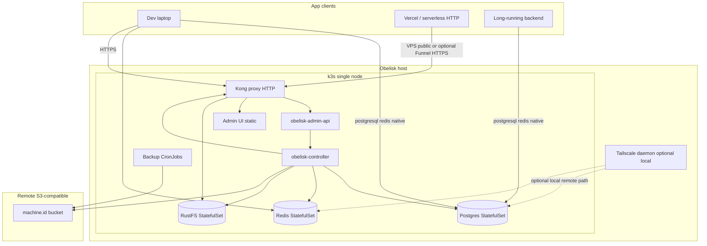

# Obelisk middleware appliance

* **Author:** hsoni92
* **Status:** Proposed
* **Date:** 2026-11-14

---

## Overview

Obelisk is a single-node middleware appliance for one indie developer. It hosts shared data services (Postgres, Redis, S3-compatible object storage) on the developer’s VPS or local machine. It does not run application code—apps stay on Vercel, Railway, a laptop, or elsewhere and connect over the network.

Install brings up the **platform** in about five minutes: k3s, Kong, backup/restore plumbing, and the admin UI. **Tailscale is optional** and is offered only on the **local machine** profile when the operator needs those services reachable from the broader internet without manual inbound setup. On a **VPS**, Tailscale is **not installed and not required**—the VPS’s own network address and Kong are the default reachability path.

Postgres, Redis, and RustFS start only when the operator enables them from the admin UI.

Apps use **native connection strings** (`postgresql://`, `redis://`) and **S3 HTTP** via hostnames/ports shown in the admin UI. On a VPS that is typically the VPS DNS name or public IP (with firewall rules the operator controls). On a local box without Tailscale, clients use LAN or localhost; with Tailscale enabled locally, clients use the tailnet when remote access is needed.

Object storage uses HTTP through Kong. **Tailscale Funnel** applies only when Tailscale is enabled (local profile, opt-in) and can expose the allowlisted RustFS S3 route—not Postgres or Redis on the public internet. On a VPS, equivalent public HTTP access uses Kong on the VPS interface instead of Funnel.

Control-plane state lives in `obelisk.yaml`. Reconcilers apply Kubernetes workloads, Kong routes, backup jobs, and Funnel policy. The admin UI edits desired state; it does not call Kong or the API server directly for every click.

## The Problem

Each side project today tends to repeat the same stack: Postgres, Redis, object storage, backups, and tunnel/VPN wiring. That duplicates work, wastes RAM on a small VPS, and makes disaster recovery a custom script per repo.

Obelisk concentrates that stack on **one box** with lazy enablement, built-in backup to S3/R2, and a restore path after hardware failure. The developer builds apps elsewhere and points them at stable URLs and secrets from the admin UI. Reachability depends on **deployment profile** (VPS vs local), not a mandatory VPN.

## Goals

* **Platform-ready install** on a single Linux node (documented minimum: 4 vCPU, 8 GB RAM) with **no data pods** until the operator starts them.
* **On-demand data services** in v1: Postgres, Redis, RustFS, Qdrant (vector DB), SearXNG (metasearch)—start/stop/restart from the admin UI with health and disk visibility.
* **Native protocol access** for OLTP/cache (`postgresql://`, `redis://` / `rediss://`) using the connection endpoints the UI publishes for the active deployment profile.
* **Deployment profiles:** **`vps`** — no Tailscale; VPS network + Kong. **`local`** — Tailscale **optional**; install offers it only when the operator needs internet reachability to services on a home/ LAN machine.
* **Kong** for HTTP only (admin API, RustFS S3 ingress, optional public edge on VPS); no Kong on the default path for Postgres/Redis wire traffic.
* **Tailscale Funnel** only when Tailscale is enabled (local, opt-in): allowlisted Kong route for RustFS S3 API; off after DR restore until re-enabled.
* **Built-in backup and restore** to operator-provided S3-compatible buckets (AWS S3, Cloudflare R2, etc.) for control-plane and data-plane artifacts.
* **Admin UI (v1)** across **Services** (per-instance lifecycle and connection strings), **DR** (remote target setup, test connection, manual backup), **Exposure** (Kong + optional Funnel), and **Platform** (`obelisk.yaml` editor when shipped), with CLI parity for lifecycle and backup (`obelisk service enable|disable`, `obelisk backup run`, `obelisk restore`).
* **Multi-project sharing** on one appliance: multiple app databases/schemas on one Postgres when services are running.
* **Reference DR narrative:** new machine → install → pull remote config → restore → previously running services healthy; Funnel remains off until explicitly turned on again.

## Non-Goals

* Hosting user application containers, CI, or deploy-from-Git.
* License server or entitlement product on this stack.
* Multi-node high availability or automatic failover.
* MongoDB, LanceDB, or usage metering on the appliance in v1 (Qdrant covers vector search in v1).
* Public exposure of Postgres or Redis (no Funnel, no open DB ports by default).
* Production `postgresql://` / `redis://` from Vercel-style serverless without a tailnet-attached backend.
* Public admin UI via Funnel in the v1 default policy.
* Arbitrary Helm marketplace or full GitOps framework in v1.

## Critical User Journeys (CUJs)

### CUJ 1: First platform install

* **Given:** Clean Ubuntu VPS, 4 vCPU / 8 GB; profile **`vps`** (no Tailscale).
* **When:** Operator runs `curl | bash` installer and opens admin UI via VPS hostname.
* **Then:** Platform Ready in ≤5 minutes; no Tailscale process; no data pods; `obelisk status` green for platform only.

### CUJ 2: Enable Postgres and connect from laptop

* **Given:** Platform-ready **VPS** appliance; operator workstation has network path to VPS (firewall allows client IP if restricted).
* **When:** Operator enables Postgres, creates a project, copies `postgresql://` URL (VPS host).
* **Then:** Client connects using native driver.

### CUJ 3: Local machine with optional Tailscale

* **Given:** Profile **`local`**; operator opted into Tailscale during install for remote access.
* **When:** Operator enables Redis and copies `redis://` from the service row in the admin UI.
* **Then:** Remote dev laptop on the same tailnet connects; without Tailscale, only LAN/localhost clients connect.

### CUJ 4: Configure remote backup and first upload

* **Given:** Platform ready; operator created two S3-compatible buckets (data + config) in R2 or AWS.
* **When:** Operator opens **DR**, notes **machine identity** (also the bucket name), creates that bucket in R2/S3, enters endpoint + API keys (Secret `obelisk-backup-remote`), runs **Test connection**, then enables a data service and clicks **Backup now** (or runs `obelisk backup run`).
* **Then:** Preflight write to `preflight/.write-test` succeeds; backup job is accepted; uploads land under `data/{type}/{instance}/` inside `s3://<machine.id>/`. Control-plane settings are not uploaded to S3; they are pushed as an encrypted GitHub blueprint ([github_encrypted_blueprint.md](./github_encrypted_blueprint.md)).

### CUJ 5: Disaster restore

* **Given:** The appliance previously pushed an encrypted blueprint to its private GitHub repo, and S3 `data/` for that `machine.id` is intact.
* **When:** Operator installs Obelisk on a fresh VPS, signs in with GitHub, unlocks with the blueprint passphrase, and runs chained restore (`pull_blueprint` → `unlock` → `apply_control` → `restore_data` → `reconcile_services`). If the new host already has a different `machine.id`, the operator chooses **adopt blueprint id** (restore that bucket) or **keep new id** (settings only).
* **Then:** Settings match the blueprint. Data objects under `data/` are restored when the blueprint id is adopted. Funnel stays off until re-enabled. The UI shows settings restored and data restored separately.

## Open Questions

* **G4-detail:** Backup encryption key escrow, retention defaults, partial-restore rollback (v1 uploads may be plaintext at rest; see Risks).
* **G9:** Confirm multi-app model remains **Option B** (per-app DB + dedicated role).

## Technical Plan (Architecture)

### Design principles

1. **Desired state in git-compatible YAML** on disk (`obelisk.yaml`) plus Kubernetes secrets for credentials; reconcilers converge cluster, Kong, and host integrations.
2. **Split control plane from data plane** at install: platform pods always; data StatefulSets only when `spec.services.*.enabled` is true.
3. **Reachability by profile:** On **VPS**, host publishes Postgres/Redis via the VPS listen address; Kong serves HTTP on the VPS interface. On **local**, default is LAN/localhost; optional **Tailscale** publishes the same services when the operator enables it for internet reachability.
4. **Exposure is policy**, not ad hoc clicks: Funnel (local + Tailscale only) and public Kong routes (primarily VPS) flow through `obelisk.yaml` and the exposure reconciler.

### Logical components

| Component | Responsibility |
| --- | --- |
| **Installer** (`install/bootstrap.sh`) | Idempotent host prep: k3s, optional Tailscale (`local` only), disk paths, initial `obelisk.yaml` with `deployment.profile`, deploy platform manifests |
| **obelisk-controller** | Watches `ObeliskCluster` CR (mirror of `obelisk.yaml`) or polls file; reconciles data-service Helm releases, resource profiles |
| **exposure-reconciler** (may be controller module) | Renders Kong declarative config; applies rate-limit + auth bundle; drives Tailscale Funnel only when `deployment.profile=local` and Tailscale enabled |
| **backup-reconciler** | Creates/suspends CronJobs per running service; mounts Secret `obelisk-backup-remote`; uploads to bucket `machine.id` under `data/` only. Settings durability is the encrypted GitHub blueprint, not an S3 `config/` tarball |
| **obelisk-admin-api** | REST via Kong on profile-appropriate interface; validates and writes desired state; triggers async reconcile |
| **admin UI** | **Next.js** (latest stable at each release, pinned in `versions.lock`) + **shadcn/ui** components; lazy routes; talks only to admin API; no custom color system beyond theme tokens |
| **obelisk CLI** | `install`, `status`, `obelisk service enable|disable`, `obelisk backup run`, `obelisk restore` parity |

### Architecture diagram



### Connection paths

| Consumer | Postgres / Redis | RustFS (S3) | Admin |
| --- | --- | --- | --- |
| **VPS profile** | Native URLs to VPS hostname/IP (operator firewall) | `https://<vps>/s3` via Kong → RustFS | `https://<vps>/admin` via Kong |
| **Local, no Tailscale** | LAN or `127.0.0.1` URLs from UI | Kong on LAN address | Admin on LAN |
| **Local + Tailscale** (optional) | MagicDNS / tailnet URLs from UI | Kong on tailnet; optional Funnel for public S3 HTTP | Admin on tailnet only (no Funnel on admin) |
| Serverless | No direct `postgresql://` / `redis://` without a reachable host | **VPS:** public Kong S3 route with SigV4; **Local+Funnel:** same allowlisted route | Not on public internet in v1 default policy |

Postgres and Redis use **ClusterIP** with **host-level publish** on the profile’s listen address (VPS interface or LAN). **Not** Kong TCP.

### Kong (v1)

* **Mode:** DB-less Kong, declarative configuration stored in a ConfigMap (`kong-obelisk-dbless.yaml`).
* **Routes (v1):** `admin-api`, `admin-ui`, `rustfs-s3` (path-prefix `/` to RustFS upstream with request-size limits).
* **Plugins on `rustfs-s3`:** rate limiting, request-size-limit; when Funnel enabled, add keyed-auth or JWT for an additional gate (operator-supplied key).
* **Reconcile loop:** exposure reconciler diffs desired routes in `obelisk.yaml` → render YAML → mount/update ConfigMap → Kong `/config` reload (or sidecar sync).

### Deployment profile (`obelisk.yaml`)

```yaml
deployment:
  profile: vps   # vps | local
  tailscale:
    enabled: false   # ignored when profile=vps; optional when profile=local
```

* **`vps`:** Installer skips Tailscale. Funnel UI is hidden. Public HTTP uses Kong on the VPS interface (operator controls cloud firewall).
* **`local`:** Installer asks whether remote internet access is needed; if yes, offers Tailscale install/join. If no, services stay on LAN/localhost only.

### Tailscale Funnel binding (v1 — local + Tailscale only)

1. No-op when `profile=vps` or `tailscale.enabled=false`.
2. When enabled, same allowlisted **rustfs-s3** Kong route only; audit and forced-off after restore.

Admin UI and mutating admin API routes are **not** in the Funnel allowlist.

### Lazy data services

Each service in `obelisk.yaml`:

```yaml
services:
  postgres:
    enabled: false
    profile: default  # memory-capped for 8GB floor
  redis:
    enabled: false
  rustfs:
    enabled: false
  qdrant:
    enabled: false
  searxng:
    enabled: false
```

When `enabled` flips true, controller applies a pinned Helm chart (StatefulSet + PVC + probes). When false, scale to zero or delete workload per policy (draft: scale to zero retains PVC).

**8 GB floor guard:** before enabling third service, admin API runs preflight (free memory, PVC space); returns warning unless `acknowledge_resource_pressure: true`.

### Multi-app projects (G9 — proposed default for draft)

| Option | Mechanism | Trade-off |
| --- | --- | --- |
| A | Shared DB user, separate databases only | Simple URLs; weak isolation if one app leaks credentials |
| B | **Per-app database + dedicated Postgres role** | Better isolation; more secret objects to manage |
| C | Separate Postgres instances per app | Heavy on 8 GB; rejected for v1 |

**Draft uses Option B** until author picks otherwise: UI “New project” creates DB + role + secret, assigns Redis logical DB index `0–15`, stores connection strings in Kubernetes Secrets surfaced in the **Services** table.

### Backup and restore (v1 proposal)

**Desired state (non-secrets in git-tracked YAML):**

```yaml
machine:
  id: obelisk-a1b2c3d4e5f6   # assigned at first boot; S3 bucket name for this host
backup:
  credentials_secret: obelisk-backup-remote
  remote:
    endpoint: https://<account-id>.r2.cloudflarestorage.com
```

**Machine identity:** Generated once (`obelisk-` + random hex), stored in `obelisk.yaml`, shown in **DR**. The operator creates **one** R2/S3 bucket whose name **equals** `machine.id`. Object paths are product-defined:

| Prefix | Contents |
| --- | --- |
| `data/{type}/{instance_id}/` | `pg_dump`, RDB, RustFS sync per running instance |
| `preflight/` | Connection test artifacts only |

Control-plane desired state is not stored under `config/`. It is pushed to a private GitHub repo as an encrypted blueprint (`manifest.json`, redacted `obelisk.public.yaml`, `secrets.enc`). See [github_encrypted_blueprint.md](./github_encrypted_blueprint.md).

**Credentials:** R2/S3 keys live in Secret `obelisk-backup-remote` (or `backup-remote.credentials.json` beside config in dev). Admin **DR** sets endpoint + keys only.

| Layer | Tooling | Schedule |
| --- | --- | --- |
| Control plane | Encrypted GitHub blueprint (not S3 `config/`) | After each successful save, once the passphrase is unlocked |
| Postgres / MySQL | `pg_dump` / `mysqldump` → `data/postgres/{id}/` or `data/mysql/{id}/` | Operator schedule + manual |
| Redis | RDB → `data/redis/{id}/` | Same |
| RustFS | Object sync → `data/rustfs/{id}/` | Same |

**Restore orchestrator** (admin API `POST /api/v1/restore/chain`): phases `pull_blueprint` (GitHub) → `unlock` → `apply_control` → `restore_data` (S3 `data/` only) → `reconcile_services` → force Funnel off. On failure the chain stops and reports the phase. **Funnel is forced off** at the end of a successful restore.

**Restore bootstrap:** On a fresh machine the operator signs in with GitHub and unlocks the blueprint passphrase. Backup API keys travel inside the encrypted bundle, so they are not retyped when the bundle decrypts. If `machine.id` differs, the operator adopts the blueprint id before data restore.

### Hardware profiles

Controller sets resource requests/limits per `spec.hardware_tier` (`floor` | `comfort`). Floor caps Postgres `shared_buffers`, Redis `maxmemory`, and serializes backup jobs.

### Install entry (G5)

1. **VPS:** `curl -fsSL https://raw.githubusercontent.com/hsoni92/obelisk/main/install/install.sh | sudo bash` — thin entry downloads a GitHub archive into `/opt/obelisk`, prepares Docker/Go/CLI, then delegates to `install/bootstrap.sh` (see [curl_vps_installer.md](./curl_vps_installer.md)). First boot with on-host image build often exceeds five wall-clock minutes on the reference hardware.
2. Bootstrap installs k3s, builds/imports platform images when `OBELISK_BUILD_IMAGES=true`, applies platform Helm (VPS defaults Kong LoadBalancer), writes `/etc/obelisk/obelisk.yaml`.
3. CLI handles day-2: `obelisk status`, `obelisk service enable postgres`, `obelisk backup run` (after DR target configured), `obelisk restore`.

Install state machine stages: `preflight → k3s → [tailscale if local+opt-in] → platform_manifests → health → done`.

## Alternatives Considered

### All data services at platform install

* **Pros:** Immediate connection strings after install; fewer UI steps.
* **Cons:** Violates 5-minute / 8 GB floor story; pulls large images before the operator needs them.
* **Reason for rejection:** Rejected by author: lazy UI launch replaces boot-everything install.

### CLI-only operator (no admin UI)

* **Pros:** Smaller frontend scope; faster v1 ship.
* **Cons:** Conflicts with goal of discoverable start/stop and backup for indie users who prefer a console.
* **Reason for rejection:** Rejected by author: admin UI required to launch data pods and manage DR.

### Raw public database ports

* **Pros:** Simplest remote access without Tailscale.
* **Cons:** Unacceptable default threat model for a single-tenant box on the public internet.
* **Reason for rejection:** Rejected by author: no Funnel to Postgres/Redis; VPS uses normal firewall policy instead of mandatory VPN.

### Kong TCP for `postgresql://` / `redis://`

* **Pros:** Single front door for all protocols.
* **Cons:** Pooling and latency issues; duplicates Tailscale; harder to debug.
* **Reason for rejection:** Rejected by author: native protocols over Tailscale direct; Kong HTTP only.

### MongoDB and LanceDB in v1 bundle

* **Pros:** Broader “middleware” catalog in marketing.
* **Cons:** RAM, backup matrices, and chart maintenance multiply on 8 GB hardware.
* **Reason for rejection:** Rejected by author: Postgres + Redis + RustFS only in v1.

### docker-compose instead of k3s

* **Pros:** Lower ops vocabulary; faster spike for restore drills.
* **Cons:** Harder to unify lazy PVC lifecycle, CronJob backups, and future catalog in one product contract.
* **Reason for rejection:** Rejected by author: k3s + on-demand pods for v1 (see brief).

### MinIO instead of RustFS

* **Pros:** Wider familiarity; mature k8s charts.
* **Cons:** Product wanted RustFS as named S3-compatible tier for app blobs.
* **Reason for rejection:** Rejected by author: RustFS for v1; interchangeability possible later.

### Coolify, CapRover, or fully managed DBaaS

* **Pros:** Less to build; managed ops.
* **Cons:** App-hosting scope (Coolify/CapRover) or loss of single-box control/cost story (managed DB).
* **Reason for rejection:** Rejected by author: data-plane-only appliance, not app PaaS; not replacing managed DB for all workloads.

### Separate Postgres instance per app (G9 option C)

* **Pros:** Strong isolation.
* **Cons:** Multiple StatefulSets on 8 GB floor; operational overhead.
* **Reason for rejection:** Rejected in draft default: shared instance with per-app DB + role (option B) unless author overrides.

## Non-Functional Requirements

### Security and privacy

* VPS: cloud firewall guidance; avoid `0.0.0.0` for Postgres/Redis unless operator explicitly opts in with warning.
* Local + Tailscale: ACL doc snippet when Tailscale is enabled.
* Secrets only in Kubernetes Secrets or host-restricted paths; never in `config/` objects unencrypted.
* Funnel allowlist enforced in reconciler; mutating admin routes rejected on enable.
* Kong rate limits on `rustfs-s3`; optional API key when Funnel is on.

### Performance and capacity

* Documented **floor** (4 vCPU / 8 GB) vs **comfort** (16 GB); preflight before third data service.
* Backup jobs serialized on floor tier to reduce memory spikes.
* Platform install target: platform-ready within 5 minutes on reference network (≥50 Mbps egress), excluding optional image pre-pull policy.

### Rollout and rollback

* Install stages resumable; `obelisk uninstall` documented for failed bootstrap.
* Service disable: default scale-to-zero with PVC retained.
* Restore forces Funnel off until operator re-acknowledges.

### Risks and mitigations (DR)

* **v1 encryption:** Off-site backups may be plaintext in the operator bucket until G4-detail lands; operator controls bucket IAM and R2 settings.
* **Credential surfaces:** Backup keys exist only in `obelisk-backup-remote` and admin API (write-only); UI does not echo secrets after save.
* **Failed backup visibility:** API returns `backup.ready=false` and backup `implementation_status` until remote metadata, credentials, and upload worker are present; DR shows last connection test result.
* **Wrong bucket:** Restore on a host with a different `machine.id` than the backup source will pull the wrong appliance—identity must be restored with config or explicitly migrated.

## Detailed Implementation Plan

### Repository layout (greenfield)

All paths relative to repository root `/home/himanshu/hsoni92-git/obelisk/`.

#### 1. `install/bootstrap.sh` (Create)

* **Type:** Shell installer entry
* **Changes:** Idempotent host bootstrap: OS preflight, k3s install pin, **Tailscale only when `deployment.profile=local` and operator opts in**, invoke platform Helm, write `/etc/obelisk/obelisk.yaml` skeleton (`deployment.profile`), install `obelisk` CLI binary.

#### 2. `install/versions.lock` (Create)

* **Type:** Config
* **Changes:** Pin k3s, Kong, Postgres, Redis, RustFS chart versions, Next.js baseline; consumed by CI and installer.

#### 3. `schemas/obelisk.yaml.schema.json` (Create)

* **Type:** JSON Schema
* **Changes:** Validate desired state: services enabled flags, hardware tier, backup targets, exposure.funnel, projects[].

#### 4. `cmd/obelisk/main.go` (Create)

* **Type:** Go CLI
* **Changes:** Commands `status`, `service enable|disable`, `backup run`, `restore`, `preflight`, `uninstall`; talks to admin API or local kubeconfig.

#### 5. `internal/controller/` (Create — package tree)

* **Type:** Go controller
* **Changes:** Reconcile `ObeliskCluster` CR from `obelisk.yaml`; apply Helm releases for postgres/redis/rustfs; resource profiles; status conditions.

#### 6. `internal/exposure/kong.go`, `internal/exposure/funnel.go` (Create)

* **Type:** Go modules
* **Changes:** Render Kong DB-less YAML; reload; manage Tailscale Funnel for `rustfs-s3` only; drift detection.

#### 7. `internal/backup/` (Create)

* **Type:** Go + job specs
* **Changes:** Schedule CronJobs; orchestrate pg_dump, Redis RDB, RustFS sync; upload to S3/R2; structured job status for UI.

#### 8. `internal/adminapi/` (Create)

* **Type:** Go HTTP API
* **Changes:** REST for UI/CLI; validate schema; project CRUD (option B); backup/restore workflows; audit log for Funnel toggles.

#### 9. `deploy/helm/platform/Chart.yaml` + templates (Create)

* **Type:** Helm chart
* **Changes:** Deploy controller, admin API, Kong, admin UI workload (or static served from Next build), RBAC, ConfigMaps.

#### 10. `deploy/helm/services/postgres/`, `redis/`, `rustfs/` (Create)

* **Type:** Helm subcharts
* **Changes:** StatefulSets, PVCs, probes, backup hooks annotations; disabled until controller enables.

#### 11. `deploy/kong/kong-dbless.yaml` (Create)

* **Type:** Kong declarative template
* **Changes:** Baseline routes `admin-api`, `admin-ui`, `rustfs-s3`; merged by exposure reconciler.

#### 12. `web/admin/` (Create)

* **Type:** Next.js app (latest stable) + shadcn/ui
* **Changes:** App router; domains Services, Connections, DR, Exposure, Network, Platform; lazy-loaded panels; uses theme tokens only.

#### 13. `web/admin/components.json` (Create)

* **Type:** shadcn config
* **Changes:** Initialize shadcn/ui per project conventions.

#### 14. `docs/runbooks/install.md`, `restore.md`, `funnel.md`, `tailscale-acl.md` (Create)

* **Type:** Operator docs
* **Changes:** Step-by-step for 3 AM scenarios referenced from UI.

#### 15. `docs/designs/design_draft.md` (Modify)

* **Type:** Design doc
* **Changes:** This document; finalizes into `obelisk.md` at Step 6.

#### 16. `docs/designs/SITEMAP.md` (Modify)

* **Type:** Index
* **Changes:** Register `obelisk.md` when finalized.

#### 17. `tests/integration/` (Create)

* **Type:** VM-based tests (e.g. scripted k3s VM)
* **Changes:** Platform install smoke; enable postgres; backup upload mock S3; restore dry-run.

#### 18. `.github/workflows/ci.yaml` (Create)

* **Type:** CI
* **Changes:** Lint Go, build CLI, validate schema, build Next admin, helm lint.

#### 19. `Makefile` or `Taskfile.yml` (Create)

* **Type:** Dev ergonomics
* **Changes:** `make dev-ui`, `make helm-lint`, `make test-integration` targets.

#### 20. `README.md` (Modify)

* **Type:** Project readme
* **Changes:** Link to design doc, install quickstart, hardware tiers.

### Verification Plan

* **Build:** `go build ./cmd/obelisk`; `cd web/admin && npm run build`
* **Unit tests:** `go test ./...`; controller and exposure package tests with fake clients
* **Schema:** `ajv` or `gojsonschema` validate fixtures against `obelisk.yaml.schema.json`
* **Helm:** `helm lint deploy/helm/platform` and each service chart
* **Static analysis:** `golangci-lint`, `eslint` on admin UI
* **Integration (v1 gate):**
  * T-install: clean VM → bootstrap → platform pods Ready ≤ 5:00 (reference hardware)
  * T-enable-postgres: UI/CLI enable → Ready → connection works over VPS or LAN URL
  * T-backup: manual backup → object in `{prefix}-obelisk-backups`
  * T-restore: fresh VM → restore → postgres data matches; Funnel off
  * T-funnel-negative: no public listener for postgres port
  * T-funnel-s3: optional enable → SigV4 PUT/GET through public hostname

---

*Drafted with EGM*