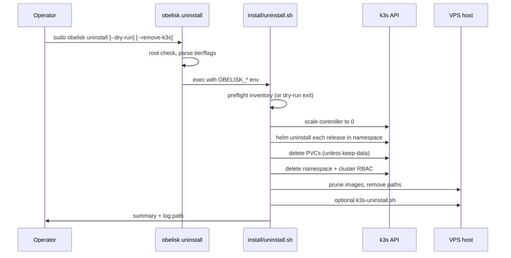

# Obelisk VPS uninstaller

* **Author:** hsoni92
* **Status:** Proposed
* **Date:** 2026-11-16
* **Intake:** [obelisk_uninstaller_concepts_brief.md](./obelisk_uninstaller_concepts_brief.md)

---

## Overview

Production VPS installs leave Obelisk state on the host, in k3s, and on disk: Helm releases, PVCs, `/opt/obelisk`, `/etc/obelisk`, `/var/lib/obelisk/credentials`, and imported container images. When bootstrap fails halfway through, or when the operator wants to reclaim the machine, there is no supported teardown path—only fragile manual steps.

This design adds **`sudo obelisk uninstall`** and **`install/uninstall.sh`**, symmetric to **`obelisk update`** and **`install/update.sh`**. The default action is a **full local Obelisk wipe** on the VPS (cluster objects, PVCs, config, credentials tree, install tree, CLI, Obelisk images). **k3s removal is optional** via **`--remove-k3s`**. **Remote** blueprint repositories, backup buckets, and GitHub OAuth app settings are never touched. **`--dry-run`** prints the action plan without mutating the host. Local dev (k3d, Multipass harness, `local` profile) is out of scope.

## The Problem

1. **Failed first install:** Curl install runs many stages (archive extract, Docker, Go, image build, k3s, Helm). Any stage can fail and leave a half-configured host. Operators need a single command to unwind and retry without hunting for release names and paths.
2. **VPS reclaim:** Handing back a VM or reusing it for another stack requires reclaiming disk and stopping the admin UI on port 80. Disable-service behavior intentionally **retains PVCs**; that is wrong for reclaim.
3. **Spec debt:** Parent design (`obelisk.md`) lists `obelisk uninstall` for failed bootstrap. Curl installer brief explicitly deferred it. The CLI has `update` but no `uninstall`.
4. **Safety gaps:** Without dry-run and ordered teardown, partial `kubectl delete namespace` attempts can hang on finalizers, leak **ClusterRole** bindings, or leave credentials on disk.

## Goals

* **G1 — Single command:** `sudo obelisk uninstall` on a VPS with the same root/env conventions as install.
* **G2 — Full local wipe (default):** Remove Obelisk Helm releases in `OBELISK_NAMESPACE`, delete PVCs in that namespace, remove cluster-scoped `obelisk-controller` RBAC, purge `/etc/obelisk` and `/var/lib/obelisk`, remove `/opt/obelisk` and `/usr/local/bin/obelisk`, prune Obelisk-related images from k3s (and Docker build tags where present).
* **G3 — Optional k3s:** `--remove-k3s` runs upstream k3s uninstall **after** Obelisk cleanup, with a second confirmation.
* **G4 — Dry-run:** `--dry-run` inventories releases, PVCs, RBAC, and host paths; performs zero mutations; exit 0.
* **G5 — Confirmations:** Interactive prompt before destructive apply; `--yes` for automation; type-to-confirm for default full wipe.
* **G6 — Shallow retry mode:** `--tier platform` or `--keep-data` skips PVC and credential-dir deletion for “fix install and retry” without full reclaim.
* **G7 — Idempotency:** Safe on partial install and safe to re-run after failures; per-stage `ok | skip | fail` logging to `/var/log/obelisk-uninstall.log`.
* **G8 — No remote side effects:** No GitHub, S3/R2, or backup API calls.
* **G9 — Tests:** Integration path install → smoke → dry-run → uninstall → re-bootstrap smoke (VM harness).
* **G10 — Runbook:** `docs/runbooks/uninstall.md` linked from install runbook.

## Non-Goals

* Uninstall for **k3d**, **Multipass** test VMs, or **local** dev profile.
* Removing **docker.io**, **snap Go**, or **Helm** installed by the curl installer.
* Deleting **remote** blueprint repos, bucket objects, or revoking OAuth apps.
* **Admin UI** button or controller API to drive uninstall.
* **Curl-pipe** uninstall when `/opt/obelisk` is already gone (v2).
* Coupling to per-service controller **`uninstalling`** Helm status (different lifecycle).
* **Resumable install** stage machine; uninstall may write `.uninstall-meta.json` but not full orchestrator parity in v1.

### Operator expectations

| Term | Meaning |
| --- | --- |
| Full local wipe | Default `obelisk uninstall`: Obelisk gone from host + namespace; k3s may remain |
| `--remove-k3s` | Entire k3s cluster removed; affects any non-Obelisk workloads on that cluster |
| `--dry-run` | Read-only inventory + planned steps |
| Remote untouched | GitHub blueprint and backup data may still exist; operator manages lifecycle separately |

**Install complete vs uninstall complete:** Uninstall complete means no Obelisk pods, Kong not serving Obelisk, credentials dir removed (default tier), and optional k3s removed. It does **not** delete cloud-side backup copies.

---

## Technical Plan

### Operator flow



### Teardown stages (ordered)

All stages log `[obelisk-uninstall]` (or `[dry-run]`) to stdout and append to `/var/log/obelisk-uninstall.log`. Each stage returns **ok**, **skip**, or **fail** and continues where safe unless `--strict` (v1 default: continue on skip, abort on hard fail).

| Stage | Action | Skip when |
| --- | --- | --- |
| S0 Preflight | Root, `linux/amd64` warn, resolve `KUBECONFIG`, `OBELISK_NAMESPACE`, `OBELISK_ROOT`, read `OBELISK_PROFILE` from config if present (refuse non-`vps` unless `--force`) | — |
| S1 Inventory | `helm list -n $NS`, `kubectl get pvc`, cluster RBAC, host path existence, image refs | dry-run prints and **exits 0** here |
| S2 Quiesce | `kubectl scale deployment/obelisk-controller -n $NS --replicas=0` (if deployment exists) | API down |
| S3 Helm releases | For each release name from `helm list -q -n $NS`: `helm uninstall $rel -n $NS` | release absent |
| S4 PVCs | `kubectl delete pvc -n $NS --all` | `--keep-data` / `--tier platform`; none present |
| S5 Namespace | `kubectl delete namespace $NS --ignore-not-found` (timeout 120s) | already gone |
| S6 Cluster RBAC | `kubectl delete clusterrole,clusterrolebinding obelisk-controller --ignore-not-found` | dry-run listed only |
| S7 Images | `k3s ctr images rm` for `obelisk-controller:*`, `obelisk-admin-ui:*`; `docker image rm` same tags if docker present | binary missing |
| S8 Host config | `rm -rf /etc/obelisk /var/lib/obelisk` (unless keep-data keeps `/var/lib/obelisk`) | paths missing |
| S9 CLI | `rm -f /usr/local/bin/obelisk` | missing |
| S10 Tree | `rm -rf $OBELISK_ROOT` (default `/opt/obelisk`) | missing; **last** so script can run from tree |
| S11 k3s | `/usr/local/bin/k3s-uninstall.sh` when `--remove-k3s` | flag off |

**Controller race:** S2 must complete before S3 so reconcile does not recreate releases.

**Helm discovery:** Never hardcode only `obelisk-platform`; include all `helm list` results (service releases `obelisk-postgres`, etc.).

### Shared path catalog

Add `install/obelisk-paths.sh` (sourced by bootstrap, install, uninstall) defining:

- `OBELISK_HOST_PATHS_DEFAULT` — `/etc/obelisk`, `/var/lib/obelisk`, `/usr/local/bin/obelisk`, `/var/log/obelisk-install.log`
- `OBELISK_ROOT` default `/opt/obelisk`

Bootstrap and uninstall reference the same list to avoid install/uninstall drift.

### CLI contract

```
sudo obelisk uninstall [flags]
```

| Flag | Default | Effect |
| --- | --- | --- |
| `--dry-run` | off | Inventory only; no mutations |
| `--yes` | off | Skip interactive confirm |
| `--tier platform` | off | Shallow: Helm + namespace; keep PVCs and `/var/lib/obelisk` |
| `--keep-data` | off | Alias to skip S4 and skip wiping `/var/lib/obelisk` |
| `--remove-k3s` | off | Run S11; requires second confirm (even with `--yes` unless `OBELISK_UNINSTALL_K3S_CONFIRM=1`) |
| `--root` | `/opt/obelisk` or env | Install tree to delete last |
| `--namespace` | `obelisk` | Target namespace |
| `--resume` | off | Read `.uninstall-meta.json` in `/var/lib/obelisk` and continue after last ok stage |

Implementation: `cmd/obelisk/uninstall_cmd.go` mirrors `update_cmd.go` — `exec bash "$OBELISK_ROOT/install/uninstall.sh"` when present; else embedded minimal bash from `/usr/local/bin` path before S9 removes it (edge case: ship `install/uninstall.sh` in every release tree).

### Environment variables

| Variable | Default | Purpose |
| --- | --- | --- |
| `OBELISK_ROOT` | `/opt/obelisk` | Tree path |
| `OBELISK_NAMESPACE` | `obelisk` | Kubernetes namespace |
| `OBELISK_CONFIG` | `/etc/obelisk/obelisk.yaml` | Detect profile |
| `KUBECONFIG` | `/etc/rancher/k3s/k3s.yaml` | Cluster access |
| `OBELISK_UNINSTALL_TIER` | `full` | `full` or `platform` |
| `OBELISK_UNINSTALL_DRY_RUN` | unset | Script-level override |

### Components

| Piece | Action | Role |
| --- | --- | --- |
| `install/uninstall.sh` | **Create** | Staged teardown; sources `obelisk-paths.sh` |
| `install/obelisk-paths.sh` | **Create** | Shared path constants |
| `cmd/obelisk/uninstall_cmd.go` | **Create** | CLI entry, root gate, flag parse, exec script |
| `cmd/obelisk/main.go` | **Modify** | `uninstall` command in usage |
| `install/bootstrap.sh` | **Modify (small)** | Source `obelisk-paths.sh` if exists |
| `docs/runbooks/uninstall.md` | **Create** | Operator procedures |
| `docs/runbooks/install.md` | **Modify** | Link uninstall + failure triage |
| `docs/designs/curl_vps_installer.md` | **Modify** | Remove “deferred uninstall” non-goal note or cross-link |
| `tests/integration/vm/uninstall-in-vm.sh` | **Create** | VM validation |
| `tests/integration/multipass/harness.sh` | **Modify** | Optional `uninstall` subcommand |
| `Makefile` | **Modify** | `test-vm-uninstall` target |

### Dry-run output (example)

Plain text sections: **Helm releases**, **PVCs**, **Cluster RBAC**, **Host paths** (exists/missing), **Images**, **k3s removal** (yes/no). Optional `OBELISK_UNINSTALL_JSON=1` for machine-readable inventory on stdout.

### Exit codes

| Code | Meaning |
| --- | --- |
| 0 | Success or dry-run |
| 1 | Hard failure |
| 2 | Partial success (`REMAINING:` list printed); safe to re-run |

### Failure and re-install

After **default full uninstall** without `--remove-k3s`, operator may re-run curl install or `install/bootstrap.sh` with a fresh `/opt/obelisk` tree. k3s remains; bootstrap is idempotent. After **`--remove-k3s`**, curl install reinstalls k3s. After **PVC purge**, in-cluster data is gone; recovery is from remote backup/blueprint only.

---

## Alternatives Considered

### Manual runbook only

Operators run `helm uninstall`, `kubectl delete`, and `rm -rf` by hand.

**Rejected:** No dry-run inventory, easy to miss cluster RBAC and PVCs, poor experience on failed partial install, no consistent logging. Power users can still follow the runbook as escape hatch.

### Default shallow uninstall (keep PVCs and `/var/lib/obelisk`)

Make the no-flag default equivalent to `--tier platform` so retry after failure is safer.

**Rejected by author:** Primary intents are VPS reclaim and full rollback; shallow mode remains via explicit `--tier platform` / `--keep-data`.

### Controller API or admin UI driven uninstall

Stop reconcile via API, then delete resources from the controller.

**Rejected:** Running controller fights Helm teardown; adds auth and coupling; host bash matches update/install.

### `kubectl delete namespace` alone

Single namespace delete without Helm ordering.

**Rejected:** Finalizer hangs common with PVCs; misses cluster-scoped RBAC; does not remove host paths or images.

### Remove k3s by default

Always run `k3s-uninstall.sh` after Obelisk cleanup.

**Rejected:** Failed-install retry benefits from keeping k3s; co-resident workloads on the same cluster would be destroyed. Opt-in `--remove-k3s` only.

### Implement uninstall only in Go (no shell)

All logic in `uninstall_cmd.go`.

**Rejected:** Failed install may lack a working CLI on tree; curl install pattern needs `install/uninstall.sh` callable from `/opt/obelisk` and exec'd by `/usr/local/bin/obelisk` before the binary is removed (ordering handles this). Shell stages match bootstrap readability.

### Remove Docker engine and Go on uninstall

Revert apt/snap packages installed by curl installer.

**Rejected:** Shared host dependencies; unrelated workloads may depend on Docker. v1 prunes Obelisk-tagged images only.

### Curl-pipe standalone uninstall script from GitHub

`curl | sudo bash` uninstall without local tree.

**Deferred:** Edge case when `/opt/obelisk` already deleted; v2 if needed.

---

## Implementation Plan

### Phase 1 — Shell teardown core

1. **`install/obelisk-paths.sh`** — Export `OBELISK_ROOT`, default host paths, log paths. No side effects when sourced.
2. **`install/uninstall.sh`** — Implement stages S0–S11; functions `stage_*` with dry-run branches; write `/var/lib/obelisk/.uninstall-meta.json` after each ok stage (create dir if needed for resume mid-wipe); `chmod +x`.
3. **`install/bootstrap.sh`** — Source `obelisk-paths.sh` when file exists (optional one-line).
4. **Manual smoke** on dev machine with k3d **out of scope**; use Multipass VM per existing harness.

### Phase 2 — CLI wrapper

5. **`cmd/obelisk/uninstall_cmd.go`** — Flags from Technical Plan; `os.Geteuid() == 0`; resolve script path; pass env; exit codes 0/1/2.
6. **`cmd/obelisk/main.go`** — Register `uninstall` + help text.
7. **`make build-cli`** — Build and copy to test VM during integration.

### Phase 3 — Docs and design index

8. **`docs/runbooks/uninstall.md`** — When to use, dry-run first, flags matrix, stuck namespace playbook, remote-not-touched callout.
9. **`docs/runbooks/install.md`** — Section “Failed install → uninstall dry-run → uninstall → re-install”.
10. **`docs/designs/SITEMAP.md`** — Row for `obelisk_uninstaller.md` (Status: Draft → Proposed after review).
11. **`docs/designs/curl_vps_installer.md`** — Replace non-goal bullet with link to uninstall design.
12. **`README.md`** — One line under VPS install mentioning uninstall.

### Phase 4 — Integration tests

13. **`tests/integration/vm/uninstall-in-vm.sh`** — Assumes smoke passed; runs dry-run; asserts Kong still up; runs `obelisk uninstall --yes`; asserts health fails; asserts paths; optional `install/bootstrap.sh` + smoke subset.
14. **`tests/integration/multipass/harness.sh`** — Subcommand `uninstall` calling uninstall-in-vm.sh.
15. **`Makefile`** — `test-vm-uninstall` depending on `vm-smoke` or documented sequence.

### Acceptance criteria (v1 done)

1. `sudo obelisk uninstall --dry-run` on smoke-passed VM: lists ≥1 Helm release when platform installed; exit 0; no cluster change.
2. `sudo obelisk uninstall --yes`: zero pods in namespace `obelisk` within timeout; `curl` admin health fails; `/usr/local/bin/obelisk` absent; `/etc/obelisk` absent (default tier).
3. `sudo obelisk uninstall --yes` second time: exit 0, message indicates already clean.
4. `sudo obelisk uninstall --yes --tier platform`: PVCs remain; `/var/lib/obelisk` remains.
5. `--remove-k3s` without second confirm: abort; with confirm: `k3s` binary absent.
6. ClusterRole `obelisk-controller` absent after full uninstall.
7. Re-bootstrap after default uninstall (k3s kept): smoke basic passes within existing timeout.
8. Runbook published and linked from install runbook.

### Rollout

1. Land design (this doc) → `/egm-review` optional.
2. Implement Phases 1–2 behind unreleased main; run manual VM test.
3. Phase 4 in CI where Multipass available; document skip when absent.
4. Mark design **Proposed** after AC met; mention in release notes when tagged.

### Open items (resolve during implementation)

* Namespace stuck `Terminating`: document `kubectl get pvc -A` and finalizer patch escape hatch in runbook only (no automation v1).
* Whether `--resume` is v1 or v1.1 if timeboxed (design includes it; cut if needed with exit 1 + “re-run full uninstall”).