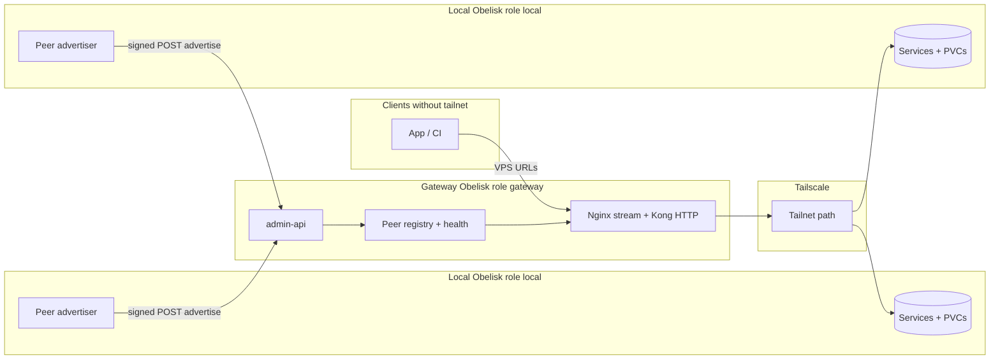

# Peer Gateway (Tailnet Aggregation)

* **Author:** hsoni92
* **Status:** Proposed
* **Date:** 2026-11-20

--------------------------------------------------------------------------------

## Overview

Obelisk is normally one appliance: data and exposure live on the same box. Operators often keep data on a home or lab machine that runs 24×7 but want **stable public connection strings** (Postgres, Redis, S3 HTTP) for apps on the internet. A **gateway** Obelisk on a VPS acts as the **connection plane**: clients connect only to the VPS hostnames and ports; the gateway forwards traffic over **Tailscale** to **local** Obelisks on the same tailnet where data actually runs.

The operator **explicitly chooses** `deployment.role: gateway` on exactly one appliance (usually the VPS) and `deployment.role: local` (default) on every other Obelisk. The role is not guessed from hardware profile: `profile` (`local` | `vps`) still describes reachability and install behavior; **`role`** describes federation. The admin UI and installer copy must make the split obvious: “This machine is the gateway; other Obelisks on your tailnet are locals that advertise services here.”

Peers on the tailnet **auto-register** via a peer API (signed advertisements). The gateway merges their catalog into Services, programs Kong and nginx stream to forward to tailnet backends, and emits **VPS-shaped** connection strings. When a local or the tailnet path is down, federated rows stay in the list and show **unhealthy**—they are not removed. This is not failover, not shared storage, and not multi-node HA.

**Glossary**

| Term | Meaning |
| --- | --- |
| **Gateway** | `deployment.role: gateway`; connection plane; aggregates locals; client URLs terminate here. |
| **Local** | `deployment.role: local` (default); data plane; owns PVCs, backups, and `machine.id`. |
| **Federated instance** | A service row on the gateway whose backend runs on a local peer. |
| **Connection export** | Projects discovery GET (credentials JSON)—unchanged semantics. |
| **Connection termination** | Gateway proxy (bytes forwarded)—exposure plane only. |

## The Problem

Remote apps (Vercel, Railway, a laptop without tailnet access) need one stable hostname and the same connection-string shape Obelisk already publishes. Today a local Obelisk can use Tailscale for reachability, but clients must use tailnet or LAN names—not the operator’s VPS DNS. A standalone VPS Obelisk holds data on the VPS; the operator wants data at home and **only** the network front door on the VPS.

Copying connection strings from multiple appliances or joining every client to Tailscale does not match the goal: **one VPS namespace**, clients unaware of home IPs or `.ts.net` names, multiple home boxes contributing services to that single catalog.

## Goals

* **G1 — Explicit roles:** Operator selects `deployment.role: gateway | local` at install and in Platform settings; overview shows **Gateway** vs **Local**; gateway role requires Tailscale for mesh backhaul on that host.
* **G2 — One gateway, many locals:** A single gateway on a tailnet aggregates multiple local Obelisks; locals auto-advertise inventory over the peer API after tailnet join (same Tailscale account + documented ACL tags).
* **G3 — Client-transparent URLs:** Connection strings, native edge hostnames, and Project discovery (where applicable) use the **gateway** public/LAN/VPS edge—never the peer’s tailnet name as the primary client-facing host.
* **G4 — Full service proxy:** For every instance type Obelisk already exposes on a single node, the gateway proxies **native TCP** (nginx stream / SNI path) and **HTTP** (Kong) to the peer’s tailnet target.
* **G5 — Visible unhealthy state:** If a peer or path is unreachable, federated instances and peer rows remain visible with `unhealthy` / `unreachable`; discovery and `/connections` include health fields where applicable.
* **G6 — Local remains source of truth:** Enable, disable, backup, and DR run on the local that owns the data; gateway reflects catalog and proxy config with bounded lag; gateway lifecycle actions on federated rows are read-only or delegated to the peer.
* **G7 — Security boundary:** Peer registration uses tailnet identity plus signed advertisements (not “any machine on the internet”); gateway blueprint must not sync peer database secrets to the gateway’s git remote by default.

## Non-Goals

* **NG1 — Failover / HA:** No automatic traffic shift to another local; no active/active; no multi-gateway leader election.
* **NG2 — Shared data plane:** No shared Postgres/Redis/RustFS across peers; no unified backup bucket on the gateway.
* **NG3 — Cloudflare Tunnel** in v1; backhaul is Tailscale-only.
* **NG4 — Implicit roles:** No auto-promotion of a VPS to gateway; no classifying tailnet members without operator-chosen `deployment.role`.
* **NG5 — Pattern B discovery proxy:** Discovery remains GET-only export; byte proxying is exposure plane only (not a new discovery gateway).
* **NG6 — Cross-peer migration:** No moving workloads between locals via the gateway.
* **NG7 — Writable federated lifecycle without peer:** Disabling or deleting a peer-owned instance from the gateway alone (without peer confirmation) is out of scope.
* **NG8 — Client tailnet membership** as a requirement for apps using gateway-published URLs.

## Resolved decisions (OQ1–OQ5)

| ID | Decision | Rationale / implementation |
| --- | --- | --- |
| **OQ1 — TLS** | **L4 SNI passthrough only** (`peer_gateway.tls_mode: passthrough`). Gateway nginx stream routes by client SNI; bytes terminate TLS on the **peer** service. No gateway termination in v1. | Matches existing single-node VPS `native_edge`; v1 validator rejects other `tls_mode` values. |
| **OQ2 — Peer admission** | **`auto_admit` defaults to true** on gateway when omitted. Operators may set `peer_gateway.auto_admit: false` and use `POST /api/v1/peers/{id}/admit` to issue tokens. | Aligns with “same tailnet, automatic pairing”; manual path remains for tighter sites. |
| **OQ3 — Second gateway** | **Warn only.** Overview exposes `warnings` when `role=gateway`. Advertise requests with `deployment_role: gateway` are rejected. No mesh-wide enforcement in v1. | Operators must not run two gateways; detection without a shared control plane is unreliable. |
| **OQ4 — Public `:9443`** | **Default on** — `peer_gateway.expose_native_public` defaults to true; federated native instances use the same public `:9443` edge as local VPS workloads. Set `expose_native_public: false` to proxy **HTTP only** through Kong. | Same blast radius model as standalone VPS; firewall remains operator-controlled. |
| **OQ5 — Peer down** | **Fast fail at edge, visible in catalog.** Unreachable peers stay in Services/`/connections` with `reachable: false`. Exposure reconciler **does not** program proxy routes for unreachable peers; nginx `proxy_connect_timeout` is **5s**. | Clients get prompt failure; UI keeps federated rows (per author). |

## Critical User Journeys (CUJs)

### CUJ 1: Operator stands up gateway and locals

* **Given:** Empty tailnet; operator has one VPS and two home machines.
* **When:** Operator installs Obelisk on the VPS, selects **profile vps** and **role gateway**, completes Tailscale join; installs Obelisk on each home box with **profile local** and **role local**, joins the same tailnet with the documented peer ACL tag.
* **Then:** Gateway overview shows **Gateway**; each home shows **Local**; within one reconcile cycle locals begin advertising; **Peers** list shows both locals as reachable or pending approval per OQ2.

### CUJ 2: Client uses VPS Postgres URL to home data

* **Given:** Local A runs Postgres instance `lab-db`; gateway admitted local A; federated row visible.
* **When:** Operator copies `postgresql://` from gateway Services (VPS hostname, native edge port); app connects from the public internet.
* **Then:** Traffic hits gateway nginx stream (or TLS path per OQ1), forwards over Tailscale to local A; app does not need tailnet credentials; data remains on local A’s PVC.

### CUJ 3: Local goes offline

* **Given:** Federated Postgres was healthy.
* **When:** Home machine sleeps or Tailscale path drops.
* **Then:** Gateway Services row stays listed; state shows **unhealthy** / peer **unreachable**; new connects fail fast at gateway when policy is set (OQ5); discovery JSON still lists instance with health field.

### CUJ 4: Operator enables a new service on a local

* **Given:** Gateway and local already paired.
* **When:** Operator enables Redis on the local via local admin UI.
* **Then:** Local advertisement updates; gateway reconciler adds federated row and proxy routes; VPS-shaped Redis URL appears on gateway without manual yaml on the gateway for that instance id (hub may persist admitted `peers[]` snapshot).

## Technical Plan (Architecture)

### Problem decomposition

Three planes:

1. **Data plane (local):** Unchanged single-node k3s, backups, `machine.id`, local `obelisk.yaml` instances.
2. **Catalog plane (gateway):** Peer registry, advertisements, health, global instance id namespacing (`{peer_id}/{type}/{id}` → edge hostname `postgres-{peer_id}-{id}.…`).
3. **Proxy plane (gateway):** Existing exposure reconciler extended so Kong HTTP upstreams and nginx stream maps target **tailnet host:port** from the registry instead of `*.svc.cluster.local` when `origin: federated`.

Pattern B (discovery service proxying bytes) stays rejected. Federated traffic uses the same components as today’s VPS edge—only upstream selection changes.

### Topology



### Configuration model

```yaml
deployment:
  profile: vps          # local | vps — install / reachability (unchanged enum)
  role: gateway         # gateway | local — federation (new; default local)
  tailscale:
    enabled: true       # required when role=gateway; local profile rules unchanged
```

Validation rules (high level):

* `role: gateway` ⇒ `tailscale.enabled: true` (mesh backhaul).
* `profile: vps` without `role: gateway` ⇒ `tailscale.enabled` must stay **false** (today’s standalone VPS).
* At most one active gateway per tailnet is **recommended**; OQ3 defines enforcement.

`obelisk.yaml` on the gateway gains **`peers[]`** (admitted locals: `peer_id`, tailnet hostname, last_seen, optional display name) and **`federated_instances[]`** or derived view from advertisements—exact storage shape is an implementation choice in the Detailed Implementation section.

Locals keep standard `instances[]`; they do **not** list the gateway as an upstream.

### Peer registration and auth

1. Local controller, on timer or after instance change, builds a **catalog snapshot**: enabled instances, tailnet dial addresses (MagicDNS or tailnet IP), protocol ports, credential handles for connection export (not necessarily full secrets in v1 ads—may reference peer-local only).
2. Local POSTs to gateway `POST /api/v1/peers/advertise` on a **tailnet-only listener** (or localhost + tailscale bind policy).
3. Gateway verifies: Tailscale source identity matches admitted peer, optional ACL tag, signature/HMAC using a peer token issued at admission (OQ2: auto vs approve).
4. Gateway merges snapshot into registry, increments generation, triggers exposure + connection resolver reconcile.
5. Heartbeat: repeat advertise or `GET /api/v1/peers/health` from gateway to local; stale peer → **unreachable**, federated rows **unhealthy**, entries retained.

### Exposure / proxy behavior

| Traffic class | Today (gateway host local data) | Federated peer backend |
| --- | --- | --- |
| Postgres, Redis, MySQL, Mongo (native) | nginx stream SNI → in-cluster Service | nginx stream SNI → `peer.tailnet:port` |
| RustFS, Qdrant, HTTP APIs | Kong route → in-cluster upstream | Kong route → `http://peer.tailnet:port` |
| Admin API/UI | Kong on gateway | Stays on gateway only (not proxied from peers in v1) |

`pkg/obelisk/endpoints.go` / connection resolver: for `origin=federated`, `PublicEdgeHost` uses gateway base domain; upstream target remains peer-only inside exposure config.

TLS behavior is **unset** until OQ1 spike; technical plan assumes either documented terminate-at-edge or passthrough with peer certs aligned to gateway virtual hostnames.

### Admin UI and API

* Overview badge: **Gateway** vs **Local**.
* New **Peers** section: admitted locals, reachability, last advertisement, approve/revoke (if OQ2 requires approval).
* Services table: column **Origin** (local | federated), **Peer**, health; federated enable/disable controls disabled or peer-delegated.
* `GET /api/v1/instances` merges local gateway-native instances (if any) with federated catalog.
* `GET /api/v1/connections` and Project discovery use resolver output including `reachable` / `peer_id`.

Installer: explicit step “Choose role: Gateway or Local” after profile selection; gateway path runs Tailscale install/join like local opt-in today.

### Interaction with existing features

| Feature | Behavior on gateway |
| --- | --- |
| **Projects discovery** | May include federated instance ids; JSON URLs point at gateway edge; bearer token auth unchanged |
| **Blueprint sync** | Gateway bundle syncs gateway desired state only; peer secrets and peer `machine.id` buckets excluded |
| **Backup / DR** | Per-local only; gateway does not backup peer PVCs |
| **Tailscale Funnel** | Remains local-profile allowlist; not required for gateway public HTTP |
| **Diagnostics** | Extend probes: gateway → tailnet → peer port per federated instance |

### Logical components (new / extended)

| Component | Responsibility |
| --- | --- |
| **peer-advertiser** (local) | Snapshot local inventory; POST advertise; renew tokens |
| **peer-registry** (gateway) | Admission, merge snapshots, heartbeats, unhealthy semantics |
| **exposure (federated)** | Kong + native_edge upstream from registry |
| **connection-resolver** | VPS-facing strings + health metadata |
| **peer-reconciler** | Tie registry changes to exposure reload |

### Connection paths (delta)

| Consumer | Federated Postgres / Redis | Federated S3 HTTP |
| --- | --- | --- |
| Internet client | Native URL to **gateway** hostname (`:9443` or policy from OQ4) → tailnet → local | `https://<gateway>/s3/...` Kong → peer RustFS |
| Operator on tailnet | May use direct local URLs on local admin; gateway still lists federated view | Same |

## Alternatives Considered

| Alternative | Why rejected |
| --- | --- |
| **Tailnet-direct connection strings** (MagicDNS on each local; clients join tailnet) | Rejected by author: apps should use gateway URLs only; no client tailnet requirement. |
| **Projects discovery only** (one GET per appliance, no proxy) | Rejected by author: does not unify hostnames under one VPS catalog; N locals ⇒ N discovery endpoints. |
| **Cloudflare Tunnel per node** | Rejected by author: v1 backhaul is Tailscale-only; avoids dual tunnel ops. |
| **Manual `peers[]` only** (no automatic advertise API) | Rejected by author: wants same-tailnet auto registration; admitted peers may still persist in yaml after sync. |
| **HTTP-only gateway** (no native TCP proxy) | Rejected by author: needs Postgres/Redis and full instance types through VPS. |
| **Tailscale Funnel on local as public front door** | Rejected by author: wants VPS as stable front; Funnel stays narrow local allowlist per base design. |
| **External LB / nginx outside Obelisk** | Rejected by author: wants Services list, connection strings, and reconcile owned by Obelisk. |
| **Implicit gateway** (any VPS on tailnet becomes hub) | Rejected by author: operator must set `deployment.role: gateway`; other tailnet Obelisks are locals. |
| **Zoom-out minimal: dual discovery URLs, no proxy** | Rejected by author: accepts gateway complexity for client-transparent VPS namespace. |

## Detailed Implementation

Implementation proceeds in phases so TLS (OQ1) and peer admission (OQ2) can be decided before full UI polish.

### Phase 0 — Role and schema foundation

| File | Change |
| --- | --- |
| `schemas/obelisk.yaml.schema.json` | Add `deployment.role` enum `gateway \| local` (default `local`). Conditional: `role=gateway` requires `tailscale.enabled: true`; `profile=vps` + `role=local` keeps `tailscale.enabled: false`. |
| `pkg/obelisk/spec.go` | `Deployment` struct: `Role` field; helpers `IsGateway()`, `IsLocal()`. |
| `internal/config/load.go` | Validate role/profile/tailscale matrix; reject invalid combinations with actionable errors. |
| `internal/config/validate_test.go` | Table tests for gateway/local × vps/local profile matrix. |
| `install/bootstrap.sh` | Install prompt: choose **role** after profile; gateway path invokes `maybe_tailscale` even on `profile=vps`; print role summary at end. |
| `cmd/obelisk/configure_deployment.go` | CLI flags or subcommand to set `deployment.role` and Tailscale with same validation as API. |
| `docs/runbooks/install.md` | Document gateway vs local choice, tailnet ACL checklist, one-gateway recommendation. |
| `docs/designs/obelisk.md` | Delta section or cross-link to peer_gateway (connection paths table row for gateway role)—avoid silent edits to locked decisions without review. |

### Phase 1 — Peer registry and advertise API (no proxy yet)

| File | Change |
| --- | --- |
| `internal/peer/registry.go` (new) | In-memory + persisted admitted peers; merge catalog snapshots; generation counter. |
| `internal/peer/advertise.go` (new) | Parse snapshot schema; idempotency key per peer+generation. |
| `internal/peer/auth.go` (new) | Peer token issue/verify; Tailscale source check hook; constant-time compare pattern from `internal/discovery/credentials.go`. |
| `internal/peer/health.go` (new) | Staleness timers; states `reachable`, `unreachable`, `degraded`. |
| `internal/adminapi/peers.go` (new) | Routes: `POST /api/v1/peers/advertise`, `GET /api/v1/peers`, `POST /api/v1/peers/{id}/admit`, `DELETE /api/v1/peers/{id}` (admission per OQ2). |
| `internal/adminapi/server.go` | Register peer routes; tailnet bind policy middleware for advertise. |
| `cmd/obelisk-controller/main.go` | Gateway: start peer reconciler loop; Local: start peer-advertiser worker. |
| `internal/controller/peer_advertiser.go` (new) | Build snapshot from spec + observe; POST to configured gateway URL from env/spec `gateway.tailnet_host`. |
| `internal/credentials/` or `deploy/.../peer-token` | Secret for peer HMAC/token storage on gateway; local stores issued token after admit. |
| `pkg/obelisk/discovery_response.go` | Optional provenance fields only if discovery includes federated ids in later phase. |

### Phase 2 — Federated exposure (Kong + native edge)

| File | Change |
| --- | --- |
| `internal/exposure/kong.go` | `mergeInstanceRoutes`: branch on `origin`; upstream URL from peer registry tailnet target. |
| `internal/exposure/native_edge.go` | SNI map entries for `postgres-{peer}-{id}.…` → peer backend. |
| `internal/exposure/reconcile.go` | Invoke federated merge after local routes; error reporting in reconcile status. |
| `internal/exposure/kong_test.go` | Golden tests for federated upstream YAML fragment. |
| `internal/exposure/native_edge_test.go` | Render test with peer backend map. |
| `pkg/obelisk/edge.go` | `PublicEdgeHost` namespacing with peer id prefix. |
| `pkg/obelisk/endpoints.go` | Connection resolver: accept federated catalog input; set client-facing host to gateway edge. |
| `internal/diagnostics/` | Probe federated instances via tailnet hop. |

### Phase 3 — Admin API, UI, installer UX

| File | Change |
| --- | --- |
| `internal/adminapi/instances.go` | Merge federated instances in list/get; enrich with `origin`, `peer_id`, `reachable`. |
| `internal/adminapi/overview.go` | Show `role` badge Gateway/Local; peer summary counts. |
| `internal/adminapi/projects.go` | When building discovery, include federated members + health fields. |
| `internal/adminapi/states_cache.go` | Cache peer reachability TTL. |
| `web/admin/lib/types.ts` | Types for peer, federated instance, role. |
| `web/admin/lib/service-rows.ts` | Badge variants: `federated`, `peer_unreachable`. |
| `web/admin/components/services/services-table.tsx` | Origin and peer columns. |
| `web/admin/app/(console)/services/page.tsx` | Wire merged instance list. |
| `web/admin/app/(console)/peers/page.tsx` (new) | Peers list, admit/revoke, reachability. |
| `web/admin/components/layout/nav` (or equivalent) | Peers nav entry when `role=gateway`. |
| `web/admin/lib/store/obelisk-api.ts` | Client methods for peers and extended instances. |
| `install/` prompts / `web` onboarding copy | “Gateway fronts clients; locals advertise here.” |

### Phase 4 — Blueprint, docs, integration tests

| File | Change |
| --- | --- |
| `internal/blueprint/bundle.go` | Exclude peer tokens and remote credentials from encrypted bundle export rules; document in schema comment. |
| `internal/blueprint/sync.go` | No change to debounce; gateway `peers[]` may sync if stored in yaml—exclude ephemeral health. |
| `docs/runbooks/tailscale-acl.md` (create) | ACL template: gateway → peer service ports; tag `obelisk-peer`. |
| `docs/designs/SITEMAP.md` | Register `peer_gateway.md` when promoted from this draft. |
| `tests/integration/vm/peer-smoke.sh` (new) | Two VM fixture: local advertises, gateway proxies (or registry-only in phase 1 gate). |
| `AGENTS.md` | Note: VPS may use Tailscale when `role=gateway`. |

### Phase ordering and gates

1. Ship Phase 0 behind feature flag or docs-only preview if needed.
2. Phase 1 + TLS spike (OQ1) on two test hosts before enabling Phase 2 in production paths.
3. Phase 3 follows working Postgres + one HTTP route through federated proxy.
4. Phase 4 before calling feature complete.

### Testing strategy

* **Unit:** schema validation, registry merge idempotency, Kong/native render with peer backends, resolver URL shape.
* **Integration:** `peer-smoke.sh` — advertise → list peers → copy connection string → TCP connect → stop local → unhealthy state persists.
* **Manual:** Install gateway on VPS Multipass + local Multipass, same tailnet; verify role labels and no second-gateway warning (OQ3).

### Rollback

* Set `deployment.role: local` on gateway (or uninstall peer routes only): strip federated Kong/nginx stanzas via reconcile; `peers: []`; locals continue standalone.
* Removing Tailscale on gateway disables federation; validator should refuse if federated routes still configured until peers cleared.