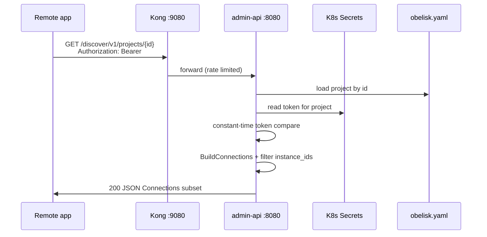

# Projects (connection discovery)

* **Author:** hsoni92
* **Status:** Proposed
* **Date:** 2026-11-19

--------------------------------------------------------------------------------

## Overview

Obelisk runs shared data services on one machine. Remote applications (hosted elsewhere) need connection strings for Postgres, Redis, object storage, and HTTP APIs without signing into the admin UI with GitHub.

This design adds **Projects** in the Services workflow. A Project is a named group of service **instances**. The same instance may appear in more than one Project. Each Project can expose a **GET-only discovery URL** that returns a JSON catalog of **full connection URLs including credentials** for every member instance— the same information as the admin connections view, filtered to membership.

Membership is edited only through the control plane (UI or GitHub-gated admin API). Nothing self-registers. Logical databases are still created under **Services → instance → Logical databases**; a Project does not provision databases in v1.

The dormant `projects[]` entries in older `obelisk.yaml` files (`postgres_db`, `redis_db`) are replaced by stable `id`, display `name`, and `instance_ids[]`.

## The Problem

Operators who deploy apps on Vercel, Railway, or another host must copy many per-instance strings from Obelisk or maintain a long list of environment variables. `GET /api/v1/connections` returns everything but requires a GitHub admin session, which CI and serverless runtimes cannot use.

The pain is configuration churn: adding RustFS to an app’s backend means editing deploy env vars again. Moving an instance or rotating exposure should not require redeploying every consumer if they can re-fetch a single discovery document.

## Goals

* Operators can create, rename, and delete Projects and assign instance membership (many-to-many) from the Services area of the admin UI.
* Desired state stores Projects in `obelisk.yaml` with stable `id`, `name`, `instance_ids[]`, and `discovery_enabled`.
* Each Project with discovery enabled has a revocable bearer token stored in Kubernetes secrets (not in git-tracked YAML or the public blueprint).
* Remote clients call one **GET-only** discovery route per Project with `Authorization: Bearer` and receive filtered, credentials-included connection JSON reusing the `BuildConnections` shape.
* Discovery authentication is separate from GitHub session and from the admin `LocalToken`.
* Kong exposes the discovery route with rate limiting; discovery is never on Tailscale Funnel.
* Admin API provides GitHub-gated CRUD for Projects, token rotation, and audit events for rotation and discovery use.

## Non-Goals

* Container self-registration, heartbeats, or TTL-based membership.
* HTTP proxying of database or Redis traffic through Obelisk.
* Consul, Eureka, or Kubernetes Endpoints compatibility.
* Auto-provisioning Postgres roles, databases, or Redis indices when a Project is created (Option B / G9 provisioning remains a separate effort).
* Per-Project credentials that hide sibling databases on a shared Postgres instance.
* More than one active discovery token per Project in v1.
* Listing multiple replicas of the same logical service inside one Project (membership is by instance id only).
* Exposing discovery via Funnel.
* CLI commands for Project CRUD in v1 (admin API and UI only; CLI follow-on).

## Open Questions

* **Kong limits:** Match mail gateway rate-limit and request-size plugins exactly, or lighter defaults?
* **Delete Project:** When a Project is deleted, revoke token secret immediately; confirm behavior if `instance_ids` still exist on instances (no cascade delete of instances).

*Resolved during draft:* `schema_version: 1` in discovery JSON; v1 auth is **Authorization: Bearer** only (no query/path token).

## Critical User Journeys (CUJs)

### CUJ 1: Operator wires a new remote app

* **Given:** Platform ready; Postgres, Redis, and RustFS instances are enabled and healthy.
* **When:** Operator opens Services → Projects, creates a Project, adds the three instances, enables discovery, copies the discovery URL and bearer token, and configures the remote app to `GET` on boot.
* **Then:** The remote app receives JSON with three connection entries and connects successfully; disabling one instance removes or marks it on the next fetch.

### CUJ 2: Developer consumes discovery without admin access

* **Given:** Operator shared only the discovery URL and bearer token (not GitHub access).
* **When:** Developer runs `curl -H "Authorization: Bearer …" https://<host>/discover/v1/projects/<id>`.
* **Then:** Response is 200 with filtered `instances[]` and profile `notes`; without token, 401; with revoked token, 401 after rotation.

### CUJ 3: Operator revokes a leaked token

* **Given:** A Project discovery token may have been logged.
* **When:** Operator clicks regenerate token in the UI.
* **Then:** Old token fails within one request; new token works; audit log records rotation; instances and membership unchanged.

### CUJ 4: Same Postgres in two Projects

* **Given:** One Postgres instance `calm-otter` is a member of Project `webapp` and Project `analytics`.
* **When:** Both Projects’ discovery endpoints are called with valid tokens.
* **Then:** Both responses include the same Postgres connection block for that instance; neither Project deletes or isolates data—the boundary is export scope, not tenancy.

## Technical Plan (Architecture)

### Design principles

1. **One URL builder:** Discovery output is a filter over `BuildConnections`; no second hostname or credential logic.
2. **Two trust domains:** GitHub session for mutations; project bearer token for discovery GET only.
3. **Secrets off spec:** Discovery tokens live in Kubernetes Secrets (pattern aligned with mail/OpenRouter gateway credentials), referenced from reconcile/UI by project `id`.
4. **Declarative membership:** `instance_ids[]` in `obelisk.yaml` is the registry; no runtime registration API.

### Data model

```yaml
projects:
  - id: "8f3c2e1a-..."          # opaque, stable in URLs
    name: "vercel-webapp"       # display; may change without breaking URLs
    instance_ids:
      - "postgres/calm-otter"
      - "redis/brisk-lynx"
      - "rustfs/amber-hawk"
    discovery_enabled: true
```

Kubernetes Secret per project (example name `obelisk-discovery-<project-id>`) holds `token` (high entropy). Rotating the token updates the Secret; YAML never stores the raw value.

**Migration:** On load, drop legacy `postgres_db` / `redis_db` fields if present (ignore or strip on save). Existing `POST /api/v1/projects` append API is replaced by full CRUD with validation.

### Request flow



### API surfaces

| Surface | Auth | Methods |
| --- | --- | --- |
| `/api/v1/projects` | GitHub (or LAN trust when blueprint off) | `GET`, `POST`, `PATCH`, `DELETE` |
| `/api/v1/projects/{id}/rotate-discovery-token` | GitHub | `POST` |
| `/discover/v1/projects/{id}` | Project bearer only | `GET` |

Admin CRUD validates that every `instance_id` exists in `spec.instances`, skips disabled instances in discovery output (v1: **omit disabled** from payload, document in response `notes` if empty).

**Discovery JSON (v1):**

```json
{
  "schema_version": 1,
  "project": { "id": "...", "name": "..." },
  "profile": "vps",
  "observed_at": "2026-11-19T10:00:00Z",
  "notes": "...",
  "instances": [ /* InstanceConnection subset */ ]
}
```

`observed_at` comes from cached service states (scheduler/vitals TTL), not a full helm poll per request.

### Auth and exposure

* Register `GET /discover/v1/projects/{id}` in `isPublic()` so GitHub middleware does not block, but the handler **always** requires a valid bearer unless `discovery_enabled` is false (404).
* Do **not** treat project bearer as `LocalToken`.
* Kong: add route `paths: [/discover]` → `admin-api`, plugins `rate-limiting` (start with mail parity: 30/min per consumer) and `request-size-limiting`.
* Exposure reconciler: discovery routes are **never** added to Funnel allowlist.
* Query/path token: **not** in v1 (header only).

### UI (Services workflow)

* New **Projects** subview or drawer: list projects, create/rename/delete, multi-select instances for membership, toggle `discovery_enabled`, show discovery URL (`/discover/v1/projects/{id}`), copy bearer token once after rotate (masked thereafter).
* Helper text: *A Project groups instances for connection discovery. It does not create databases.*

### Core library changes

* `pkg/obelisk/project.go` — extend `Project` struct; validation helpers.
* `pkg/obelisk/endpoints.go` — `BuildConnectionsForProject(resolved Spec, project Project, states map[string]string) Connections`.
* `internal/credentials/` or `internal/discovery/` — load and compare project tokens from Secrets.
* `internal/adminapi/projects.go` — CRUD handlers; `handleDiscovery` on public path.
* `internal/adminapi/session.go` — extend `isPublic` for `/discover/` prefix (GET only).

### Observability

* Audit: `project.discovery.access`, `project.discovery.token.rotate`, `project.create|update|delete` (mirror instance audit pattern in `overview.go`).
* Metrics counter optional: `discovery_requests_total{project_id,status}`.

### Non-functional requirements

| Area | Requirement |
| --- | --- |
| Security | Constant-time token compare; rate limit at Kong; UI blast-radius warning; no token in blueprint public YAML. |
| Performance | Discovery GET must not call `ObserveServiceStates` with full helm per instance; use cached states ≤60s old. |
| Rollout | Feature safe when no projects defined; old yaml without `projects` unchanged. |
| Rollback | Remove Kong `/discover` route and handlers; orphan secrets harmless. |

## Alternatives Considered

### Alternative A: Status quo (per-instance copy and admin-only `/connections`)

* **Pros:** No new attack surface; no token lifecycle.
* **Cons:** Remote runtimes cannot use GitHub; many env vars per app.
* **Reason for Rejection:** Rejected by author: operational friction for multi-service apps.

### Alternative B: Endpoints-only discovery (no passwords in JSON)

* **Pros:** Smaller blast radius on token leak; closer to Consul semantics.
* **Cons:** Apps still need a second channel for secrets.
* **Reason for Rejection:** Rejected by author: single GET should return usable connection URLs.

### Alternative C: External Consul or etcd on the appliance

* **Pros:** Familiar SD APIs; health ecosystem.
* **Cons:** Extra processes, RAM, and ops on a single-node product; duplicate of declarative `obelisk.yaml`.
* **Reason for Rejection:** Rejected by author: YAGNI for one-box Obelisk.

### Alternative D: Discovery proxy (Pattern B — route all traffic through Obelisk)

* **Pros:** Central logging; one firewall hole.
* **Cons:** Wrong for Postgres/Redis wire protocols; latency and bottleneck.
* **Reason for Rejection:** Rejected by author: endpoints-only resolution (Pattern A).

### Alternative E: Reuse admin `LocalToken` for discovery

* **Pros:** One token to copy.
* **Cons:** Full admin API access if leaked.
* **Reason for Rejection:** Rejected by author: scoped project tokens required.

### Alternative F: UI label “Connection bundles” instead of Projects

* **Pros:** Avoids collision with G9 “create project” language and logical DB copy.
* **Cons:** New vocabulary for operators already thinking in “projects.”
* **Reason for Rejection:** Rejected by author: keep **Projects** label with in-UI glossary.

### Alternative G: Legacy schema (`postgres_db` / `redis_db` without `instance_ids`)

* **Pros:** Minimal YAML churn for early stubs.
* **Cons:** Ambiguous when multiple Postgres instances exist; never wired to UI.
* **Reason for Rejection:** Rejected: explicit `instance_ids[]` membership.

### Alternative H: Defer many-to-many membership to v2

* **Pros:** Simpler UI and integrity rules.
* **Cons:** Same instance cannot be exported to two apps without duplicate Projects content.
* **Reason for Rejection:** Rejected by author: many-to-many required in v1.

### Alternative I: Separate discovery sidecar listener (`:8083`)

* **Pros:** Clean separation from admin mux and `requireGitHub`.
* **Cons:** Extra Kong service, another port, duplicates mail gateway pattern without clear win for read-only GET.
* **Reason for Rejection:** Rejected for v1: single admin-api process with `isPublic` discovery path and Kong `/discover` route.

## Detailed Implementation Plan

### Target files to create or modify

#### 1. `pkg/obelisk/spec.go` (Modify)

* **Scope:** Core `Project` type and validation.
* **Changes:** Replace `postgres_db` / `redis_db` with `ID`, `Name`, `InstanceIDs []string`, `DiscoveryEnabled bool`. Add `ValidateProject`, `FindProject`, uniqueness of `id` and `name`. Add migration helper `NormalizeProjects()` that generates `id` when missing.

#### 2. `pkg/obelisk/project.go` (Create)

* **Scope:** Pure functions for membership checks.
* **Changes:** `ProjectContainsInstance`, `FilterInstancesForProject`, constants for discovery path prefix.

#### 3. `pkg/obelisk/endpoints.go` (Modify)

* **Scope:** Connection export.
* **Changes:** `BuildConnectionsForProject(resolved Spec, p Project, states map[string]string) Connections` — filter `BuildConnections` output; set `observed_at` from caller; attach optional per-instance `state` from `states` map.

#### 4. `pkg/obelisk/endpoints_test.go` (Modify)

* **Scope:** Unit tests.
* **Changes:** Cases for empty membership, disabled instance omitted, many-to-many same instance in two projects yields identical blocks, unknown instance id in project ignored with validation at API layer.

#### 5. `schemas/obelisk.yaml.schema.json` (Modify)

* **Scope:** JSON Schema for `projects[]`.
* **Changes:** Require `id`, `name`, `instance_ids`; optional `discovery_enabled`; remove `postgres_db` / `redis_db` or mark deprecated with `additionalProperties` migration note.

#### 6. `install/obelisk.yaml.example` (Modify)

* **Scope:** Installer sample.
* **Changes:** Example commented `projects:` entry documenting discovery fields.

#### 7. `internal/discovery/auth.go` (Create)

* **Scope:** Token load/compare.
* **Changes:** Read token from Secret `obelisk-discovery-<projectID>` in controller namespace; `subtle.ConstantTimeCompare`; functions `EnsureProjectToken`, `RotateProjectToken`, `ValidateBearer(projectID, token string) bool`.

#### 8. `internal/adminapi/projects.go` (Create)

* **Scope:** CRUD and discovery handler.
* **Changes:** `handleListProjects`, `handleCreateProject`, `handlePatchProject`, `handleDeleteProject`, `handleRotateDiscoveryToken`, `handleDiscoverProject` (GET only). Validation on instance ids; audit hooks.

#### 9. `internal/adminapi/server.go` (Modify)

* **Scope:** Route registration.
* **Changes:** Wire new handlers; discovery route registered on mux **before** or with `isPublic` exemption.

#### 10. `internal/adminapi/session.go` (Modify)

* **Scope:** Public route allowlist.
* **Changes:** `isPublic` returns true for `GET` paths matching `/discover/v1/projects/` prefix only.

#### 11. `internal/adminapi/states_cache.go` (Create, optional small file)

* **Scope:** Avoid helm storm on discovery polls.
* **Changes:** Mutex + TTL cache (e.g. 60s) wrapping `ObserveServiceStates`; vitals sampler may later share this.

#### 12. `internal/exposure/kong.go` (Modify)

* **Scope:** Declarative Kong render.
* **Changes:** Add `admin-api` route `paths: [/discover]` or dedicated service upstream to same controller `:8080` with rate-limiting + request-size-limiting plugins (mirror mail gateway numbers unless changed).

#### 13. `deploy/kong/kong-dbless.yaml` (Modify)

* **Scope:** Static Kong template (local/dev).
* **Changes:** Same `/discover` route block as reconciler output.

#### 14. `deploy/helm/platform/files/kong-dbless.yaml` (Modify)

* **Scope:** Shipped Kong ConfigMap template.
* **Changes:** Match `internal/exposure/kong.go` route.

#### 15. `internal/controller/` (Modify if needed)

* **Scope:** Secret reconciliation.
* **Changes:** On project create with `discovery_enabled`, ensure K8s Secret exists (empty token until rotate); on delete, delete Secret; no change to data-plane Helm releases.

#### 16. `web/admin/lib/types.ts` (Modify)

* **Scope:** TypeScript types.
* **Changes:** `Project`, discovery response shape mirroring `Connections`.

#### 17. `web/admin/lib/store/obelisk-api.ts` (Modify)

* **Scope:** RTK Query endpoints.
* **Changes:** `listProjects`, `createProject`, `updateProject`, `deleteProject`, `rotateProjectDiscoveryToken`.

#### 18. `web/admin/components/services/projects-panel.tsx` (Create)

* **Scope:** UI.
* **Changes:** List/create/edit projects, instance multi-select from enabled instances, discovery toggle, copy URL, rotate token flow, blast-radius warning text.

#### 19. `web/admin/app/(console)/services/page.tsx` (Modify)

* **Scope:** Services page layout.
* **Changes:** Tab or section for Projects alongside existing table.

#### 20. `web/admin/components/services/service-details-dialog.tsx` (Modify, optional)

* **Scope:** Cross-link.
* **Changes:** Show which Projects include this instance (read-only chips).

#### 21. `docs/runbooks/` or `README.md` (Modify)

* **Scope:** Operator/dev docs.
* **Changes:** Short section: discovery curl example, token handling, Projects vs logical databases.

#### 22. `docs/designs/obelisk.md` (Modify)

* **Scope:** Product spec alignment.
* **Changes:** G9 footnote: Projects v1 = discovery grouping, not auto DB provision; update CUJ 2 wording if it implies old project model.

#### 23. `docs/designs/projects_discovery_concepts_brief.md` (No content change)

* **Scope:** Provenance reference only in Additional Resources section of final doc.

### Behaviors to implement (checklist)

1. Creating a project with `discovery_enabled: true` creates Secret if missing; first rotate writes token.
2. `PATCH` can add/remove `instance_ids` without rotating token.
3. `DELETE` project removes YAML entry and deletes discovery Secret.
4. Discovery with wrong id → 404; disabled discovery → 404; wrong token → 401; missing Authorization → 401.
5. GitHub-gated `GET /api/v1/projects` returns metadata **without** raw token (only `discovery_configured: true`).

### Verification plan

* **Build:** `go build ./...` from repo root.
* **Unit tests:** `go test ./pkg/obelisk/... ./internal/discovery/... ./internal/adminapi/...` — discovery filter, token compare, `isPublic` path matching.
* **Lint:** Existing project CI / `golangci-lint` if configured.
* **Schema:** Validate example yaml against `schemas/obelisk.yaml.schema.json` after update.
* **Integration (manual or test script):**
  * Create project via API with two instance ids.
  * Rotate token; `curl -H "Authorization: Bearer …" https://<host>/discover/v1/projects/<id>` → 200 and exactly two instances.
  * Remove one instance from project; next GET returns one.
  * Revoke token; GET → 401.
  * Confirm `GET /api/v1/connections` with GitHub still returns all instances.
* **Kong:** After reconcile, `curl` via port 9080 hits `/discover` with rate limit (optional abuse test).

### Additional resources

* [projects_discovery_concepts_brief.md](./projects_discovery_concepts_brief.md)
* [mail_gateway.md](./mail_gateway.md) — gateway token and Kong patterns
* [obelisk.md](./obelisk.md) — deployment profiles and connection semantics

### Future improvements

* Per-project Option B provisioning (DB + role + scoped credentials).
* Optional `?token=` with log redaction.
* ETag support for discovery caching.
* CLI `obelisk project list` parity.

--------------------------------------------------------------------------------

*Drafted with EGM*